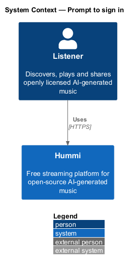
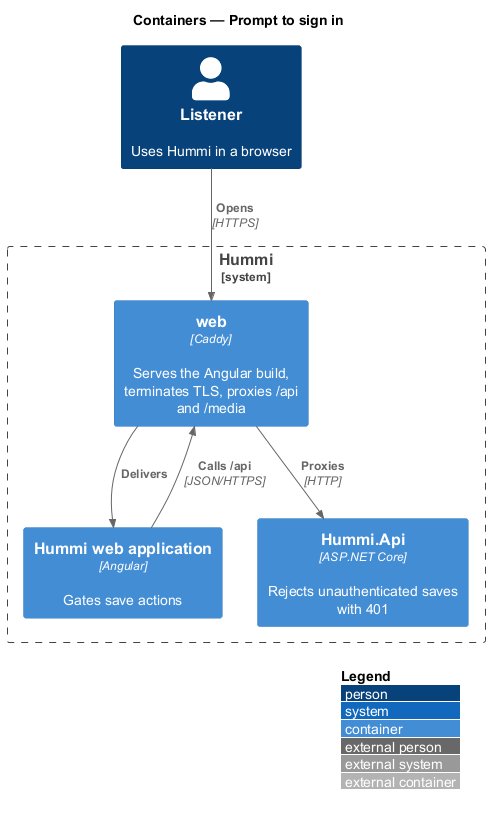
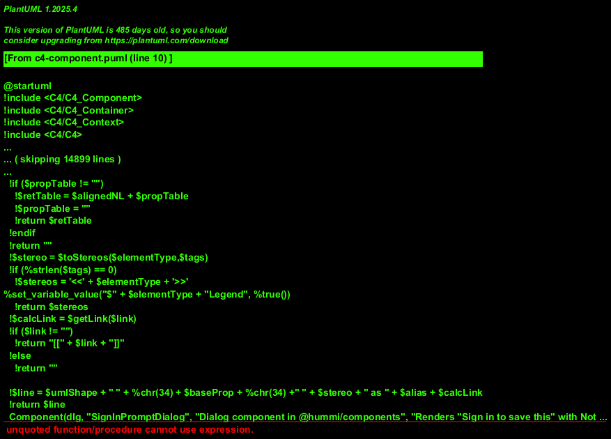
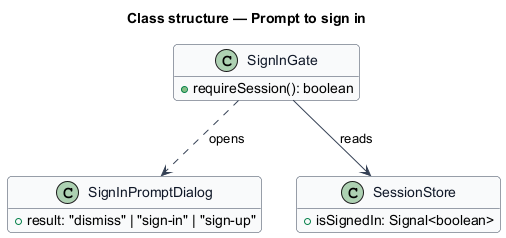
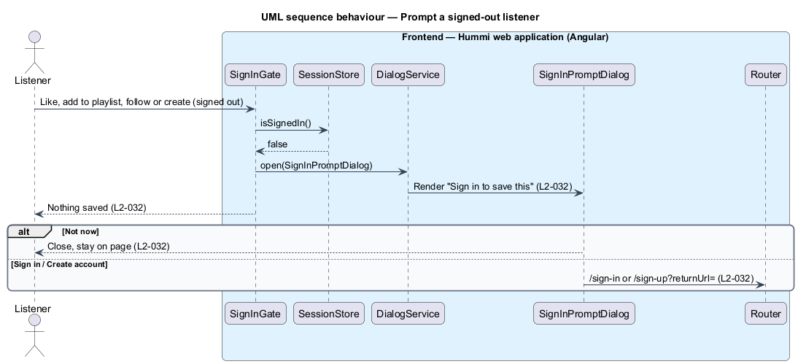

# Prompt to sign in

## Overview

Signed-out listeners can play anything, but saving needs an account. When they try to like a track,
add to a playlist, follow an artist or create a playlist, a dialog explains why and offers Sign in or
Create account. Nothing is saved. The API independently rejects unauthenticated save requests with 401.

## Description

`SignInGate` is the single client-side check every save action calls.

**Frontend — Hummi web application (Angular)**

- **`SignInGate`** — Service in @hummi/api. Checks `SessionStore` before a save action and opens the Sign in to save this dialog when signed out (`L2-032`)
- **`SessionStore`** — Signal store in @hummi/api. Holds the signed-in listener, the access token and the signed-in/signed-out state the shell reads
- **`DialogService`** — Service in @hummi/components. Opens `hm-dialog` components as modal overlays and returns a typed close result (`L2-047`)
- **`SignInPromptDialog`** — Dialog component in @hummi/components. Renders "Sign in to save this" with Not now, Create account and Sign in
- **`Router`** — Angular router. Navigates to `/sign-in` or `/sign-up` with a `returnUrl`

## Requirements

The feature realizes the following level-2 (L2) requirements. Each L2 requirement refines a level-1 (L1) requirement in `docs/specs/L1.md`; the text is copied from `docs/specs/L2.md`.

| L2 ID | Refines (L1) | Requirement |
|-------|--------------|-------------|
| `L2-032` | `L1-007` | **Sign in required prompt.** 1. Given a signed-out listener, when they try to like a track, add to a playlist, follow an artist or create a playlist, then the dialog "Sign in to save this" reads "Likes, playlists and your queue live in your free Hummi account." with "Not now", "Create account" and "Sign in", and nothing is saved. 2. Given "Not now", when activated, then the dialog closes and the listener stays on the page. 3. Given "Sign in" or "Create account", when activated, then the matching page opens. |

## Diagrams

### System context

A signed-out listener tries to save something in Hummi. No external system takes part.

### Containers

The prompt runs entirely in the Angular application; `Hummi.Api` independently returns 401 for any unauthenticated save.

### Components

`SignInGate` reads `SessionStore` and opens `SignInPromptDialog` through `DialogService`.

### Class structure

`SignInGate` depends on `SessionStore` and opens `SignInPromptDialog`.

### Behaviour — prompt a signed-out listener

The gate returns false before any request is made, so nothing is saved. The chosen button routes to the auth page with a return URL.

