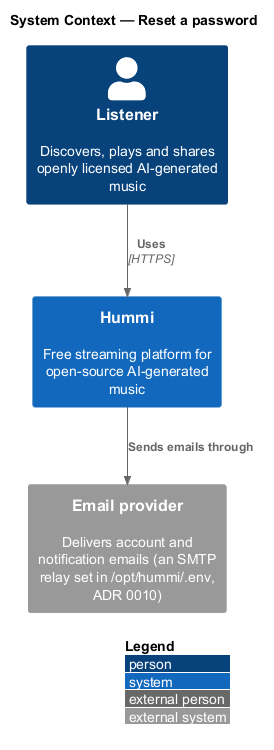
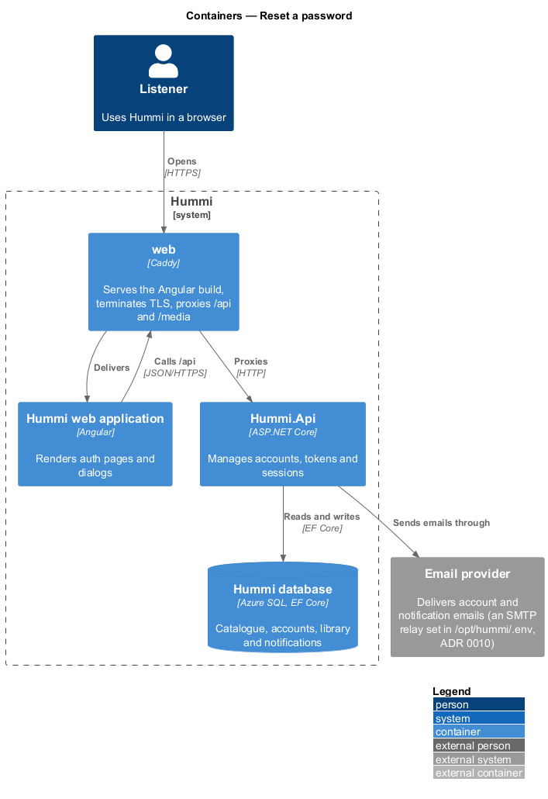
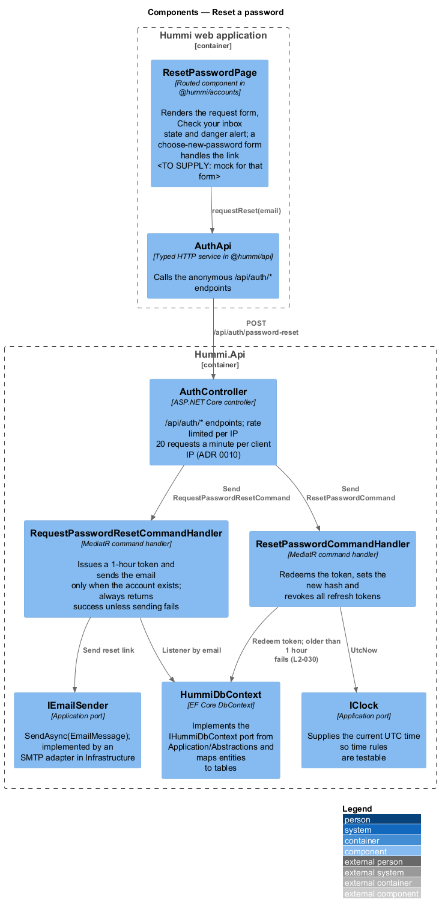
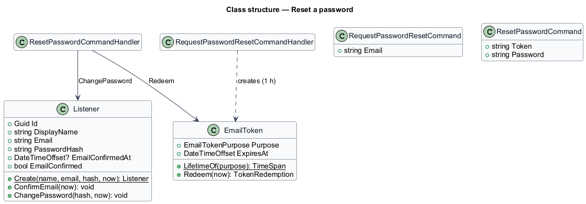
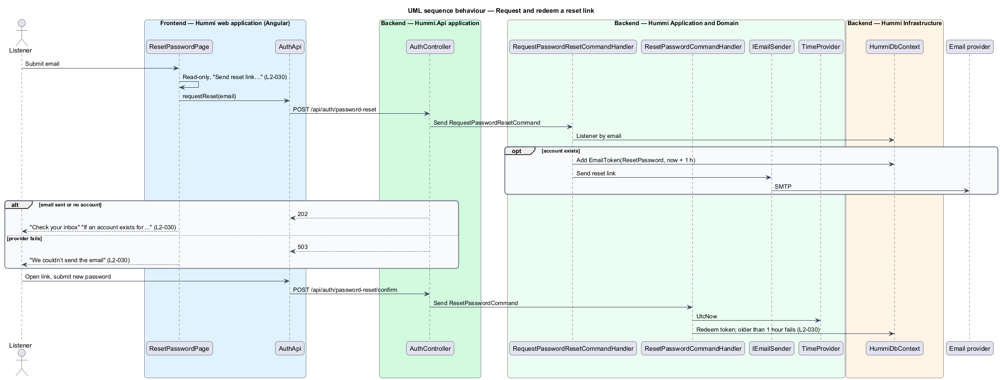

# Reset a password

## Overview

A listener who forgot their password requests a reset link at `/reset-password`. The page shows the
same confirmation whether or not an account exists, so it cannot be used to discover accounts. The
link works for 1 hour and leads to a form for a new password.

- **reset link** — single-use emailed link carrying an `EmailToken` with purpose `ResetPassword`

## Description

Two commands: request a link, and redeem it with a new password.

**Frontend — Hummi web application (Angular)**

- **`ResetPasswordPage`** — Routed component in @hummi/accounts. Renders the request form, Check your inbox state and danger alert; a choose-new-password form handles the link <TO SUPPLY: mock for that form>
- **`AuthApi`** — Typed HTTP service in @hummi/api. Calls the anonymous `/api/auth/*` endpoints

**Backend — Hummi.Api application**

- **`AuthController`** — ASP.NET Core controller. `/api/auth/*` endpoints; rate limited per IP 20 requests a minute per client IP (ADR 0010)

**Backend — Hummi Application and Domain**

- **`RequestPasswordResetCommandHandler`** — MediatR command handler. Issues a 1-hour token and sends the email only when the account exists; always returns success unless sending fails
- **`ResetPasswordCommandHandler`** — MediatR command handler. Redeems the token, sets the new hash and revokes all refresh tokens
- **`IEmailSender`** — Application port. `SendAsync(EmailMessage)`; implemented by an SMTP adapter in Infrastructure
- **`IClock`** — Application port. Supplies the current UTC time so time rules are testable

**Backend — Hummi Infrastructure**

- **`HummiDbContext`** — EF Core DbContext. Implements the `IHummiDbContext` port from `Application/Abstractions` and maps entities to tables
- **`Hummi database`** — Azure SQL. Listeners, email tokens and refresh tokens

## Requirements

The feature realizes the following level-2 (L2) requirements. Each L2 requirement refines a level-1 (L1) requirement in `docs/specs/L1.md`; the text is copied from `docs/specs/L2.md`.

| L2 ID | Refines (L1) | Requirement |
|-------|--------------|-------------|
| `L2-030` | `L1-007` | **Reset password.** 1. Given a visitor, when they open `/reset-password`, then it shows "Reset your password" with "Enter your email and we’ll send a link to choose a new one.", a required "Email" field, "Send reset link" and "Back to sign in". 2. Given an empty email, when they submit, then the summary and field show "Enter the email you signed up with". 3. Given submission in progress, when the form renders, then the field is read-only and the button reads "Send reset link…" and is disabled. 4. Given any email, when they submit, then the page shows "Check your inbox" with "If an account exists for {email}, a reset link is on its way. It works for 1 hour." whether or not an account exists, and "Back to sign in". 5. Given a sent reset link, when more than 1 hour has passed, then it no longer resets the password. 6. Given the email cannot be sent, when they submit, then a danger alert reads "We couldn’t send the email" with "Try again in a minute. If it keeps happening, contact support." |

## Diagrams

### System context

A listener resets a forgotten password in Hummi; the reset link travels through the email provider.

### Containers

`Hummi.Api` stores tokens in the database and sends the email through the provider.

### Components

`ResetPasswordPage` calls `AuthApi`; `AuthController` sends the request and redeem commands.

### Class structure

`RequestPasswordResetCommandHandler` creates a reset `EmailToken`; `ResetPasswordCommandHandler` redeems it and calls `Listener.ChangePassword`.

### Behaviour — request and redeem a reset link

The request returns 202 whether or not the account exists. Only an email-delivery failure changes the response. Redemption checks the 1-hour expiry against `IClock`.

