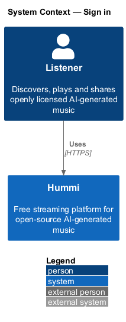
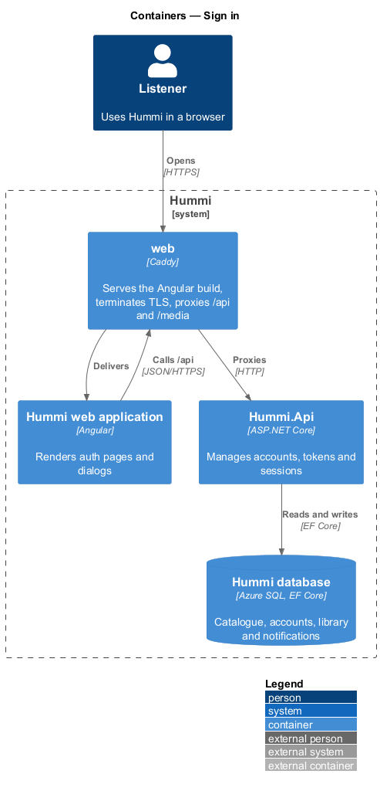
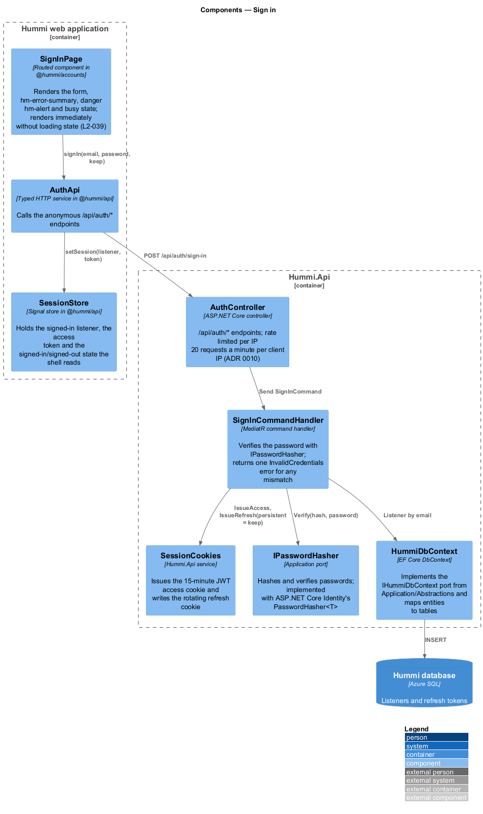
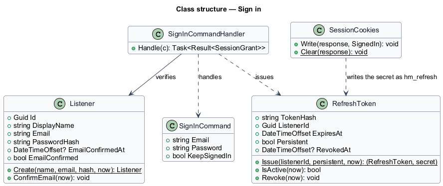
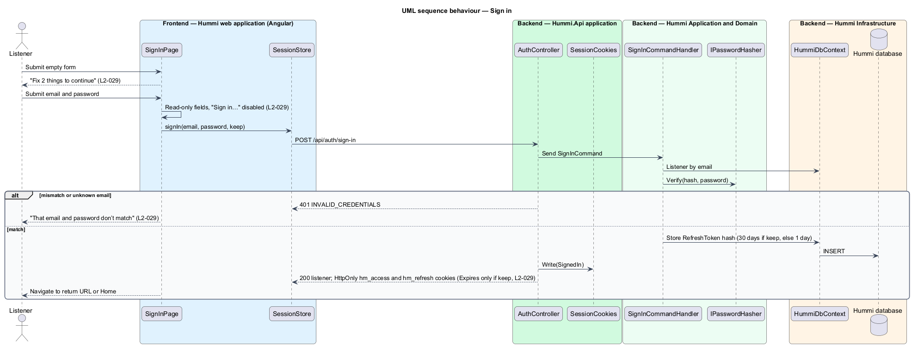

# Sign in

## Overview

Sign in (`/sign-in`) starts a session from an email and password. "Keep me signed in" (checked by
default) keeps the session after the browser closes. A wrong email or password gives one message that
does not say which value was wrong.

- **session** — pair of a short-lived access token (JWT) and a refresh token, each in an `HttpOnly`, `Secure`, `SameSite=Strict` cookie (`hm_access`, `hm_refresh`); no token reaches script or web storage
- **persistent session** — session whose refresh cookie has an expiry date; otherwise the cookie lasts until the browser closes

Access token lifetime: 15 minutes. Persistent refresh lifetime: 30 days; without Keep me signed in the refresh token lasts 1 day on the server and its cookie ends with the browser. Refresh rotates the token; sign-out revokes it (ADR 0010).

## Description

Sign in is a command that verifies credentials and issues tokens.

**Frontend — Hummi web application (Angular)**

- **`SignInPage`** — Routed component in @hummi/accounts. Renders the form, `hm-error-summary`, danger `hm-alert` and busy state; renders immediately without loading state (`L2-039`)
- **`SessionStore`** — Signal store in @hummi/api. Holds the signed-in listener, the access token and the signed-in/signed-out state the shell reads

**Backend — Hummi.Api application**

- **`AuthController`** — ASP.NET Core controller. `/api/auth/*` endpoints; rate limited per IP 20 requests a minute per client IP (ADR 0010)

**Backend — Hummi Application and Domain**

- **`SignInCommandHandler`** — MediatR command handler. Verifies the password with `IPasswordHasher`; returns one `InvalidCredentials` error for any mismatch
- **`SessionCookies`** — Hummi.Api service. Issues the 15-minute JWT access cookie and writes the refresh cookie; `RefreshToken.Issue` in the domain creates the secret and stores only its hash
- **`IPasswordHasher`** — Application port. Hashes and verifies passwords; implemented with ASP.NET Core Identity's `PasswordHasher<T>`

**Backend — Hummi Infrastructure**

- **`HummiDbContext`** — EF Core DbContext. Implements the `IHummiDbContext` port from `Application/Abstractions` and maps entities to tables
- **`Hummi database`** — Azure SQL. Listeners and refresh tokens

## Requirements

The feature realizes the following level-2 (L2) requirements. Each L2 requirement refines a level-1 (L1) requirement in `docs/specs/L1.md`; the text is copied from `docs/specs/L2.md`.

| L2 ID | Refines (L1) | Requirement |
|-------|--------------|-------------|
| `L2-029` | `L1-007` | **Sign in.** 1. Given a visitor, when they open Sign in (`/sign-in`), then it shows "Welcome back" with "Sign in to pick up where you left off.", the required fields "Email" and "Password", a checked "Keep me signed in" option, a "Forgot password?" link, a "Sign in" button and "New to Hummi? Create a free account". 2. Given empty fields, when they submit, then the summary "Fix 2 things to continue" lists "Enter the email you signed up with" and "Enter your password" and each field shows its error. 3. Given submission in progress, when the form renders, then the fields are read-only and the button reads "Sign in…" and is disabled. 4. Given a wrong email or password, when they submit, then a danger alert reads "That email and password don’t match" with "Check both and try again, or reset your password." linking to Reset password, without saying which value was wrong. 5. Given correct credentials, when they submit, then they are signed in; with "Keep me signed in" checked the session persists after the browser closes. 6. Given the Sign in page, when it renders, then email and password is the only sign-in method offered. |

## Diagrams

### System context

A listener signs in to Hummi with email and password. No external identity provider takes part (`L2-029`).

### Containers

The Angular application is delivered by the `web` container, which also proxies `/api` to `Hummi.Api`; the API reads and writes the Hummi database through EF Core.

### Components

`SignInPage` calls `SessionStore.signIn`; `AuthController` sends `SignInCommand`, whose handler uses `IPasswordHasher`, and writes the cookies with `SessionCookies`.

### Class structure

`SignInCommandHandler` verifies a `Listener` and issues a `RefreshToken`, persisting only its hash; `SessionCookies` writes the secret to the browser.

### Behaviour — sign in

Both an unknown email and a wrong password return the same 401 `INVALID_CREDENTIALS` so the response does not reveal which was wrong. Any other failure shows "Sign in isn’t working right now". Success opens the `returnUrl` from the Sign in to save this prompt, or Home. The refresh cookie carries an expiry only when Keep me signed in is checked.

