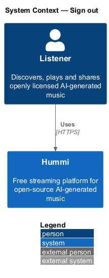
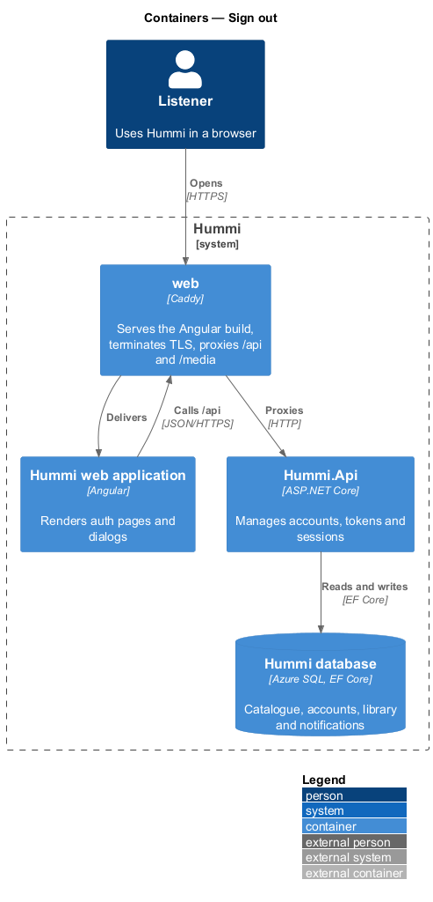
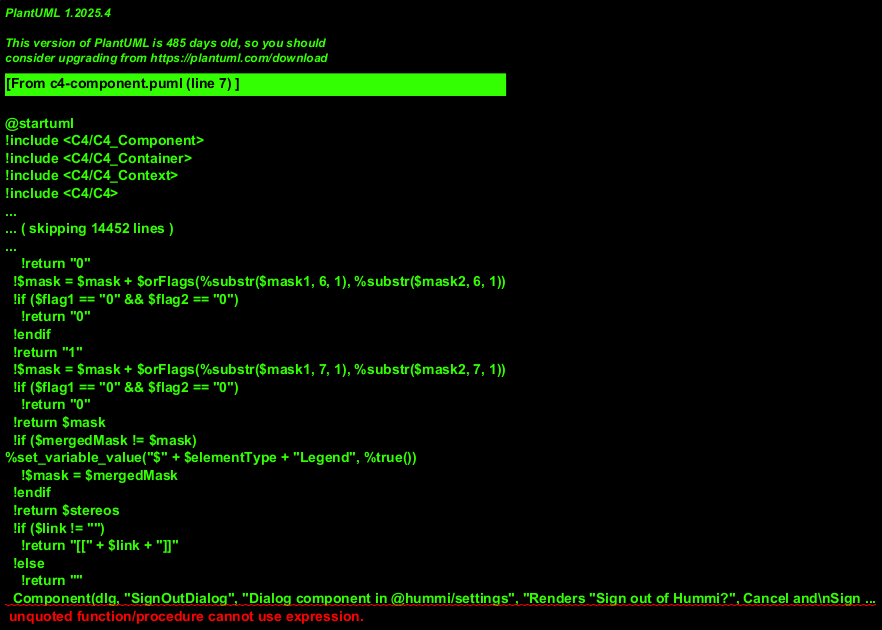
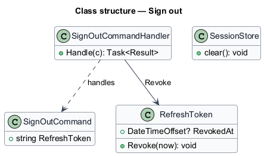
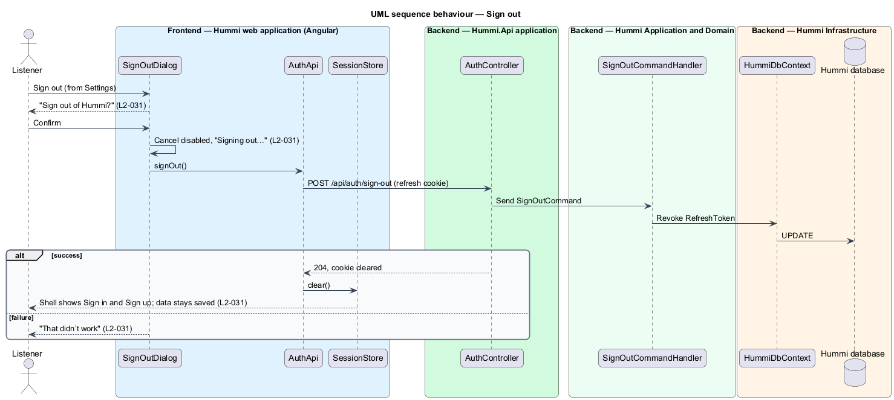

# Sign out

## Overview

Sign out ends the session on this device after a confirmation dialog opened from Settings. The
listener's playlists and likes stay saved, and they can keep listening signed out.

- **revocation** — marking a refresh token unusable so it cannot mint new access tokens

## Description

Sign out revokes the device's refresh token and clears browser session state.

**Frontend — Hummi web application (Angular)**

- **`SignOutDialog`** — Dialog component in @hummi/settings. Renders "Sign out of Hummi?", Cancel and Sign out with busy and error states
- **`AuthApi`** — Typed HTTP service in @hummi/api. Calls the anonymous `/api/auth/*` endpoints
- **`SessionStore`** — Signal store in @hummi/api. Holds the signed-in listener, the access token and the signed-in/signed-out state the shell reads

**Backend — Hummi.Api application**

- **`AuthController`** — ASP.NET Core controller. `/api/auth/*` endpoints; rate limited per IP <TO SUPPLY: limits>

**Backend — Hummi Application and Domain**

- **`SignOutCommandHandler`** — MediatR command handler. Revokes the refresh token named by the cookie

**Backend — Hummi Infrastructure**

- **`HummiDbContext`** — EF Core DbContext. Implements the `IHummiDbContext` port from `Application/Abstractions` and maps entities to tables
- **`Hummi database`** — Azure SQL. Refresh tokens

## Requirements

The feature realizes the following level-2 (L2) requirements. Each L2 requirement refines a level-1 (L1) requirement in `docs/specs/L1.md`; the text is copied from `docs/specs/L2.md`.

| L2 ID | Refines (L1) | Requirement |
|-------|--------------|-------------|
| `L2-031` | `L1-007` | **Sign out.** 1. Given a signed-in listener on Settings, when they activate "Sign out", then the dialog "Sign out of Hummi?" reads "Your playlists and likes stay saved. You can keep listening without an account." with "Cancel" and "Sign out". 2. Given they confirm, when sign-out succeeds, then the session ends, the shell shows the signed-out state, and their data remains saved. 3. Given sign-out is in progress, when the dialog renders, then "Cancel" is disabled and the button reads "Signing out…". 4. Given sign-out fails, when the dialog renders, then it shows "That didn’t work" with "We couldn’t sign you out. Check your connection and try again." |

## Diagrams

### System context

A signed-in listener signs out of Hummi. No external system takes part.

### Containers

The Angular application is delivered by the `web` container, which also proxies `/api` to `Hummi.Api`; the API reads and writes the Hummi database through EF Core.

### Components

`SignOutDialog` calls `AuthApi` and `SessionStore`; `AuthController` sends `SignOutCommand`.

### Class structure

`SignOutCommandHandler` revokes a `RefreshToken`; the browser clears `SessionStore`.

### Behaviour — sign out

Only the session is ended; no library data is touched. The shell reacts to `SessionStore.clear()` by switching to the signed-out layout.

