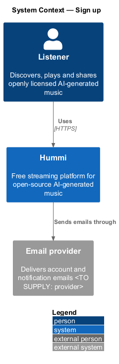
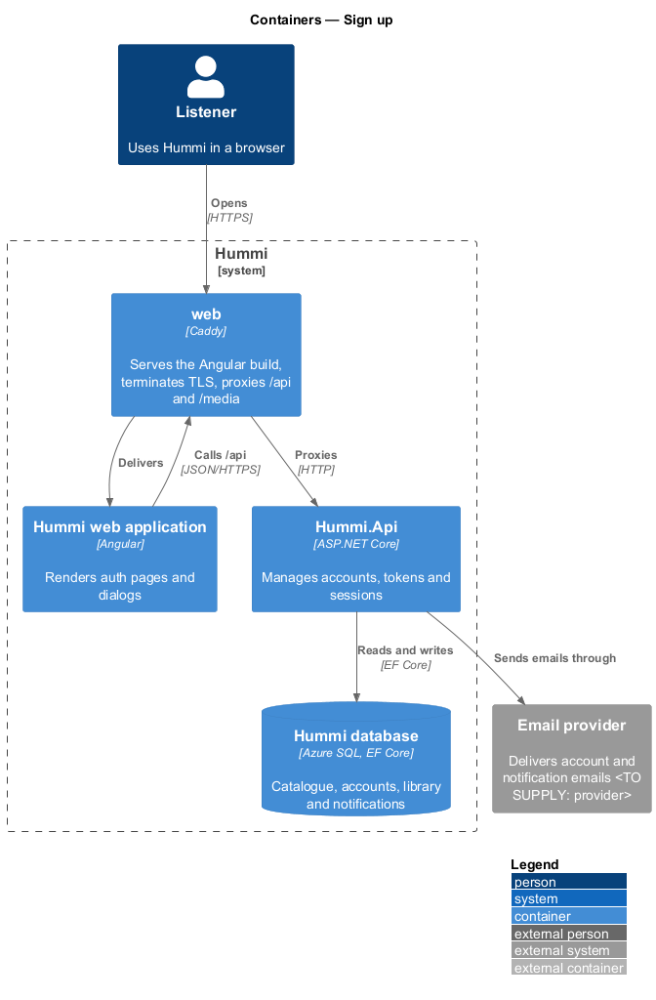
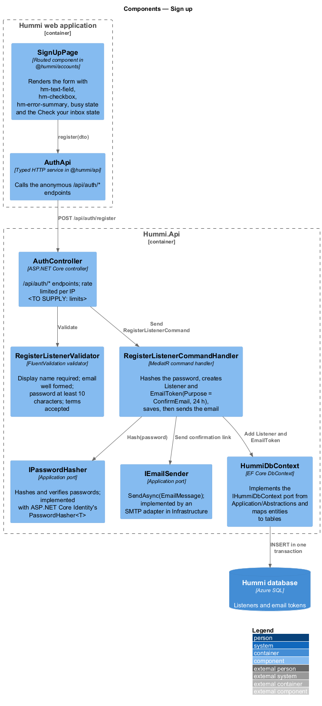
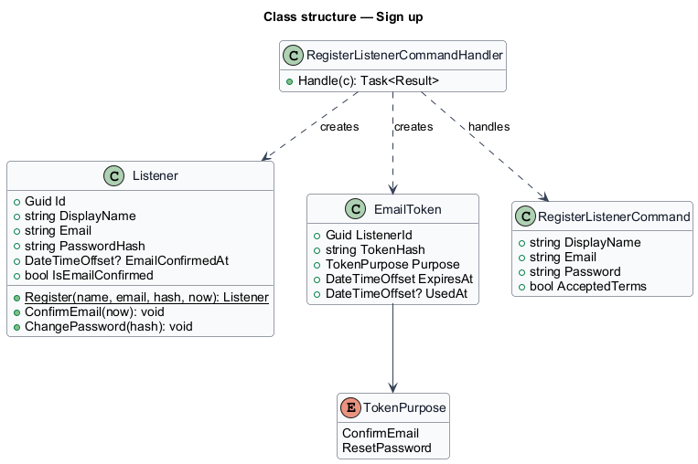
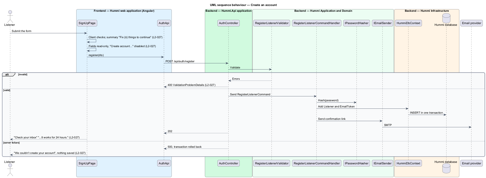

# Sign up

## Overview

The accounts subsystem manages who a listener is. Listening needs no account; saving does. Sign up
(`/sign-up`) creates a free account from a display name, an email address and a password of at least
10 characters, then sends a confirmation email.

- **listener account** — record of a display name, unique email and password hash
- **confirmation link** — single-use emailed link that proves ownership of the address, valid for 24 hours
- **error summary** — `hm-error-summary` block listing each invalid field with a link to it

Email and password is the only sign-in method.

## Description

Registration is one command that creates the account and an email token in one transaction, then sends the email.

**Frontend — Hummi web application (Angular)**

- **`SignUpPage`** — Routed component in @hummi/accounts. Renders the form with `hm-text-field`, `hm-checkbox`, `hm-error-summary`, busy state and the Check your inbox state
- **`AuthApi`** — Typed HTTP service in @hummi/api. Calls the anonymous `/api/auth/*` endpoints

**Backend — Hummi.Api application**

- **`AuthController`** — ASP.NET Core controller. `/api/auth/*` endpoints; rate limited per IP <TO SUPPLY: limits>

**Backend — Hummi Application and Domain**

- **`RegisterListenerValidator`** — FluentValidation validator. Display name required; email well formed; password at least 10 characters; terms accepted
- **`RegisterListenerCommandHandler`** — MediatR command handler. Hashes the password, creates `Listener` and `EmailToken(Purpose = ConfirmEmail, 24 h)`, saves, then sends the email
- **`IPasswordHasher`** — Application port. Hashes and verifies passwords; implemented with ASP.NET Core Identity's `PasswordHasher<T>`
- **`IEmailSender`** — Application port. `SendAsync(EmailMessage)`; implemented by an SMTP adapter in Infrastructure

**Backend — Hummi Infrastructure**

- **`HummiDbContext`** — EF Core DbContext. Implements the `IHummiDbContext` port from `Application/Abstractions` and maps entities to tables
- **`Hummi database`** — Azure SQL. Listeners and email tokens

## Requirements

The feature realizes the following level-2 (L2) requirements. Each L2 requirement refines a level-1 (L1) requirement in `docs/specs/L1.md`; the text is copied from `docs/specs/L2.md`.

| L2 ID | Refines (L1) | Requirement |
|-------|--------------|-------------|
| `L2-027` | `L1-007` | **Sign up.** 1. Given a visitor, when they open Sign up (`/sign-up`), then it shows "Create your free account" with "Save playlists, follow artists and keep your place across devices.", the required fields "Display name", "Email" and "Password" (help "At least 10 characters"), the checkbox "I agree to the terms and the community rules" with "Hummi is free. You can listen without an account, but saving needs one.", a "Create account" button, and "Already have an account? Sign in". 2. Given invalid input, when they submit, then an error summary "Fix {n} things to continue" links to each invalid field and the fields show "Enter a display name" (empty name), "That email address looks incomplete" (malformed email) and "Use at least 10 characters" (password under 10 characters) as applicable. 3. Given submission in progress, when the form renders, then the fields are read-only and the button reads "Create account…" and is disabled. 4. Given valid input, when the account is created, then the page shows "Check your inbox" with "We sent a confirmation link to {email}. It works for 24 hours.", a success alert "Account created" with a "Start again" link, and "I’ve confirmed my email". 5. Given a server failure, when they submit, then a danger alert reads "We couldn’t create your account" with "Something went wrong on our side. Nothing was saved; try again in a moment." and no account exists. |

## Diagrams

### System context

A visitor creates an account in Hummi, which sends a confirmation email through the email provider.

### Containers

`Hummi.Api` stores the account in the database and calls the external email provider.

### Components

`SignUpPage` calls `AuthApi`; `AuthController` validates and sends `RegisterListenerCommand`, whose handler uses `IPasswordHasher` and `IEmailSender`.

### Class structure

`RegisterListenerCommandHandler` creates a `Listener` and an `EmailToken` with purpose `ConfirmEmail`.

### Behaviour — create an account

The server validates again with the same rules. Account and token commit together, so a failure leaves no account; the email goes out after the commit. An address already registered returns the same 202 response to avoid revealing accounts <TO SUPPLY: confirm duplicate-email behaviour>.

