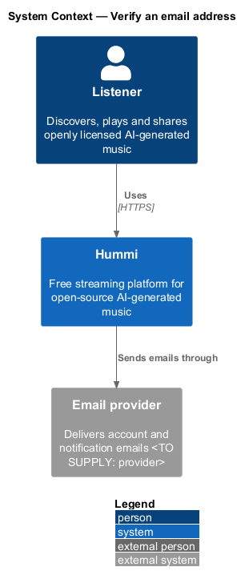
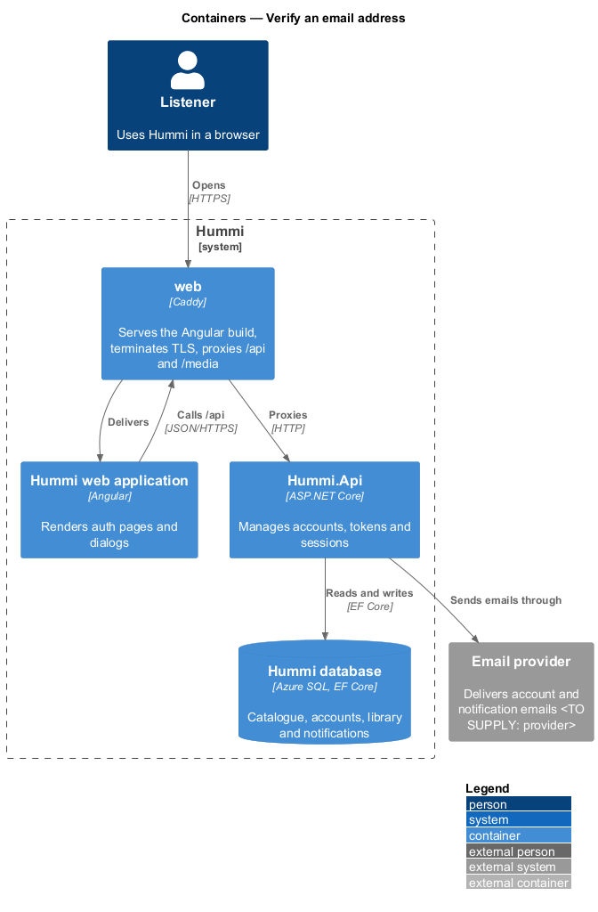
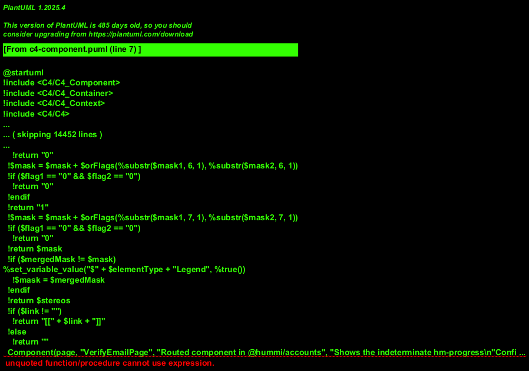
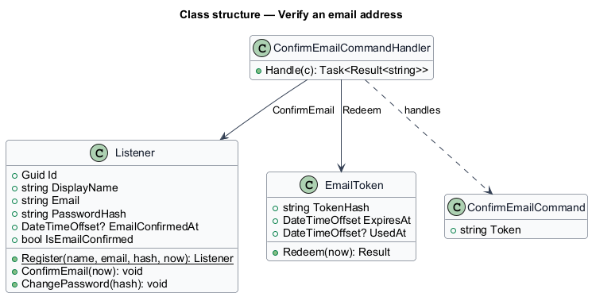
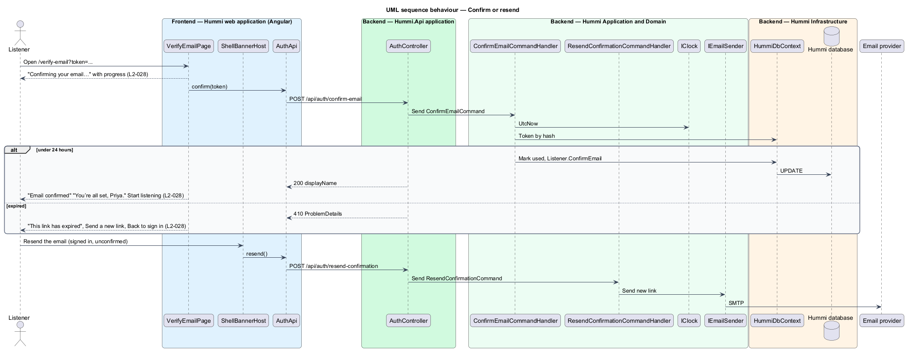

# Verify an email address

## Overview

After sign-up the listener confirms their email by opening the link they received. The link lands on
`/verify-email?token=`, which redeems the token. A link older than 24 hours has expired and the page
offers a new one. Until confirmation, every shell page shows a persistent banner with a resend link.

- **unconfirmed account** — account whose `EmailConfirmedAt` is null

## Description

Two commands: one redeems a token, one issues a fresh one.

**Frontend — Hummi web application (Angular)**

- **`VerifyEmailPage`** — Routed component in @hummi/accounts. Shows the indeterminate `hm-progress` "Confirming email", then confirmed or expired state
- **`ShellBannerHost`** — Shell component in the hummi application. Shows the email-confirmation `hm-banner` while `SessionStore.listener().emailConfirmed` is false
- **`AuthApi`** — Typed HTTP service in @hummi/api. Calls the anonymous `/api/auth/*` endpoints
- **`SessionStore`** — Signal store in @hummi/api. Holds the signed-in listener, the access token and the signed-in/signed-out state the shell reads

**Backend — Hummi.Api application**

- **`AuthController`** — ASP.NET Core controller. `/api/auth/*` endpoints; rate limited per IP <TO SUPPLY: limits>

**Backend — Hummi Application and Domain**

- **`ConfirmEmailCommandHandler`** — MediatR command handler. Finds the token by hash, checks expiry against `IClock`, marks it used and calls `Listener.ConfirmEmail`
- **`ResendConfirmationCommandHandler`** — MediatR command handler. Invalidates open tokens and issues a new 24-hour token
- **`IClock`** — Application port. Supplies the current UTC time so time rules are testable
- **`IEmailSender`** — Application port. `SendAsync(EmailMessage)`; implemented by an SMTP adapter in Infrastructure

**Backend — Hummi Infrastructure**

- **`HummiDbContext`** — EF Core DbContext. Implements the `IHummiDbContext` port from `Application/Abstractions` and maps entities to tables
- **`Hummi database`** — Azure SQL. Listeners and email tokens

## Requirements

The feature realizes the following level-2 (L2) requirements. Each L2 requirement refines a level-1 (L1) requirement in `docs/specs/L1.md`; the text is copied from `docs/specs/L2.md`.

| L2 ID | Refines (L1) | Requirement |
|-------|--------------|-------------|
| `L2-028` | `L1-007` | **Email verification.** 1. Given a confirmation link, when the visitor opens `/verify-email`, then the page shows "Confirming your email…" with "This takes a moment. You’ll be taken to Hummi when it’s done." and an indeterminate progress bar labelled "Confirming email". 2. Given a link under 24 hours old, when confirmation succeeds, then the page shows "Email confirmed" with "You’re all set, {name}. Your account is ready." and "Start listening", which opens Home. 3. Given a link older than 24 hours, when it is opened, then the page shows "This link has expired" with "Confirmation links work for 24 hours. We can send a fresh one.", "Send a new link" and "Back to sign in". 4. Given a signed-in listener whose email is unconfirmed, when any shell page renders, then a persistent banner reads "Confirm your email. Check your inbox to keep saving playlists. Resend the email." and the link resends the confirmation email. |

## Diagrams

### System context

A listener confirms their email address with a link Hummi sent through the email provider.

### Containers

`Hummi.Api` redeems tokens in the database and sends replacement links through the email provider.

### Components

`VerifyEmailPage` and `ShellBannerHost` call `AuthApi`; `AuthController` sends `ConfirmEmailCommand` and `ResendConfirmationCommand`.

### Class structure

`EmailToken.Redeem` enforces single use and expiry; `ConfirmEmailCommandHandler` then calls `Listener.ConfirmEmail`.

### Behaviour — confirm or resend

Expiry is checked on the server against `IClock`. The shell banner (`L2-028`, `L2-042`) reads the confirmed flag from the session and calls the resend command.

