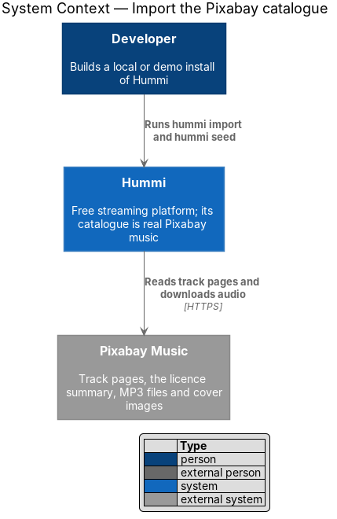
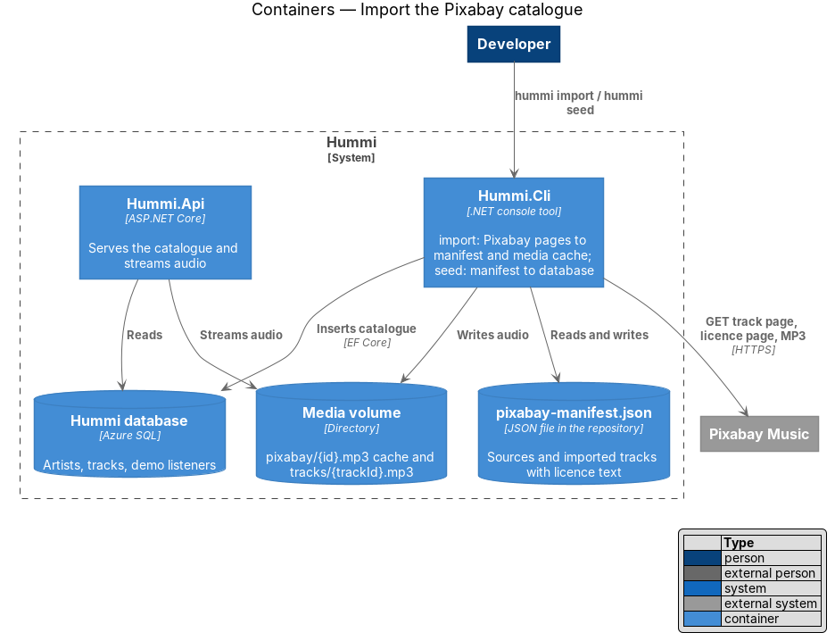
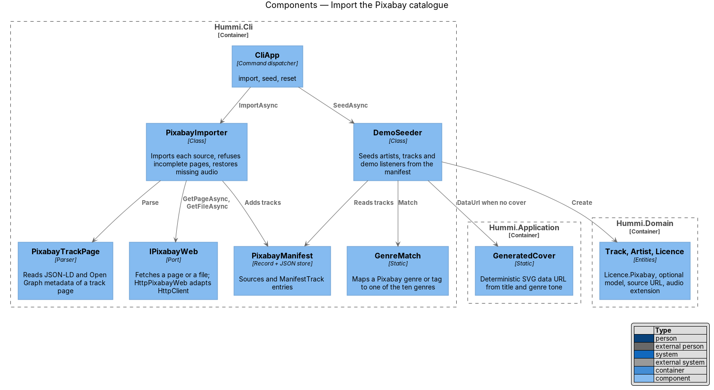
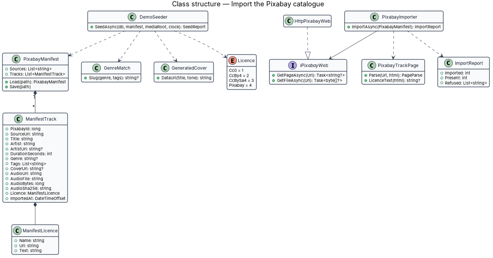
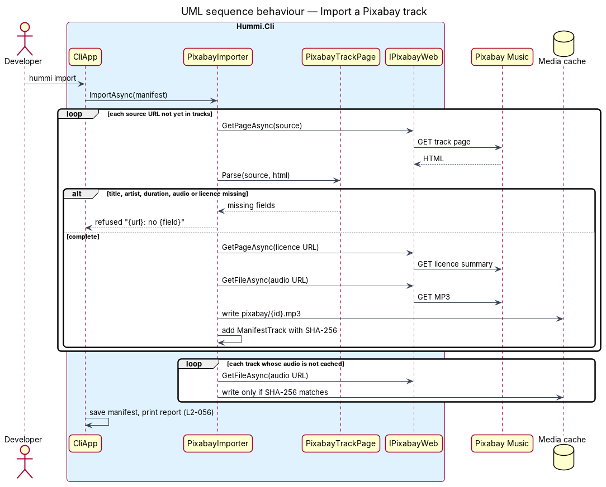
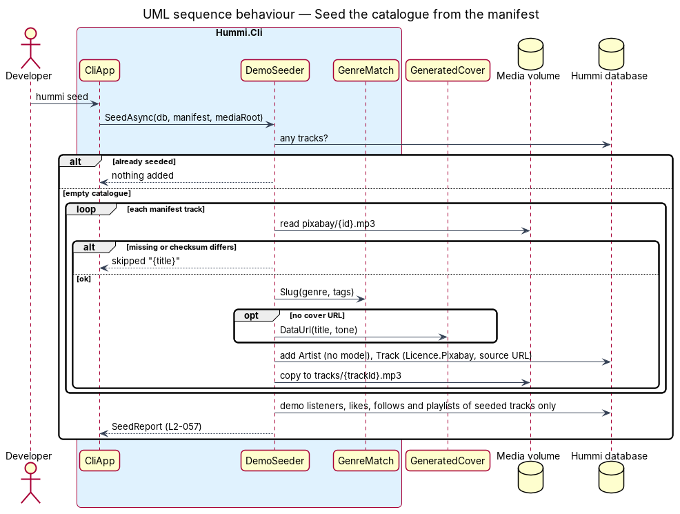

# Import the Pixabay catalogue

## Overview

Hummi's catalogue is made only of real tracks from Pixabay Music (ADR 0021). A developer lists Pixabay
track pages in a committed manifest, runs `hummi import` to read each page, keep its metadata and download
its audio, and runs `hummi seed` to write exactly those tracks into a migrated database. Nothing describing
the catalogue is invented: a field the page does not give stays empty, a track the page cannot describe is
refused, and a cover is generated only when the track has none.

- **manifest** — `src/backend/Hummi.Cli/Catalogue/pixabay-manifest.json`, the source of truth: `sources` (track page URLs) and `tracks` (imported entries)
- **media cache** — `{media root}/pixabay/{id}.mp3`, the downloaded audio, never committed
- **generated cover** — an SVG `data:` URL drawn from the title and genre with the design-system cover gradients

## Description

The slice lives in the developer tool `Hummi.Cli`, with one pure helper in `Hummi.Application` and small
domain changes. Production code paths of the API and the frontend do not know about Pixabay beyond the
licence and the source link.

**Developer tool — Hummi.Cli**

- **`CliApp`** — Dispatches `import`, `seed` and `reset`. `import` and `seed` read the manifest from `Catalogue:ManifestPath`, else the copy next to the binary; `import` writes it back to `Catalogue:ManifestPath` when set
- **`PixabayManifest`** — Records `ManifestTrack` and `ManifestLicence`; loads and saves indented camel-case JSON
- **`IPixabayWeb`** — Port that fetches a page as text or a file as bytes, null when it cannot. `HttpPixabayWeb` adapts `HttpClient`; tests use a fake
- **`PixabayTrackPage`** — Parses a track page: JSON-LD (`MusicRecording`, `AudioObject`) first, then Open Graph and `music:` meta tags. Reports the fields it could not find. Extracts the licence page's text
- **`PixabayImporter`** — Imports each source in order, refuses non-Pixabay URLs and incomplete pages, accepts only the Pixabay Content License, writes `pixabay/{id}.mp3` and records its size and SHA-256; restores a missing cached file only when its checksum matches
- **`DemoSeeder`** — Seeds one artist per uploader (no model, no description), each track with `Licence.Pixabay`, its source URL, genre from `GenreMatch`, real or generated cover, and copies the audio to `tracks/{trackId}.mp3`; skips a track whose audio is missing or corrupt; adds the demo listeners with likes, follows, playlists and notifications that refer only to seeded tracks
- **`GenreMatch`** — Returns the slug of the fixed genre whose name or slug equals the Pixabay genre or a tag, case-insensitively, with the aliases "steel drum", "steel drums", "steel pan", "steelpan", "calypso" for Steelpan & Calypso and "children", "kids" for Kids

**Backend — Hummi Application and Domain**

- **`GeneratedCover`** — Static helper in `Application/Catalogue`. `DataUrl(title, tone)` returns a deterministic SVG of 300 × 300 with the tone's gradient, rings placed by a hash of the title and the title's initials, under 2,048 characters
- **`Licence.Pixabay`** — New licence value 4, labelled "Pixabay Content License"
- **`Artist.ModelName`** — Optional; `GetArtistQuery` and `GetTrackQuery` return null when unknown
- **`Track.SourceUrl`, `Track.AudioExtension`** — The Pixabay page of the track and the audio file's extension (`.mp3` for imports, `.wav` for rows created before)

**Frontend — Hummi web application (Angular)**

- **`TrackPage`**, **`LicencePage`**, **`ArtistPage`** — Hide the model when null; the track page adds the Source row; the licence page describes the Pixabay Content License and links to it (view-track, view-licence, view-artist)
- **`HomePage`** — Hides empty shelves and shows "No music yet" when every shelf is empty and nothing is featured (view-home)

## Requirements

The feature realizes the following level-2 (L2) requirements. Each L2 requirement refines a level-1 (L1) requirement in `docs/specs/L1.md`; the text is copied from `docs/specs/L2.md`.

| L2 ID | Refines (L1) | Requirement |
|-------|--------------|-------------|
| `L2-056` | `L1-014` | **Import tracks from Pixabay Music.** 1. Given a source URL of a Pixabay music track page, when `hummi import` runs, then the manifest gains one entry with the Pixabay id, the source URL, the title, the artist and their profile URL, the duration in seconds, the Pixabay genre and tags, the cover image URL (or none), the audio URL, file name, size and SHA-256, and the licence's name, URL and text, all read from the track's page and the licence page it links to; and the audio is saved to the media cache as `pixabay/{id}.mp3`. 2. Given a page that lacks a title, an artist, a duration, an audio file or the Pixabay Content License, when it is imported, then no entry is added, nothing is filled in, and the command reports the URL and what was missing. 3. Given a URL that is not a Pixabay music track page, or a page or file that cannot be fetched, when it is imported, then it is refused and reported and the other sources are still imported. 4. Given a track already in the manifest, when `hummi import` runs again, then its page is not fetched again; given its audio is missing from the media cache, then the audio is downloaded again and kept only if its SHA-256 matches the manifest. 5. Given the import ends, when it reports, then it prints how many tracks were imported, already present and refused, and the manifest is written with its tracks in source order. |
| `L2-057` | `L1-014` | **Seed the catalogue from the manifest.** 1. Given a manifest with N tracks whose audio is cached, when `hummi seed` runs on a migrated database, then the catalogue holds exactly those N tracks (N may be 0, 1 or a few) with the title, artist, duration, licence and source URL of the manifest, one artist per uploader with no model and no description, no albums and no plays, and each track's audio copied to `tracks/{id}.mp3`. 2. Given a track's Pixabay genre or one of its tags equals the name or slug of one of the ten genres (case-insensitive, e.g. "Reggae", "zouk", "Kids"), when it is seeded, then it is listed under that genre; otherwise it is unclassified. 3. Given a track with a cover URL, when it is seeded, then its cover is that URL; given a track without one, then its cover is a generated image, the same for the same title and genre, drawn with the design-system cover gradients. 4. Given a manifest track whose cached audio is missing or does not match its SHA-256, when `hummi seed` runs, then that track is skipped and reported and the others are seeded. 5. Given the demo listeners, when `hummi seed` runs, then Nadia Charles likes the first three tracks of the manifest or fewer, keeps them in "Road trip to the north coast", follows their artists and has a new-release notification only if a track exists; Mei Rodríguez's public "Sunday kitchen" holds the first four tracks or fewer; no like, follow, playlist entry or notification refers to a track or artist that is not in the catalogue. 6. Given the catalogue already has tracks, when `hummi seed` runs again, then nothing is added. |
| `L2-058` | `L1-014` | **Screens with a small catalogue.** 1. Given a catalogue of one track, when a listener opens Home, Browse, the track's genre, Search, the track page, its licence page, its artist page, Library, a playlist and the Offline page, then each shows that track (or its own empty state where it has none) without an empty shelf, a broken layout or a horizontal scroll at 360px. 2. Given a catalogue of a few tracks (fewer than ten), when Home renders, then the "Top 10 on Hummi this week" shelf lists them ranked from 1 and the other shelves show only what they hold. 3. Given a catalogue with no tracks, when a listener opens Home, Browse and Search, then Home shows "No music yet" (L2-002 AC5), Browse shows "10 genres · no tracks yet" and every genre page shows its empty state (L2-004 AC5). |
| `L2-012` | `L1-003`, `L1-014` | **Licence and credit page.** 1. Given a Pixabay track "{title}" by "{artist}", when a listener opens `/tracks/{slug}/licence`, then the heading is "Licence and credit" with "How you can reuse what you hear on Hummi" and an info alert "{title} is under the Pixabay Content License" with "{artist} shared it on Pixabay under the Pixabay Content License. You may use it for free, including commercially, and change it. Credit is not required but is appreciated:" followed by the credit line "“{title} by {artist}, from Pixabay.”", a "Read the Pixabay Content License" link to `https://pixabay.com/service/license-summary/` and a "View on Pixabay" link to the track's Pixabay page, both opening in a new tab. 2. Given the licence page, when it loads, then a "Licences on Hummi" table lists one row: Pixabay Content License — "Use, change and share for free, including commercially" — "Nothing; credit is appreciated. Don’t sell or redistribute it unaltered on its own, or claim it as your own". 3. Given the licence page, when it loads, then a "Back to {title}" link returns to the track page. 4. Given any track, when it is published, then it carries exactly one licence; every imported track carries the Pixabay Content License and the licence page has no empty state. A track whose model is known keeps the credit line "“{title} by {artist}, generated with {model}.”". |

## Diagrams

### System context

A developer runs the Hummi tool; it reads track pages and audio from Pixabay Music.

### Containers

`Hummi.Cli` reads and writes the manifest, writes audio to the media volume and inserts the catalogue; the API
then serves it as before.

### Components

`PixabayImporter` uses the `IPixabayWeb` port and the `PixabayTrackPage` parser; `DemoSeeder` reads the
manifest and uses `GenreMatch` and `GeneratedCover`.

### Class structure

The manifest owns its tracks and each track its licence; the seeder maps a manifest track to domain entities.

### Behaviour — import a Pixabay track

### Behaviour — seed the catalogue from the manifest

## Open questions

- **Page format not verified.** `pixabay.com` was denied by the network policy of the session that built this
  feature, so `PixabayTrackPage` is tested only against fixtures following schema.org JSON-LD and Open Graph.
  The first real `hummi import` must be checked, and the parser adjusted if Pixabay's markup differs.
- **Standalone redistribution.** The Pixabay Content License forbids redistributing content unaltered on a
  standalone basis; whether streaming in Hummi counts must be cleared before a production catalogue (ADR 0021).
- **Waveforms.** Imported tracks have no waveform peaks until an MP3 decoder is added.
