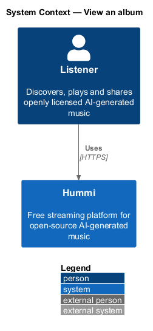
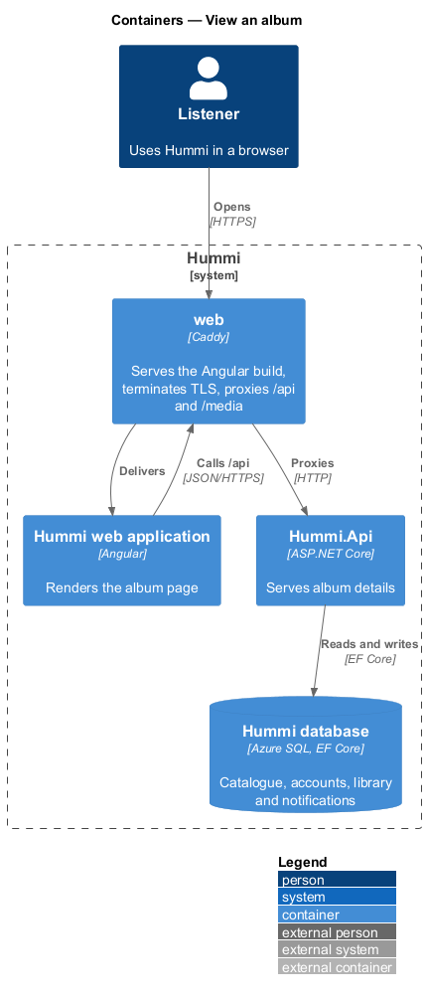
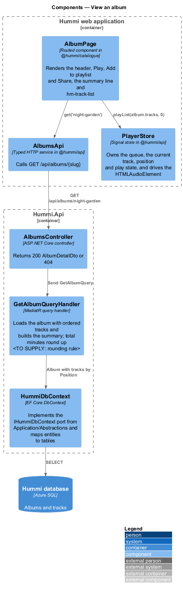
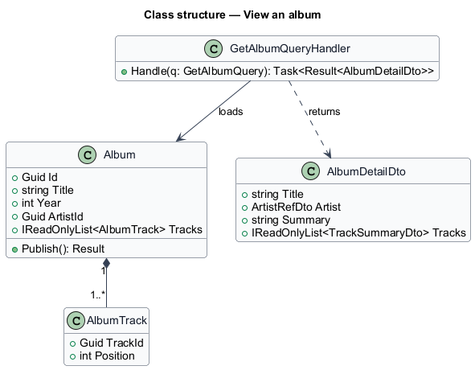
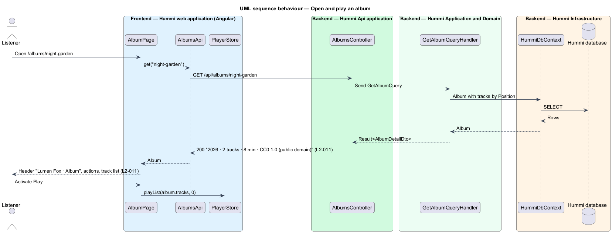

# View an album

## Overview

An album page (`/albums/{slug}`) lists the tracks of one release by one artist, with a summary of year,
track count, total minutes and licence. A published album always holds at least one track, so the
page has no empty state.

- **album** — ordered collection of tracks released together by one artist
- **album summary** — line "{year} · {n} tracks · {minutes} min · {licence}"

## Description

The slice is one read query. The publish invariant lives in the `Album` entity.

**Frontend — Hummi web application (Angular)**

- **`AlbumPage`** — Routed component in @hummi/catalogue. Renders the header, Play, Add to playlist and Share, the summary line and `hm-track-list`
- **`AlbumsApi`** — Typed HTTP service in @hummi/api. Calls `GET /api/albums/{slug}`
- **`PlayerStore`** — Signal store in @hummi/api. Owns the queue, the current track, position and play state, and drives the `HTMLAudioElement`

**Backend — Hummi.Api application**

- **`AlbumsController`** — ASP.NET Core controller. Returns 200 `AlbumDetailDto` or 404

**Backend — Hummi Application and Domain**

- **`GetAlbumQueryHandler`** — MediatR query handler. Loads the album with ordered tracks and builds the summary; total minutes round up <TO SUPPLY: rounding rule>
- **`Album`** — Domain entity. `Publish()` fails unless the album holds at least one track (`L2-011`)

**Backend — Hummi Infrastructure**

- **`HummiDbContext`** — EF Core DbContext. Implements the `IHummiDbContext` port from `Application/Abstractions` and maps entities to tables
- **`Hummi database`** — Azure SQL. Albums and tracks

## Requirements

The feature realizes the following level-2 (L2) requirements. Each L2 requirement refines a level-1 (L1) requirement in `docs/specs/L1.md`; the text is copied from `docs/specs/L2.md`.

| L2 ID | Refines (L1) | Requirement |
|-------|--------------|-------------|
| `L2-011` | `L1-003` | **Album page.** 1. Given the album Night Garden, when a listener opens `/albums/night-garden`, then the heading is "Night Garden" and the subtitle is "Lumen Fox · Album" with the artist linked. 2. Given the album page, when it loads, then it shows "Play", "Add to playlist" and "Share" buttons, the album track list, and the summary "{year} · {n} tracks · {minutes} min · {licence}" (e.g. "2026 · 2 tracks · 8 min · CC0 1.0 (public domain)"). 3. Given any album, when it is published, then it has at least one track; the album page has no empty state. |

## Diagrams

### System context

A listener opens an album page in Hummi. No external system takes part.

### Containers

The Angular application is delivered by the `web` container, which also proxies `/api` to `Hummi.Api`; the API reads and writes the Hummi database through EF Core.

### Components

`AlbumPage` calls `AlbumsApi` and `PlayerStore`; `AlbumsController` sends `GetAlbumQuery` to its handler.

### Class structure

`Album` composes one or more `AlbumTrack` positions and enforces the at-least-one-track rule in `Publish()`.

### Behaviour — open and play an album

The handler returns tracks in album order with a precomposed summary line; Play hands the list to `PlayerStore`.

