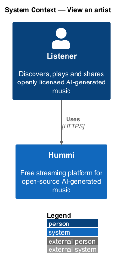
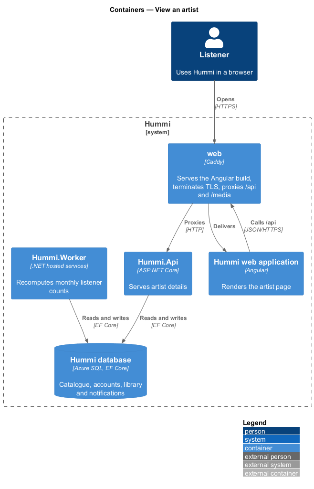
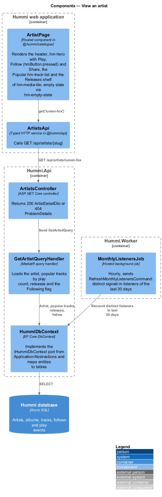
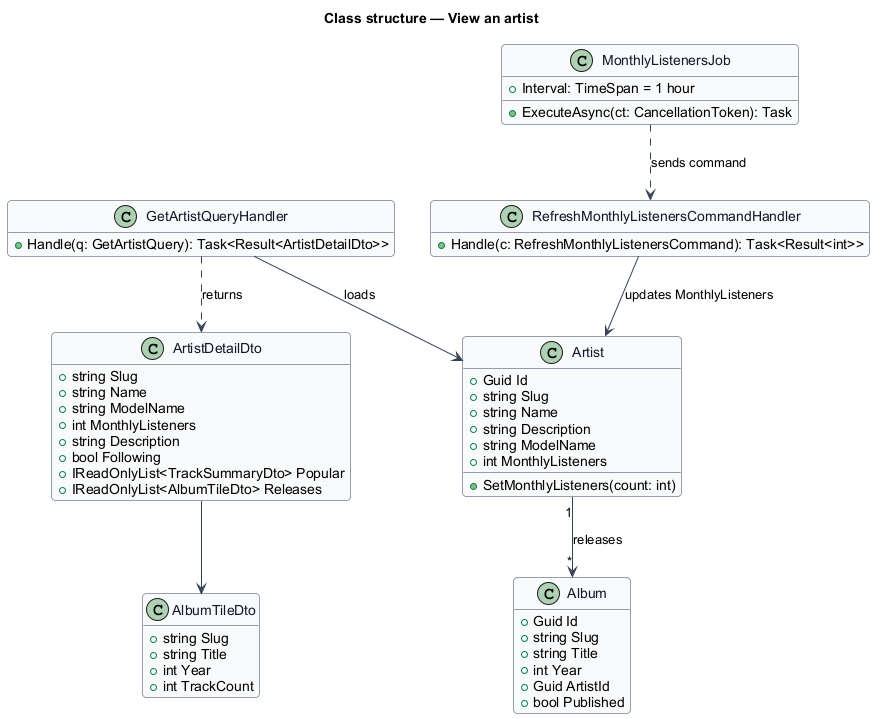
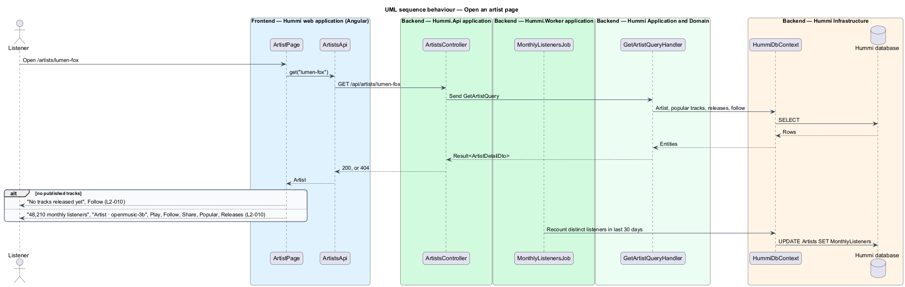

# View an artist

## Overview

An artist page (`/artists/{slug}`) presents one artist: a named generator persona that publishes
tracks made with one open-weights model. It shows monthly listeners, the model, a description, a
Popular track list and the artist's releases. The listener can play the artist, follow it and share
it. Following is part of the library subsystem (`L2-018`).

- **monthly listeners** — count of distinct listeners who played at least one of the artist's tracks in the last 30 days
- **release** — album by the artist, shown as a tile with year and track count

## Description

The slice is one read query; a scheduled job keeps the monthly listener count current.

**Frontend — Hummi web application (Angular)**

- **`ArtistPage`** — Routed component in @hummi/catalogue. Renders the header, `hm-hero` with Play, Follow (`hmButton` with `pressed`) and Share, the Popular `hm-track-list` and the Releases shelf of `hm-media-tile`; empty state via `hm-empty-state`. Follow and Share are wired by the library and sharing journeys
- **`ArtistsApi`** — Typed HTTP service in @hummi/api. Calls `GET /api/artists/{slug}`

**Backend — Hummi.Api application**

- **`ArtistsController`** — ASP.NET Core controller. Returns 200 `ArtistDetailDto` or 404 ProblemDetails

**Backend — Hummi.Worker application**

- **`MonthlyListenersJob`** — Hosted background job. Sends `RefreshMonthlyListenersCommand` when the worker starts and then every hour. The handler counts, per artist, the distinct signed-in listeners whose play events of the last 30 days hit the artist's tracks; anonymous plays cannot be told apart and are not counted

**Backend — Hummi Application and Domain**

- **`GetArtistQueryHandler`** — MediatR query handler. Loads the artist, the 5 most played playable tracks as Popular, the published albums newest first as Releases (year and playable track count), and the `Following` flag, false until follows exist. No playable tracks means the empty state

**Backend — Hummi Infrastructure**

- **`HummiDbContext`** — EF Core DbContext. Implements the `IHummiDbContext` port from `Application/Abstractions` and maps entities to tables
- **`Hummi database`** — Azure SQL. Artists, albums, tracks, follows and play events

## Requirements

The feature realizes the following level-2 (L2) requirements. Each L2 requirement refines a level-1 (L1) requirement in `docs/specs/L1.md`; the text is copied from `docs/specs/L2.md`.

| L2 ID | Refines (L1) | Requirement |
|-------|--------------|-------------|
| `L2-010` | `L1-003` | **Artist page.** 1. Given the artist Kaiso Collective, when a listener opens `/artists/kaiso-collective`, then the heading is "Kaiso Collective", the subtitle is "48,210 monthly listeners", the overline is "Artist · openmusic-3b" and the artist description is shown. 2. Given the artist page, when it loads, then it shows "Play", "Follow" (not pressed) and "Share" buttons, a "Popular" track list and a "Releases" shelf of album tiles with year and track count (e.g. "Mas on the Avenue", "2026 · 2 tracks"). 3. Given an artist with no published tracks, when the page loads, then it shows "No tracks released yet" with "Kaiso Collective hasn’t published anything. Follow to hear when they do." and a "Follow" button. |

## Diagrams

### System context

A listener opens an artist page in Hummi. No external system takes part.

### Containers

The page reads through `Hummi.Api`; `Hummi.Worker` updates the stored monthly listener counts in the same database.

### Components

`ArtistPage` calls `ArtistsApi`; `ArtistsController` sends `GetArtistQuery`. `MonthlyListenersJob` in the worker writes the count the query reads.

### Class structure

`Artist` releases `Album` items. The handler projects both into `ArtistDetailDto`; `MonthlyListenersJob` maintains `Artist.MonthlyListeners`.

### Behaviour — open an artist page

The page reads one DTO. The monthly listener count is precomputed by `MonthlyListenersJob` in `Hummi.Worker`, so the read stays a single query.

