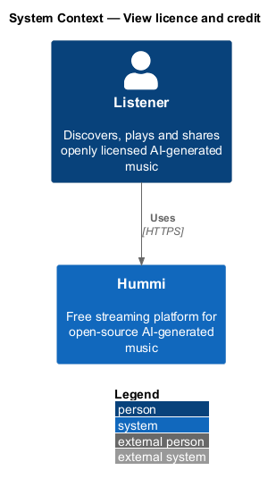
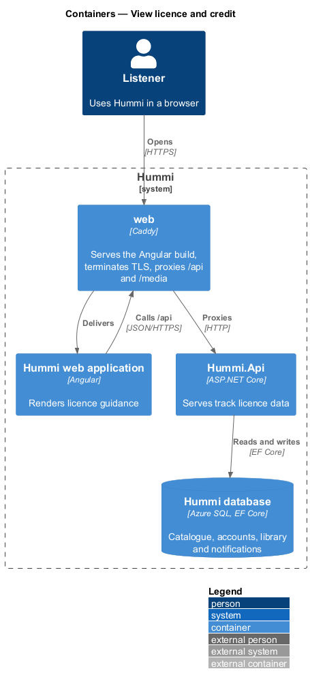
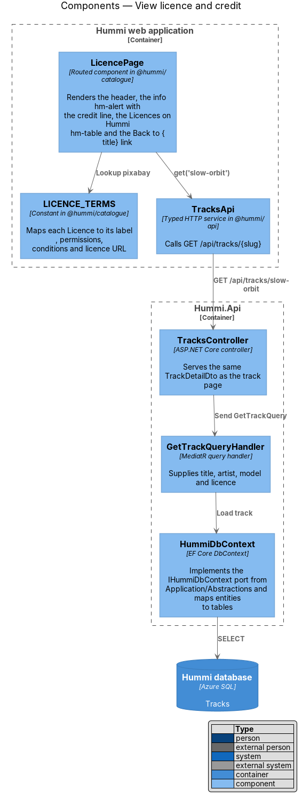
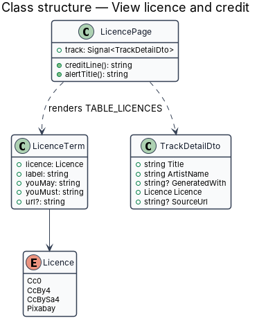
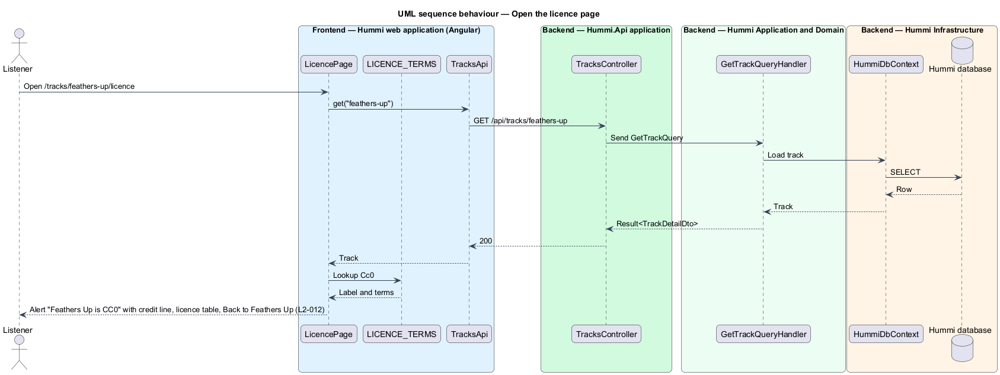

# View licence and credit

## Overview

Every track on Hummi carries exactly one open licence. The licence and credit page
(`/tracks/{slug}/licence`) explains how the listener may reuse a track and gives a ready-made credit
line naming the track, the artist and the generating model. A table compares the three licences
Hummi accepts.

- **credit line** — attribution sentence "“{title} by {artist}, generated with {model}.”"
- **licence** — one of CC0 1.0, CC BY 4.0 and CC BY-SA 4.0

The licence comparison is static product content; only the alert depends on the track.

## Description

The slice reuses the track query and keeps the licence table as typed constants in the frontend.

**Frontend — Hummi web application (Angular)**

- **`LicencePage`** — Routed component in @hummi/catalogue. Renders the header, the info `hm-alert` with the credit line, the Licences on Hummi `hm-table` and the Back to {title} link. An unknown slug shows Not found
- **`LICENCE_TERMS`** — Constant in @hummi/catalogue. Maps each `Licence` to its table name, the short name of the alert heading, permissions, conditions and the alert's terms (CC0: credit appreciated but not required; CC BY and CC BY-SA: credit required)
- **`TracksApi`** — Typed HTTP service in @hummi/api. Calls `GET /api/tracks/{slug}`

**Backend — Hummi.Api application**

- **`TracksController`** — ASP.NET Core controller. Serves the same `TrackDetailDto` as the track page

**Backend — Hummi Application and Domain**

- **`GetTrackQueryHandler`** — MediatR query handler. Supplies title, artist, model and licence

**Backend — Hummi Infrastructure**

- **`HummiDbContext`** — EF Core DbContext. Implements the `IHummiDbContext` port from `Application/Abstractions` and maps entities to tables
- **`Hummi database`** — Azure SQL. Tracks

## Requirements

The feature realizes the following level-2 (L2) requirements. Each L2 requirement refines a level-1 (L1) requirement in `docs/specs/L1.md`; the text is copied from `docs/specs/L2.md`.

| L2 ID | Refines (L1) | Requirement |
|-------|--------------|-------------|
| `L2-012` | `L1-003` | **Licence and credit page.** 1. Given Feathers Up, when a listener opens `/tracks/feathers-up/licence`, then the heading is "Licence and credit" with "How you can reuse what you hear on Hummi" and an info alert "Feathers Up is CC0" with "Kaiso Collective released it into the public domain. Credit is appreciated but not required: “Feathers Up by Kaiso Collective, generated with openmusic-3b.”" 2. Given the licence page, when it loads, then a "Licences on Hummi" table lists: CC0 1.0 — "Use, remix and share for any purpose" — "Nothing"; CC BY 4.0 — "Use, remix and share, including commercially" — "Credit the artist and model"; CC BY-SA 4.0 — "Use, remix and share, including commercially" — "Credit, and share changes under the same licence". 3. Given the licence page, when it loads, then a "Back to {title}" link returns to the track page. 4. Given any track, when it is published, then it has exactly one of the three licences; the licence page has no empty state. |

## Diagrams

### System context

A listener reads reuse terms for a track in Hummi. No external system takes part.

### Containers

The Angular application is delivered by the `web` container, which also proxies `/api` to `Hummi.Api`; the API reads and writes the Hummi database through EF Core.

### Components

`LicencePage` calls `TracksApi` and reads `LICENCE_TERMS`; the API path is the track query of the view-track feature.

### Class structure

`LicencePage` derives the credit line from `TrackDetailDto` and renders one `LicenceTerm` per `Licence` value.

### Behaviour — open the licence page

The page combines the track DTO with the static `LICENCE_TERMS` table to build the alert and the three-row comparison.

