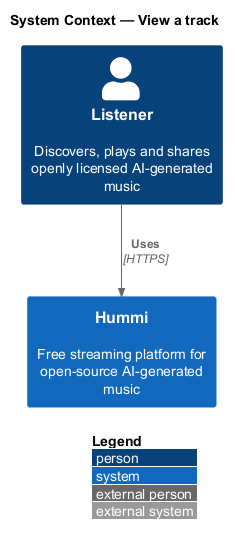
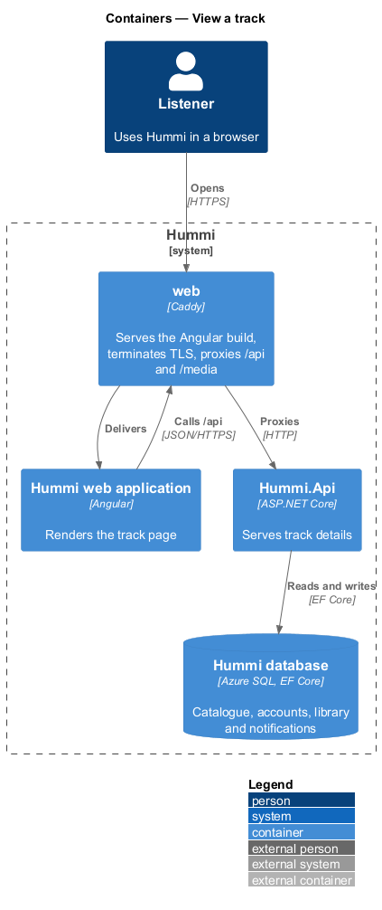
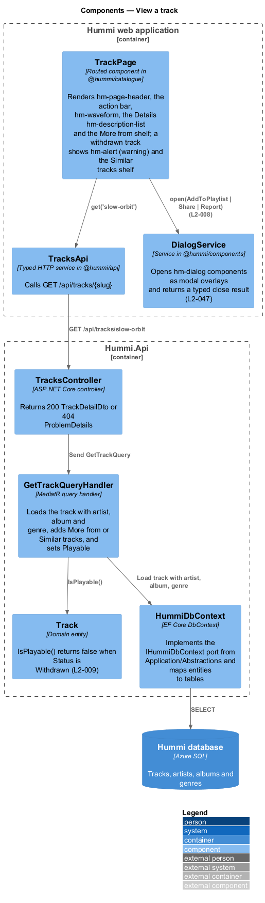
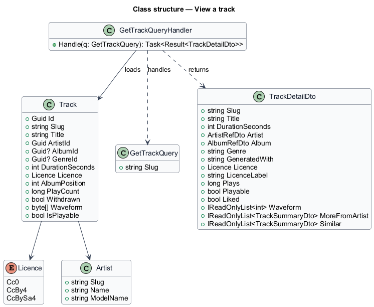
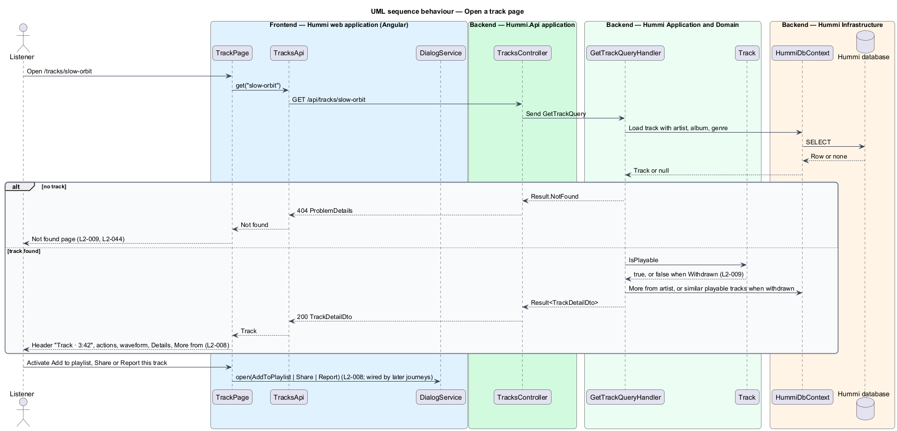

# View a track

## Overview

The catalogue subsystem presents what Hummi carries: tracks, artists, albums and their licences. The
track page (`/tracks/{slug}`) is the canonical page of one track. It shows the track's artist and
album, its waveform, a details list that names its source (the track's Pixabay page), the
open-weights model that generated it when one is known, and its licence, and a shelf of more tracks by
the same artist. From here the listener plays, likes, adds to
a playlist, shares or reports the track.

- **open-weights model** — generative model whose weights are publicly released, named in "Generated with" when known; Pixabay tracks name none (ADR 0021)
- **source** — the track's Pixabay Music page, linked from the "Source" row in a new tab
- **withdrawn track** — track its creator removed from playback; its page remains, with a notice and similar tracks
- **waveform** — precomputed amplitude peaks drawn as bars, filled up to the played proportion

A slug that matches no track yields the Not found page (`L2-044`): the API answers 404 and the page renders
the Not found composition in place. Slugs are lowercase words joined by hyphens, derived from the title
when the track is created (ADR 0007).

## Description

The slice is one read query and the page that renders it; actions delegate to other subsystems.

**Frontend — Hummi web application (Angular)**

- **`TrackPage`** — Routed component in @hummi/catalogue. Renders `hm-page-header`, `hm-hero` with the action bar and `hm-waveform` (played proportion from `PlayerStore` while this track is loaded), the Details `hm-description-list` and the More from shelf; a withdrawn track shows `hm-alert` (warning) and the Similar tracks shelf and has no Play
- **`TracksApi`** — Typed HTTP service in @hummi/api. Calls `GET /api/tracks/{slug}`
- **`DialogService`** — Service in @hummi/components. Opens `hm-dialog` components as modal overlays and returns a typed close result (`L2-047`). Not built yet: Like, Add to playlist, Share and Report render now and open their dialogs when the library, sharing and reporting journeys land

**Backend — Hummi.Api application**

- **`TracksController`** — ASP.NET Core controller. Returns 200 `TrackDetailDto` or 404 ProblemDetails

**Backend — Hummi Application and Domain**

- **`GetTrackQueryHandler`** — MediatR query handler. Loads the track with artist, published album and genre, and sets `Playable`. A playable track gets More from: up to 6 of the artist's other playable tracks, most played first. A withdrawn track gets Similar tracks instead: up to 6 playable tracks of the same genre (of the same artist when it has no genre), most played first. "Generated with" is the artist's `ModelName` (null when unknown); `SourceUrl` is the track's Pixabay page
- **`Track`** — Domain entity. `IsPlayable` is false once `Withdrawn` (`L2-009`); `Licence` is exactly one licence, `Pixabay` for imported tracks; `Waveform` holds 64 precomputed peaks from 0 to 100

**Backend — Hummi Infrastructure**

- **`HummiDbContext`** — EF Core DbContext. Implements the `IHummiDbContext` port from `Application/Abstractions` and maps entities to tables
- **`Hummi database`** — Azure SQL. Tracks, artists, albums and genres

## Requirements

The feature realizes the following level-2 (L2) requirements. Each L2 requirement refines a level-1 (L1) requirement in `docs/specs/L1.md`; the text is copied from `docs/specs/L2.md`.

| L2 ID | Refines (L1) | Requirement |
|-------|--------------|-------------|
| `L2-008` | `L1-003` | **Track page.** 1. Given the track Feathers Up, when a listener opens `/tracks/feathers-up`, then the heading is "Feathers Up", the subtitle is "Kaiso Collective · Mas on the Avenue" with the artist linking to the artist page, and the overline is "Track · 3:42". 2. Given the track page, when it loads, then it shows the actions "Play", "Like Feathers Up", "Add to playlist", "Share" and "Report this track", and a waveform showing the played proportion. 3. Given the track page, when it loads, then a "Details" list shows Artist (link), Album (link, only when the track is on an album), Genre (only when classified), "Generated with" (only when the model is known, e.g. "openmusic-3b (open weights)"), Source (for a Pixabay track, "Pixabay" linking to the track's Pixabay page in a new tab), Licence (link to the licence page, e.g. "Pixabay Content License") and Plays (e.g. "128,904"). 4. Given the track page, when it loads, then a "More from {artist}" shelf lists other tracks by the same artist. 5. Given "Add to playlist", "Share" or "Report this track", when activated, then the matching dialog opens (L2-020, L2-025, L2-038). |
| `L2-009` | `L1-003` | **Withdrawn track.** 1. Given a track its creator withdrew, when a listener opens its page, then a warning reads "This track is no longer available" with "Its creator withdrew it, so we can’t play it. It was licensed {licence}; copies already shared keep that licence." and the track cannot be played. 2. Given a withdrawn track, when its page loads, then a "Similar tracks" shelf lists playable tracks. 3. Given a track id that does not exist, when a listener opens it, then the Not found page (L2-044) is shown. |

## Diagrams

### System context

A listener opens a track page in Hummi. No external system takes part.

### Containers

The Angular application is delivered by the `web` container, which also proxies `/api` to `Hummi.Api`; the API reads and writes the Hummi database through EF Core.

### Components

`TrackPage` calls `TracksApi`; `TracksController` sends `GetTrackQuery`, whose handler loads the `Track` entity through `HummiDbContext`.

### Class structure

`Track` holds its slug, `Licence`, album position and waveform peaks; the model name lives on `Artist`. `GetTrackQueryHandler` projects them into `TrackDetailDto`, including the `Playable` flag from `IsPlayable`.

### Behaviour — open a track page

The handler resolves the slug, asks the `Track` entity whether it is playable and selects the shelf accordingly. Actions open dialogs owned by the library, sharing and reporting subsystems.

