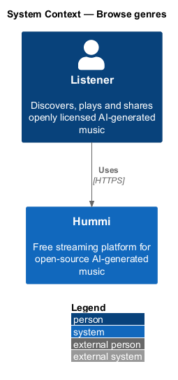
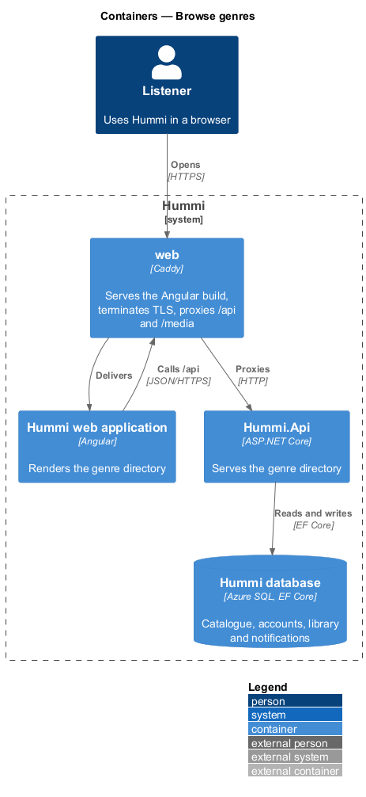
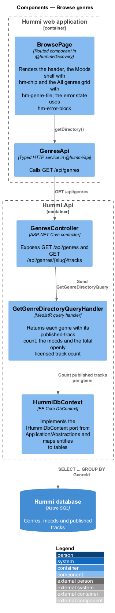
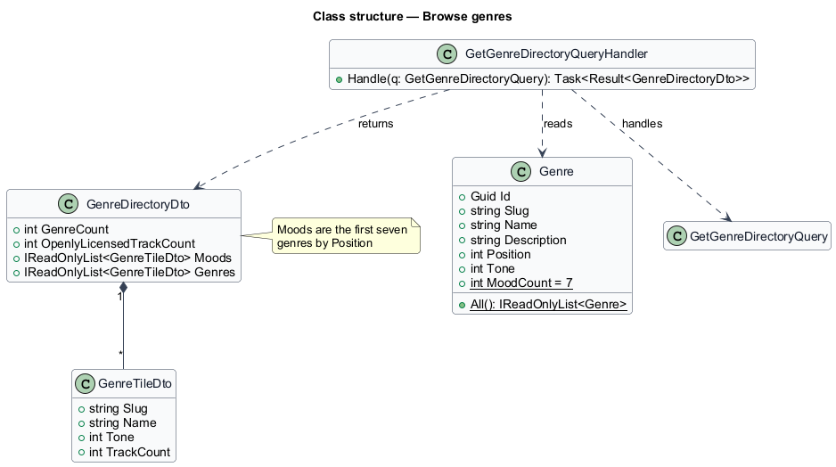
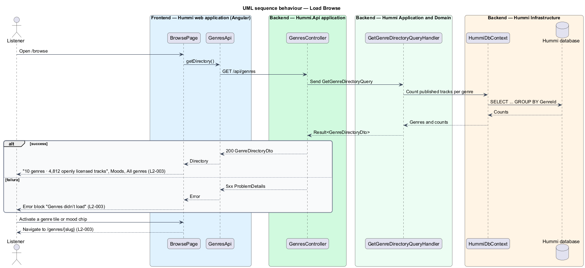

# Browse genres

## Overview

Browse (`/browse`) is the directory of the catalogue. It lists every genre Hummi carries and a set of
moods, and is the target of every "Browse genres" button on empty states across the product.

- **genre** — named category a track belongs to, one of ten fixed values (Soca, Kids, Steelpan & Calypso, Dancehall, Island chill, Parang, Chutney, Reggae, Zouk, Rapso), seeded with the schema by the `AddGenres` migration
- **mood** — chip on the Moods shelf that opens a genre page; the Moods shelf shows the first seven genres in Browse order (`Genre.MoodCount`). Curating moods beyond that mapping is deferred
- **openly licensed track** — published track carrying CC0 1.0, CC BY 4.0 or CC BY-SA 4.0. Every published Hummi track carries one, so the count is the count of tracks that are not withdrawn

Browse always has content, so it defines a loading and an error state but no empty state.

## Description

Browse is a single read query plus a page that renders the result.

**Frontend — Hummi web application (Angular)**

- **`BrowsePage`** — Routed component in @hummi/discovery (`BrowseComponent`, `/browse`). Renders `hm-page-header`, the Moods shelf of `hmChip` links and the All genres grid of `hm-genre-tile` inside `hm-shelf`; skeleton tiles while loading; the error state uses `hm-error-block`
- **`GenresApi`** — Typed HTTP service in @hummi/api. Calls `GET /api/genres`

**Backend — Hummi.Api application**

- **`GenresController`** — ASP.NET Core controller. Exposes `GET /api/genres` and `GET /api/genres/{slug}/tracks`

**Backend — Hummi Application and Domain**

- **`GetGenreDirectoryQueryHandler`** — MediatR query handler. Returns each genre in `Position` order with its published-track count and cover `Tone` (1 to 6), the first seven as moods, and the total openly licensed track count

**Backend — Hummi Infrastructure**

- **`HummiDbContext`** — EF Core DbContext. Implements the `IHummiDbContext` port from `Application/Abstractions` and maps entities to tables
- **`Hummi database`** — Azure SQL. The `Genres` table and published tracks, each with a nullable `GenreId`

## Requirements

The feature realizes the following level-2 (L2) requirements. Each L2 requirement refines a level-1 (L1) requirement in `docs/specs/L1.md`; the text is copied from `docs/specs/L2.md`.

| L2 ID | Refines (L1) | Requirement |
|-------|--------------|-------------|
| `L2-003` | `L1-001` | **Browse genres and moods.** 1. Given the catalogue, when a listener opens Browse (`/browse`), then the heading is "Browse" and the subtitle shows the genre count and openly licensed track count (e.g. "10 genres · 4,812 openly licensed tracks"). 2. Given Browse, when it loads, then a "Moods" shelf shows genre chips and an "All genres" shelf shows a tile for each of the ten genres: Soca, Kids, Steelpan & Calypso, Dancehall, Island chill, Parang, Chutney, Reggae, Zouk, Rapso. 3. Given any genre tile or chip, when the listener activates it, then the Genre page for that genre opens. 4. Given Browse fails to load, when it renders, then the error block title is "Genres didn’t load". Browse has no empty state. |

## Diagrams

### System context

A listener browses the catalogue in Hummi. No external system takes part.

### Containers

The Angular application is delivered by the `web` container, which also proxies `/api` to `Hummi.Api`; the API reads and writes the Hummi database through EF Core.

### Components

`BrowsePage` calls `GenresApi`; `GenresController` sends `GetGenreDirectoryQuery` to its handler, which reads through `HummiDbContext`.

### Class structure

`Genre` is a catalogue entity with ten fixed instances (`Genre.All()`); the handler projects them into `GenreDirectoryDto` with one `GenreTileDto` per genre and per mood.

### Behaviour — load Browse

The page issues one request. The handler counts published tracks per genre in the database, and the page renders either the directory or the error block of `L2-003`.

