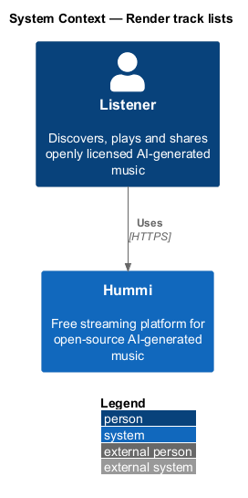
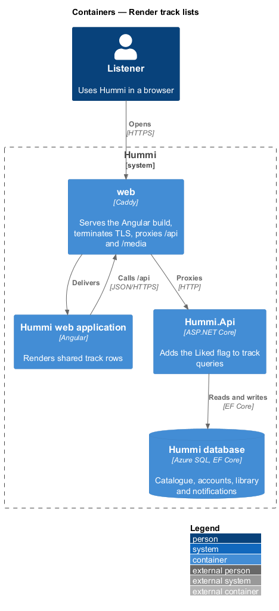
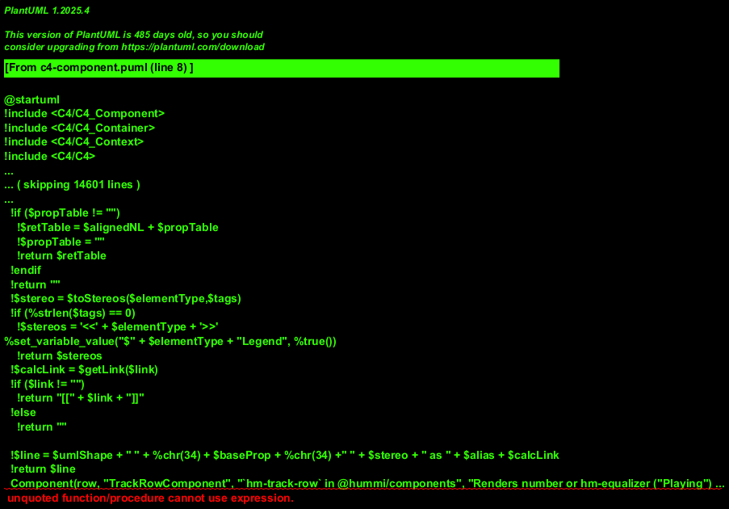
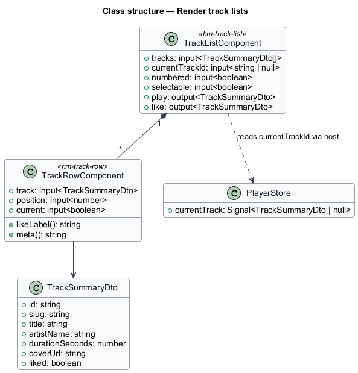
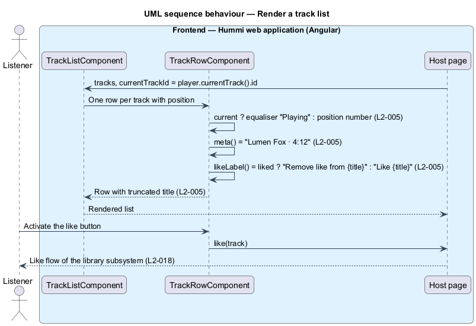

# Render track lists

## Overview

A track list is the row-based list of tracks that appears on Home, Genre, Search, Track, Artist,
Album, Playlist and Queue. It is one shared component so that every list numbers, marks, truncates
and labels its rows the same way.

- **current row** — row whose track is the one `PlayerStore` is playing; it shows an animated equaliser instead of its number
- **row actions** — like button and More actions menu at the end of each row

The list holds no data of its own. Its rows come from the page that hosts it; the like state of each
row comes from the `liked` flag in `TrackSummaryDto`, and the current row from `PlayerStore`.

## Description

The slice is frontend-only apart from the `Liked` flag, which every track-returning query computes for the signed-in listener.

**Frontend — Hummi web application (Angular)**

- **`TrackListComponent`** — `hm-track-list` in @hummi/components. Renders an ordered list of `hm-track-row`; inputs `tracks`, `currentTrackId`, `numbered`, `selectable`
- **`TrackRowComponent`** — `hm-track-row` in @hummi/components. Renders number or `hm-equalizer` ("Playing"), cover, title link, "{artist} · {duration}", the like `hm-icon-button` and the More actions `hm-menu`; the title truncates with `text-overflow: ellipsis`
- **`Host page`** — Any feature page. Supplies `TrackSummaryDto[]` and reacts to `like`, `play` and `more` outputs
- **`PlayerStore`** — Signal store in @hummi/api. Owns the queue, the current track, position and play state, and drives the `HTMLAudioElement`

**Backend — Hummi Application and Domain**

- **`LikedTrackProjection`** — EF Core query extension in Application. `ProjectToSummary(listenerId)` adds `Liked = Likes.Any(l => l.ListenerId == listenerId)` to every track query

## Requirements

The feature realizes the following level-2 (L2) requirements. Each L2 requirement refines a level-1 (L1) requirement in `docs/specs/L1.md`; the text is copied from `docs/specs/L2.md`.

| L2 ID | Refines (L1) | Requirement |
|-------|--------------|-------------|
| `L2-005` | `L1-001` | **Track list rows.** 1. Given a track list, when it renders, then each row shows its position number, cover, title linking to the track page, and "{artist} · {duration}" (e.g. "Kaiso Collective · 3:42"). 2. Given the currently playing track is in the list, when it renders, then that row is marked current and shows an animated equaliser labelled "Playing" instead of its number. 3. Given a row, when it renders, then it has a like button labelled "Like {title}" (not pressed), or "Remove like from {title}" (pressed) if already liked, and a "More actions for {title}" button. 4. Given a title too long for the row (e.g. "The Quiet Between Two Lighthouses, Revisited (Extended Dream Mix)"), when it renders, then the title is truncated without breaking the row layout. |

## Diagrams

### System context

Every page that lists tracks uses this component. No external system takes part.

### Containers

The Angular application is delivered by the `web` container, which also proxies `/api` to `Hummi.Api`; the API reads and writes the Hummi database through EF Core.

### Components

A host page passes rows into `TrackListComponent`, which composes `TrackRowComponent`; the host reads the current track from `PlayerStore`.

### Class structure

`TrackListComponent` composes one `TrackRowComponent` per `TrackSummaryDto`. The row derives its labels; `PlayerStore` supplies the current track through the host.

### Behaviour — render a track list

Each row derives its labels from `TrackSummaryDto` and its current state from the host's `currentTrackId`. The like output leaves persistence to the library subsystem (`L2-018`).

