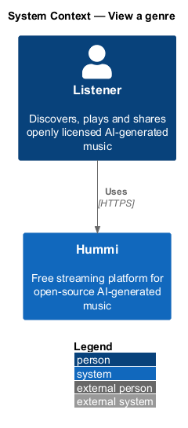
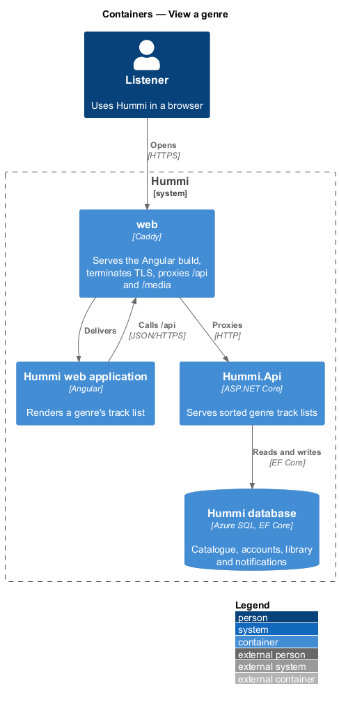
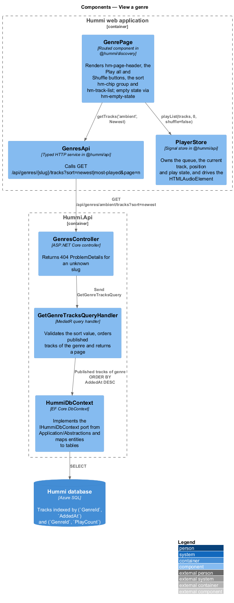
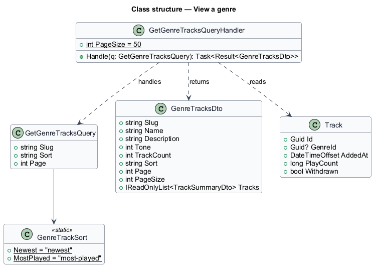
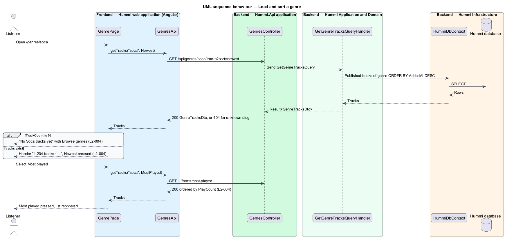
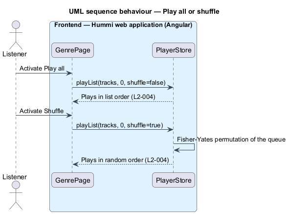

# View a genre

## Overview

A genre page (`/genres/{slug}`) lists the published tracks of one genre. It is reached from Browse,
from mood chips and from the genre field of a track page. The listener can sort the list by newest or
most played, play the whole list in order or shuffle it.

- **sort order** — `newest` (date added, descending; the default) or `most-played` (play count, descending)
- **shuffle** — playback order produced by a uniform random permutation (Fisher–Yates) of the loaded page of the list

## Description

The slice reads a paged, sorted track list and hands it to the shared player.

**Frontend — Hummi web application (Angular)**

- **`GenrePage`** — Routed component in @hummi/discovery (`GenreComponent`, `/genres/:slug`). Renders `hm-page-header`, the Play all and Shuffle `hmButton`s, the sort `hmChip` toggle buttons and `hm-track-list`; empty state via `hm-empty-state`; failure via `hm-error-block` ("This genre didn’t load"). It loads the first page; later pages are not yet requested
- **`GenresApi`** — Typed HTTP service in @hummi/api. Calls `GET /api/genres/{slug}/tracks?sort=newest|most-played&page=n`
- **`PlayerStore`** — Signal store in @hummi/api. Owns the queue, the current track, position and play state, and drives the `HTMLAudioElement`. `playFrom(list, 0)` backs Play all; `playShuffled(list)` backs Shuffle

**Backend — Hummi.Api application**

- **`GenresController`** — ASP.NET Core controller. Returns 404 ProblemDetails (`GENRE_NOT_FOUND`) for an unknown slug and 422 (`GENRE_QUERY_INVALID`) for an unknown sort or a page below 1

**Backend — Hummi Application and Domain**

- **`GetGenreTracksQueryHandler`** — MediatR query handler. Validates the sort and page, orders published tracks of the genre in the database and returns a page. Page size: 50 (`GetGenreTracksQueryHandler.PageSize`)

**Backend — Hummi Infrastructure**

- **`HummiDbContext`** — EF Core DbContext. Implements the `IHummiDbContext` port from `Application/Abstractions` and maps entities to tables
- **`Hummi database`** — Azure SQL. Tracks indexed by (`GenreId`, `AddedAt`) and (`GenreId`, `PlayCount`)

## Requirements

The feature realizes the following level-2 (L2) requirements. Each L2 requirement refines a level-1 (L1) requirement in `docs/specs/L1.md`; the text is copied from `docs/specs/L2.md`.

| L2 ID | Refines (L1) | Requirement |
|-------|--------------|-------------|
| `L2-004` | `L1-001` | **Genre page.** 1. Given the Soca genre, when a listener opens `/genres/soca` (or chooses "Soca" in the header), then the heading is "Soca" and the subtitle shows the track count and genre description (e.g. "1,204 tracks · road-march riddims, J’ouvert mornings and fete anthems"). 2. Given the Genre page, when it loads, then it shows "Play all" and "Shuffle" buttons and the sort chips "Newest" (pressed by default) and "Most played", above a numbered track list. 3. Given the sort chips, when the listener selects "Most played", then that chip is pressed, "Newest" is not, and the list is ordered by play count. 4. Given "Play all", when activated, then the genre's tracks play in list order; given "Shuffle", when activated, then they play in random order. 5. Given a genre with no tracks, when the page loads, then it shows "No Soca tracks yet" with "New tracks arrive every day. Try a neighbouring genre while you wait." and a "Browse genres" button. |

## Diagrams

### System context

A listener opens a genre in Hummi. No external system takes part.

### Containers

The Angular application is delivered by the `web` container, which also proxies `/api` to `Hummi.Api`; the API reads and writes the Hummi database through EF Core.

### Components

`GenrePage` calls `GenresApi` and hands lists to `PlayerStore`. `GenresController` sends `GetGenreTracksQuery` to its handler.

### Class structure

`GetGenreTracksQuery` carries a `GenreTrackSort` value; the handler rejects other values with a 422. The handler reads `Track` rows and returns `GenreTracksDto`.

### Behaviour — load and sort a genre

The sort chip changes the query parameter, and the handler orders by `AddedAt` or `PlayCount` in the database rather than in the browser.

### Behaviour — play all or shuffle

Both buttons hand the loaded list to `PlayerStore`; Shuffle permutes the queue before playback starts.

