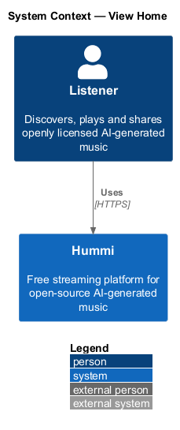
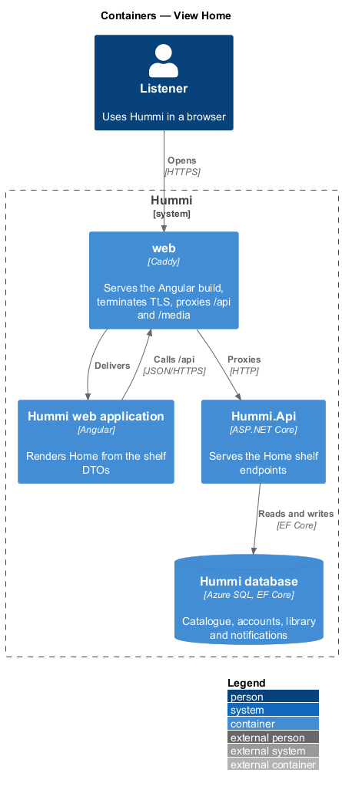
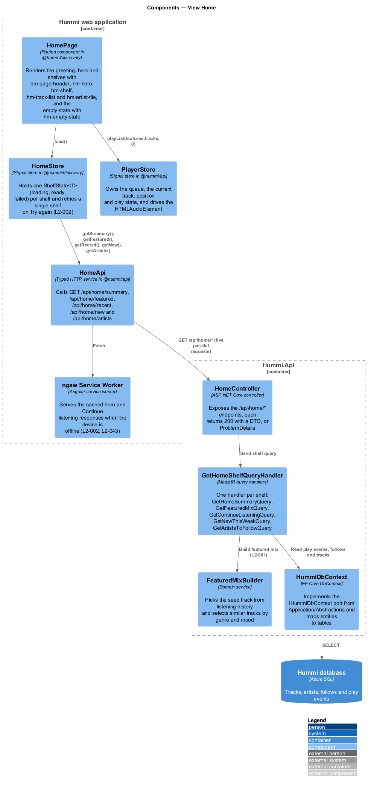
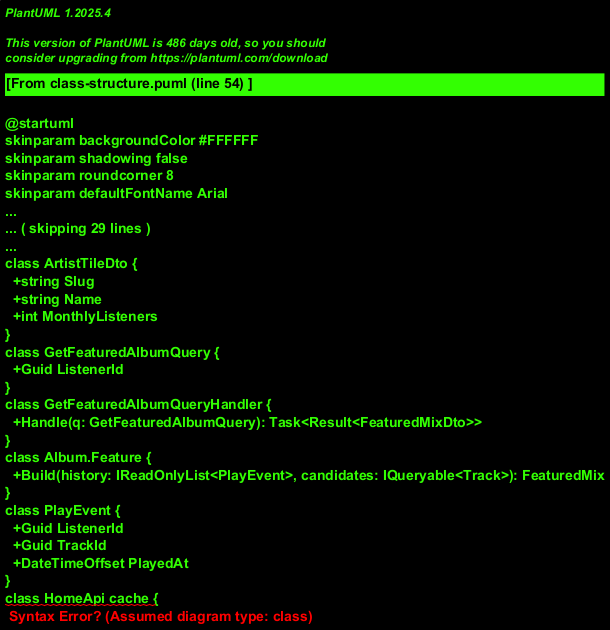
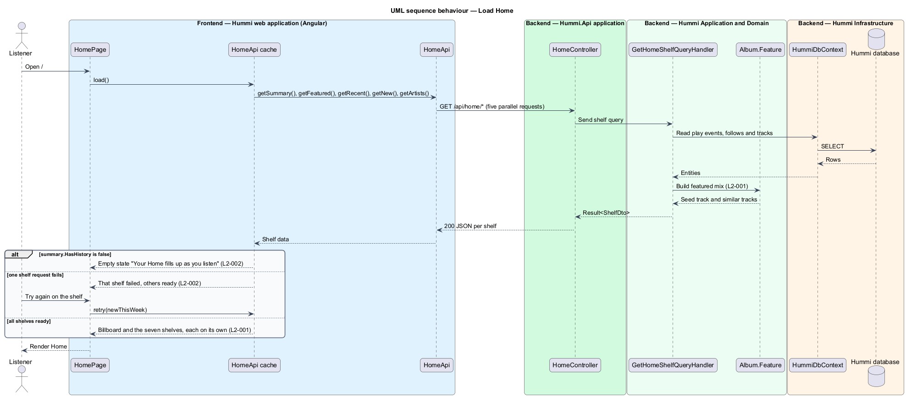
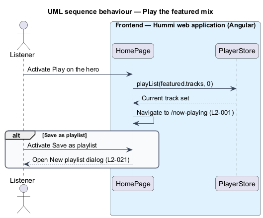
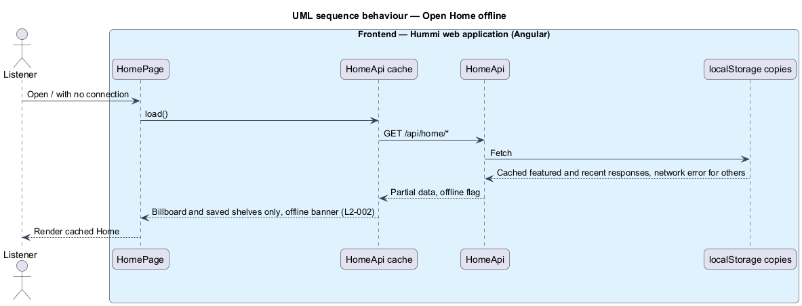

# View Home

## Overview

Hummi is a free streaming platform for openly licensed music generated by open-weights models. The
discovery subsystem helps a listener find something to play. Home (`/`) is its entry point and the
first page a listener sees.

Home is personal. For a signed-in listener it greets them by name and time of day and arranges four
blocks: a featured mix, recently played tracks, new releases and artists to follow. A listener with
no history sees an empty state that points to Browse instead. Each block loads independently, so a
failure in one shelf leaves the rest of the page usable, and an offline device shows only what it
cached earlier.

- **featured mix** — generated list of tracks similar to one seed track, offered as the Home hero
- **shelf** — titled horizontal or vertical group of tiles or track rows on a page
- **listening history** — ordered record of tracks a listener has played, derived from play events
- **partial state** — page state in which one shelf failed to load while the others rendered

## Description

Home is a read-only vertical slice. The page fetches each shelf separately so a shelf failure does not fail the page.

**Frontend — Hummi web application (Angular)**

- **`HomePage`** — Routed component in @hummi/discovery. Renders the greeting, hero and shelves with `hm-page-header`, `hm-hero`, `hm-shelf`, `hm-track-list` and `hm-artist-tile`, and the empty state with `hm-empty-state`
- **`HomeStore`** — Signal store in @hummi/discovery. Holds one `ShelfState<T>` (`loading`, `ready`, `failed`) per shelf and retries a single shelf on Try again (`L2-002`)
- **`HomeApi`** — Typed HTTP service in @hummi/api. Calls `GET /api/home/summary`, `/api/home/featured`, `/api/home/recent`, `/api/home/new` and `/api/home/artists`
- **`ngsw Service Worker`** — Angular service worker. Serves the cached hero and Continue listening responses when the device is offline (`L2-002`, `L2-043`)
- **`PlayerStore`** — Signal store in @hummi/api. Owns the queue, the current track, position and play state, and drives the `HTMLAudioElement`

**Backend — Hummi.Api application**

- **`HomeController`** — ASP.NET Core controller. Exposes the `/api/home/*` endpoints; each returns 200 with a DTO, or ProblemDetails

**Backend — Hummi Application and Domain**

- **`GetHomeShelfQueryHandler`** — MediatR query handlers. One handler per shelf: `GetHomeSummaryQuery`, `GetFeaturedMixQuery`, `GetContinueListeningQuery`, `GetNewThisWeekQuery`, `GetArtistsToFollowQuery`
- **`FeaturedMixBuilder`** — Domain service. Picks the seed track from listening history and selects similar tracks by genre and mood. Similarity rule: <TO SUPPLY>
- **`IClock`** — Application port. Supplies the current UTC time so time rules are testable

**Backend — Hummi Infrastructure**

- **`HummiDbContext`** — EF Core DbContext. Implements the `IHummiDbContext` port from `Application/Abstractions` and maps entities to tables
- **`Hummi database`** — Azure SQL. Tracks, artists, follows and play events

## Requirements

The feature realizes the following level-2 (L2) requirements. Each L2 requirement refines a level-1 (L1) requirement in `docs/specs/L1.md`; the text is copied from `docs/specs/L2.md`.

| L2 ID | Refines (L1) | Requirement |
|-------|--------------|-------------|
| `L2-001` | `L1-001` | **Home default content.** 1. Given a listener opens Home, when it loads, then the billboard shows the kicker "New album · Carnival 2025", the title "Mas on the Avenue", the artist "Kaiso Collective", the blurb "Twelve road-ready tracks recorded live on the Avenue — brass, iron and a whole band of feathers.", the meta "12 tracks · 46 min · Free to stream and share", and the buttons "Play album" and "Add to library". 2. Given the billboard, when it renders, then its artwork carries an "Opens with" chip showing the cover and title of the album's lead track (e.g. "Feathers Up"). 3. Given the billboard, when the listener activates "Play album", then the lead track plays, the button reads "Pause", and the player bar appears (L2-013); when they activate "Add to library", then the toast "Added Mas on the Avenue to your library" is shown (L2-041). 4. Given Home has loaded, when it renders below the billboard, then it shows the shelves "Recently added" (note "Fresh this week"), "Top 10 on Hummi this week" (note "Most played across the islands"), "Soca" (note "Road march contenders"), "Kids" (note "Sing-alongs and bedtime songs"), "Steelpan & Calypso", "Dancehall" and "Island chill" (note "For slow afternoons"), in that order, each with a "See all" link. 5. Given the "Top 10 on Hummi this week" shelf, when it renders, then each card is preceded by its outlined rank numeral from 1 to 10. 6. Given a shelf wider than the viewport, when the listener hovers it, then "Previous" and "Next" arrow buttons page it horizontally; given the "Recently added" shelf, then its cards do not carry the "New" badge, while cards in other shelves do when the track is new. 7. Given a card, when the listener hovers or focuses it, then a play button appears on its cover; given the card is the current track, then its title is coral and the play button stays visible, with an animated equaliser before the title only while it plays. 8. Given Home, when it renders, then the footer reads "Every track on Hummi is free to stream and free to share." and "hummi.fm — free music, made in the open." |
| `L2-002` | `L1-001` | **Home empty, partial and offline states.** 1. Given a listener with no listening history, when they open Home, then it shows "Your Home fills up as you listen" with "Play a few tracks and we’ll line up what to hear next. Pick a genre to begin.", a "Browse genres" button to Browse, and a "Start with a genre" shelf of six genre tiles. 2. Given the "Soca" shelf fails to load while the rest succeeds, when Home renders, then that shelf shows "Soca didn’t load" with "Everything else on this page still works. Try the shelf again." and a "Try again" button, and the billboard and the other shelves still render. 3. Given the device is offline, when Home renders, then a warning banner reads "You are offline. Showing what was saved on this device. Playing tracks you have not heard recently needs a connection." and only the billboard and the cached shelves are shown. |

## Diagrams

### System context

A listener opens Home in Hummi. The slice involves no external system.

### Containers

The Angular application is delivered by the `web` container, which also proxies `/api` to `Hummi.Api`; the API reads and writes the Hummi database through EF Core.

### Components

`HomePage` reads `HomeStore`, which calls `HomeApi`. In the API, `HomeController` sends one query per shelf; the featured-mix handler delegates track selection to `FeaturedMixBuilder`.

### Class structure

Each shelf has a DTO. `GetFeaturedMixQueryHandler` builds `FeaturedMixDto` through `FeaturedMixBuilder`, which reads `PlayEvent` rows. `HomeStore` holds one signal per shelf.

### Behaviour — load Home

`HomeStore` issues the five shelf requests in parallel. Each response settles its own `ShelfState`, so the page renders the empty, partial or full layout of `L2-001` and `L2-002` from the combined state.

### Behaviour — play the featured mix

The hero hands its track list to the shared `PlayerStore` and navigates to Now playing; Save as playlist reuses the New playlist dialog of the library subsystem.

### Behaviour — open Home offline

With no network, the service worker answers from its data cache. Only the hero and Continue listening are cached, so `HomeStore` renders those two shelves under the offline banner.

