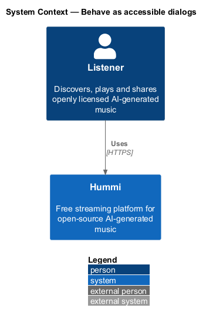
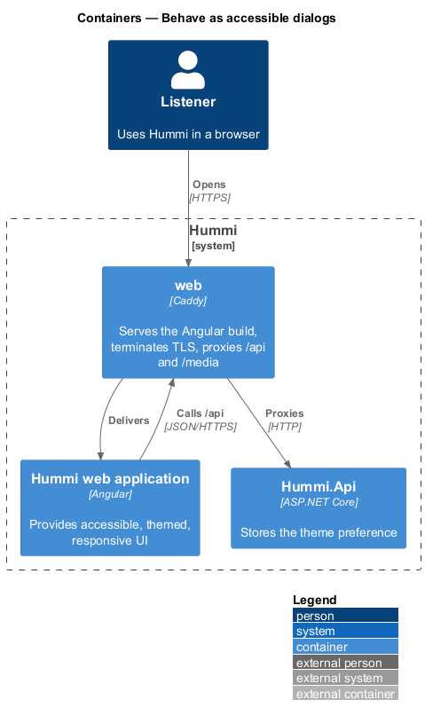
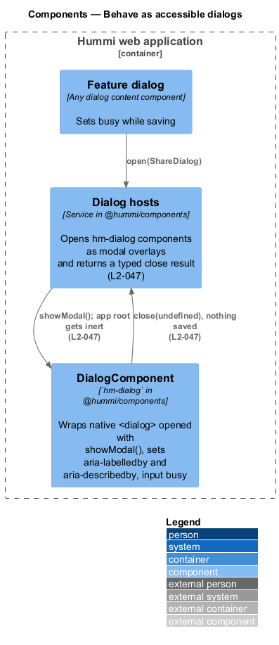
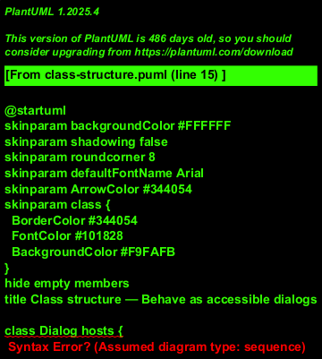
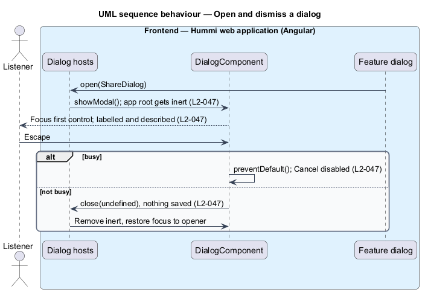

# Behave as accessible dialogs

## Overview

Every dialog in Hummi behaves the same way: it is modal, labelled by its title, described by its
description, and the page behind it is inert. Escape or Close dismisses a dialog without saving
unless the dialog is busy, in which case Cancel is disabled until the operation finishes.

- **inert** — state in which content cannot receive focus or input, set with the `inert` attribute
- **busy dialog** — dialog with an operation in flight

## Description

One component and one service implement the contract; feature dialogs only supply content.

**Frontend — Hummi web application (Angular)**

- **`Dialog hosts`** — App-wide dialogs open through services in @hummi/api (`PlaylistDialogs`, `ShareDialogs`, `ReportDialogs`, `AccountDialogs`, `SignInGate`) and render in the shell; page dialogs render in their page. `hm-dialog` makes everything else inert (`L2-047`, ADR 0019)
- **`DialogComponent`** — `hm-dialog` in @hummi/components. Wraps native `<dialog>` opened with `showModal()`, sets `aria-labelledby` and `aria-describedby`, input `busy`
- **`Feature dialog`** — Any dialog content component. Sets `busy` while saving

## Requirements

The feature realizes the following level-2 (L2) requirements. Each L2 requirement refines a level-1 (L1) requirement in `docs/specs/L1.md`; the text is copied from `docs/specs/L2.md`.

| L2 ID | Refines (L1) | Requirement |
|-------|--------------|-------------|
| `L2-047` | `L1-012` | **Dialog behaviour.** 1. Given any dialog, when it opens, then it is modal, labelled by its title and described by its description, and the page behind it is inert. 2. Given any dialog that is not busy, when the listener presses Escape or activates "Close", then it closes without saving. 3. Given a busy dialog, when it renders, then "Cancel" is disabled until the operation finishes. |

## Diagrams

### System context

Any listener uses dialogs in Hummi. No external system takes part.

### Containers

Dialogs run entirely in the Angular application.

### Components

Feature content opens a dialog through its service or its own state; either way `DialogComponent` renders it.

### Class structure

`DialogComponent` makes the background inert, traps Tab and emits dismiss; each dialog ignores dismiss while busy and disables Cancel.

### Behaviour — open and dismiss a dialog

Native `showModal()` provides modality and the top layer; the service also sets `inert` on the app root and restores focus. The `cancel` event is blocked while `busy` is true.

