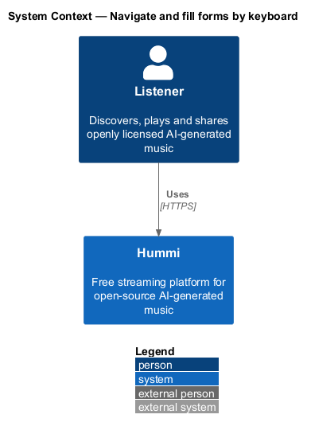
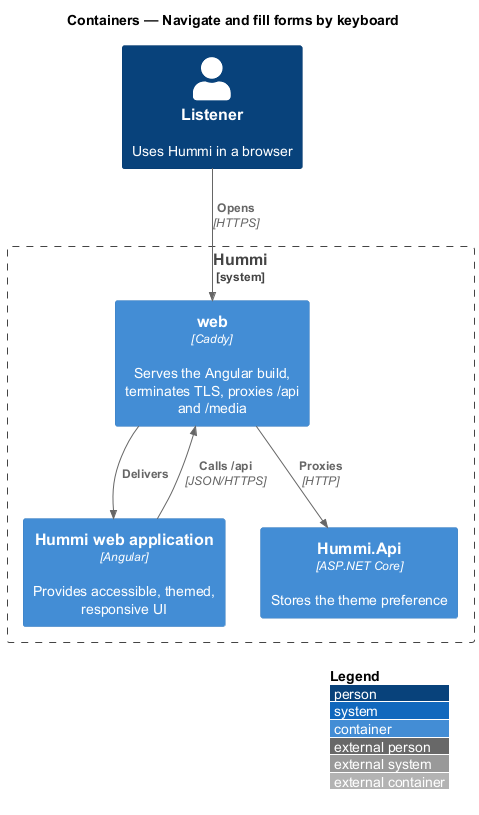
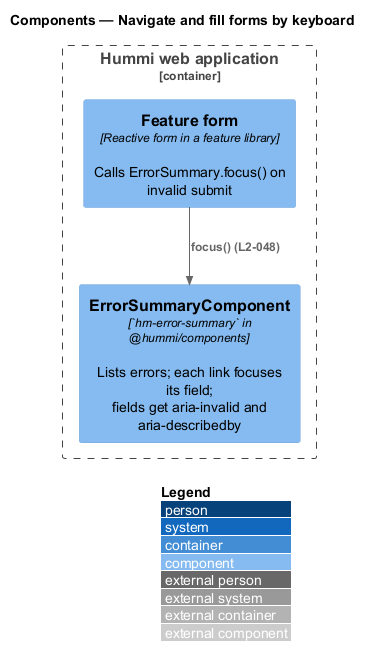
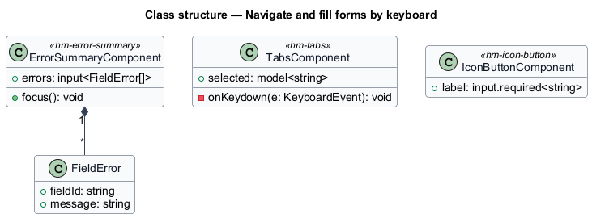
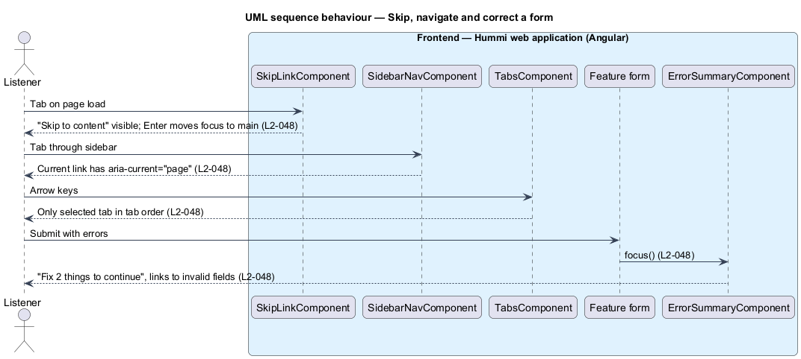

# Navigate and fill forms by keyboard

## Overview

Hummi is fully operable by keyboard. A Skip to content link is the first Tab stop; the current nav
link is marked; icon-only buttons carry text labels; tab lists use roving tab index; and a form
submitted with errors moves focus to an error summary that links to each invalid field.

- **roving tab index** — pattern in which only the selected tab has `tabindex="0"` and arrow keys move selection
- **error summary** — `hm-error-summary` listing "Fix {n} thing(s) to continue" with links to fields

Journey 02 covers L2-048 AC1 (skip link), AC3 (current nav link) and AC4 (labelled, keyboard-operable shell and player controls). AC2 (form error summary) lands with the forms of journey 07, and AC5 (tab lists) with Search (journey 05) and Library (journey 09).

## Description

The patterns are built into the component library so features inherit them.

**Frontend — Hummi web application (Angular)**

- **`SkipLinkComponent`** — Shell component in the hummi application. First focusable element; moves focus to `#main`
- **`SidebarNavComponent`** — `hm-sidebar-nav` in @hummi/components. Uses `routerLinkActive` with `ariaCurrentWhenActive="page"`
- **`TabsComponent`** — `hm-tabs` in @hummi/components. Roving tab index with Arrow, Home and End keys
- **`Feature form`** — Reactive form in a feature library. Calls `ErrorSummary.focus()` on invalid submit
- **`ErrorSummaryComponent`** — `hm-error-summary` in @hummi/components. Lists errors; each link focuses its field; fields get `aria-invalid` and `aria-describedby`

## Requirements

The feature realizes the following level-2 (L2) requirements. Each L2 requirement refines a level-1 (L1) requirement in `docs/specs/L1.md`; the text is copied from `docs/specs/L2.md`.

| L2 ID | Refines (L1) | Requirement |
|-------|--------------|-------------|
| `L2-048` | `L1-012` | **Keyboard-accessible forms and navigation.** 1. Given any page, when the listener presses Tab first, then a "Skip to content" link appears and moves focus to the main content. 2. Given a form submitted with errors, when it renders, then the error summary "Fix {n} thing(s) to continue" receives focus and each item links to its field; each invalid field is marked invalid and described by its error. 3. Given the shell, when it renders, then the current page's nav link is marked as the current page. 4. Given any interactive control, when reached with Tab, then it is focusable and operable with the keyboard; icon-only buttons carry text labels (e.g. "Previous track", "More actions for {title}"). 5. Given a tab list (Search result types, Library), when the listener uses the keyboard, then only the selected tab is in the tab order. |

## Diagrams

### System context

A keyboard user operates Hummi. No external system takes part.

### Containers

Keyboard behaviour runs entirely in the Angular application.

### Components

Shell and library components implement skip link, current link, roving tabs and error summary.

### Class structure

`ErrorSummaryComponent` composes `FieldError` entries; `IconButtonComponent` makes the label mandatory.

### Behaviour — skip, navigate and correct a form

`IconButtonComponent` requires a `label` input, so an unlabelled icon button fails to compile. The error summary receives focus on invalid submit.

