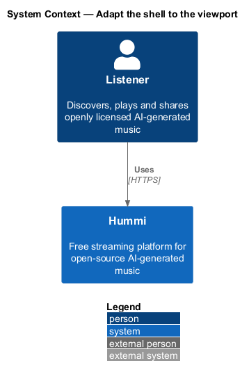
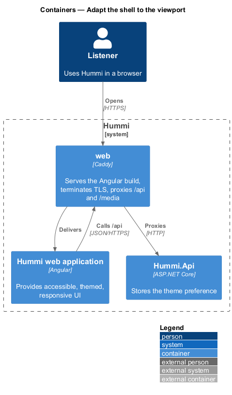
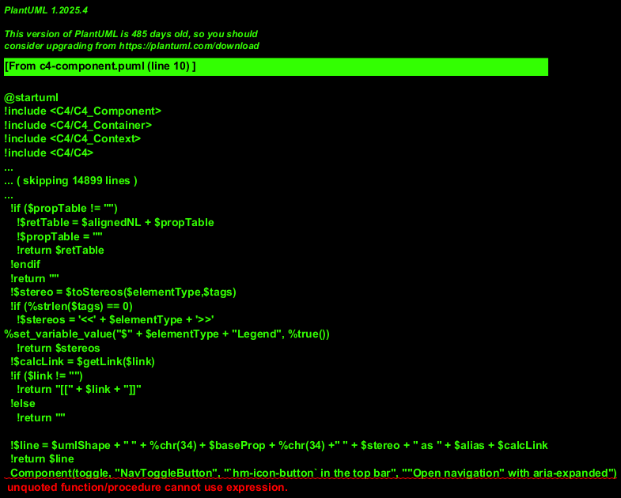
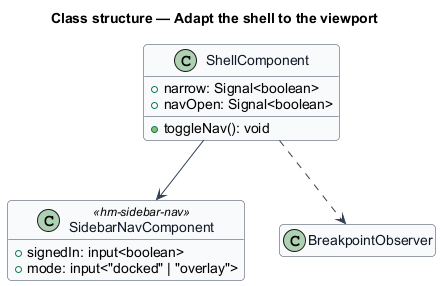
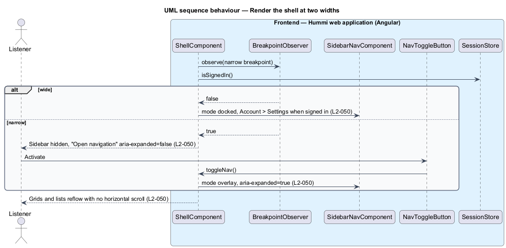

# Adapt the shell to the viewport

## Overview

The shell is the frame around every page: sidebar navigation, top bar, content and player bar. On wide
viewports the sidebar is always visible; on narrow viewports it hides behind an "Open navigation"
button. Grids, track lists and the player bar reflow so the page never scrolls horizontally.

- **narrow viewport** — width below the sidebar breakpoint <TO SUPPLY: value from `docs/design-system/` tokens>

## Description

Layout is CSS-driven; one signal tracks the narrow breakpoint for the navigation toggle.

**Frontend — Hummi web application (Angular)**

- **`ShellComponent`** — Shell component in the hummi application. CSS grid of sidebar, top bar, main and player bar
- **`BreakpointObserver`** — Angular CDK layout. Emits whether the viewport is narrow
- **`SidebarNavComponent`** — `hm-sidebar-nav` in @hummi/components. Home, Browse, Search, Library, Notifications and, signed in, Account > Settings
- **`NavToggleButton`** — `hm-icon-button` in the top bar. "Open navigation" with `aria-expanded`
- **`SessionStore`** — Signal store in @hummi/api. Holds the signed-in listener, the access token and the signed-in/signed-out state the shell reads

## Requirements

The feature realizes the following level-2 (L2) requirements. Each L2 requirement refines a level-1 (L1) requirement in `docs/specs/L1.md`; the text is copied from `docs/specs/L2.md`.

| L2 ID | Refines (L1) | Requirement |
|-------|--------------|-------------|
| `L2-050` | `L1-012` | **Responsive layout.** 1. Given a wide viewport, when the shell renders, then the primary navigation is a visible sidebar with Home, Browse, Search, Library, Notifications and, when signed in, Account > Settings. 2. Given a narrow viewport, when the shell renders, then the sidebar is hidden and an "Open navigation" button in the top bar opens it, with its expanded state reflecting whether it is open. 3. Given any viewport width, when a page renders, then tile grids, track lists and the player bar reflow to fit without horizontal page scrolling. |

## Diagrams

### System context

A listener uses Hummi on any screen size. No external system takes part.

### Containers

The layout runs entirely in the Angular application.

### Components

`ShellComponent` reads `BreakpointObserver` and `SessionStore`, and controls `SidebarNavComponent` through `NavToggleButton`.

### Class structure

`ShellComponent` holds `narrow` and `navOpen` signals and sets the `SidebarNavComponent` mode.

### Behaviour — render the shell at two widths

The breakpoint signal only switches the navigation mode; grids reflow with CSS `auto-fill` columns and `min-width: 0` so content never forces horizontal scrolling.

