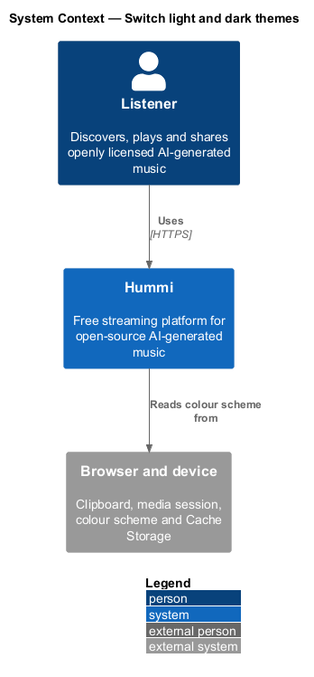
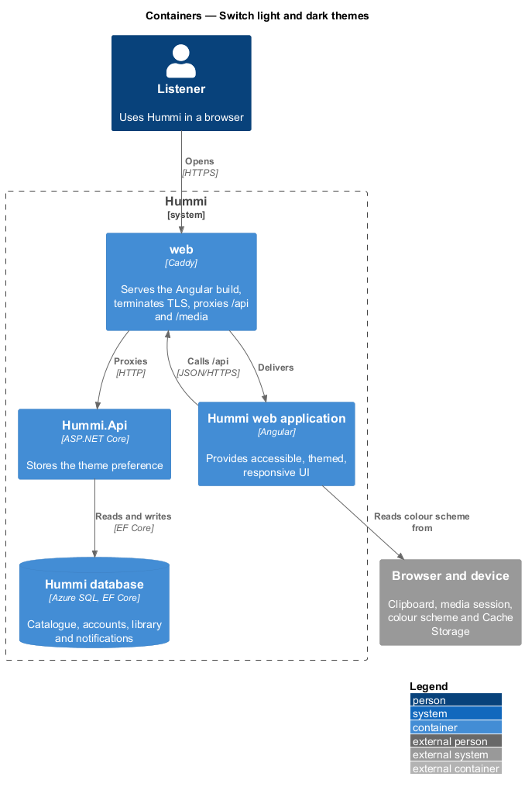
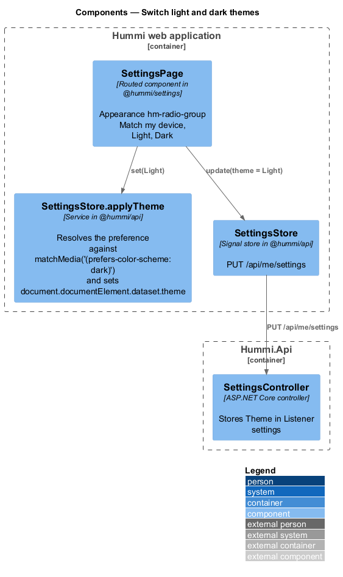
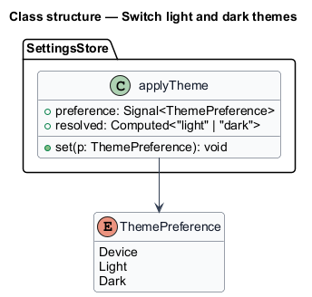
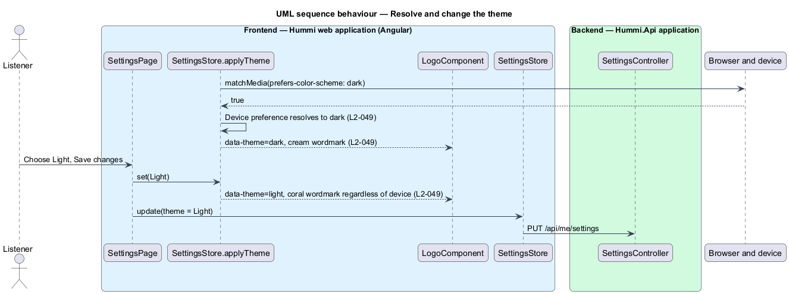

# Switch light and dark themes

## Overview

Hummi renders in a light or a dark theme. By default it matches the device's colour scheme; a
listener may fix Light or Dark in Settings > Appearance. The logo follows the theme: cream wordmark
on dark, coral wordmark on light (ADR 0001).

- **theme preference** — `Device`, `Light` or `Dark`
- **colour tokens** — CSS custom properties in `@hummi/components` styles, redefined under `[data-theme]`

## Description

A theme service sets `data-theme` on `<html>`; tokens and `hm-logo` react to it.

**Frontend — Hummi web application (Angular)**

- **`SettingsPage`** — Routed component in @hummi/settings. Appearance `hm-radio-group` Match my device, Light, Dark
- **`SettingsStore.applyTheme`** — Service in @hummi/api. Resolves the preference against `matchMedia('(prefers-color-scheme: dark)')` and sets `document.documentElement.dataset.theme`
- **`LogoComponent`** — `hm-logo` in @hummi/components. Colours the wordmark from tokens
- **`SettingsStore`** — Typed HTTP service in @hummi/api. `PUT /api/me/settings`

**Backend — Hummi.Api application**

- **`SettingsController`** — ASP.NET Core controller. Stores `Theme` in `Listener settings`

## Requirements

The feature realizes the following level-2 (L2) requirements. Each L2 requirement refines a level-1 (L1) requirement in `docs/specs/L1.md`; the text is copied from `docs/specs/L2.md`.

| L2 ID | Refines (L1) | Requirement |
|-------|--------------|-------------|
| `L2-049` | `L1-012` | **Light and dark themes.** 1. Given Settings, when it renders, then an "Appearance" section offers the "Theme" choices "Match my device" (default), "Light" and "Dark". 2. Given "Match my device", when the device uses a dark colour scheme, then Hummi renders dark; when it uses light, then Hummi renders light. 3. Given "Light" or "Dark", when chosen and saved, then Hummi renders that theme regardless of the device setting. 4. Given the dark theme, when the logo renders, then the cream wordmark is shown; given the light theme, then the coral wordmark is shown. |

## Diagrams

### System context

A listener chooses a theme in Hummi; the device supplies its colour scheme.

### Containers

The Angular application reads the device colour scheme; `Hummi.Api` stores the preference.

### Components

`SettingsPage` calls `SettingsStore.applyTheme` and `SettingsStore`; `LogoComponent` and tokens follow `data-theme`.

### Class structure

`SettingsStore.applyTheme` resolves a `ThemePreference` to a concrete theme.

### Behaviour — resolve and change the theme

The preference is applied at once in the browser and saved with the Settings command so other devices pick it up. Signed-out visitors keep the preference in `localStorage` (ADR 0016).

