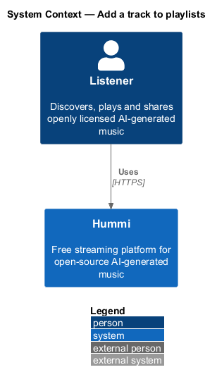
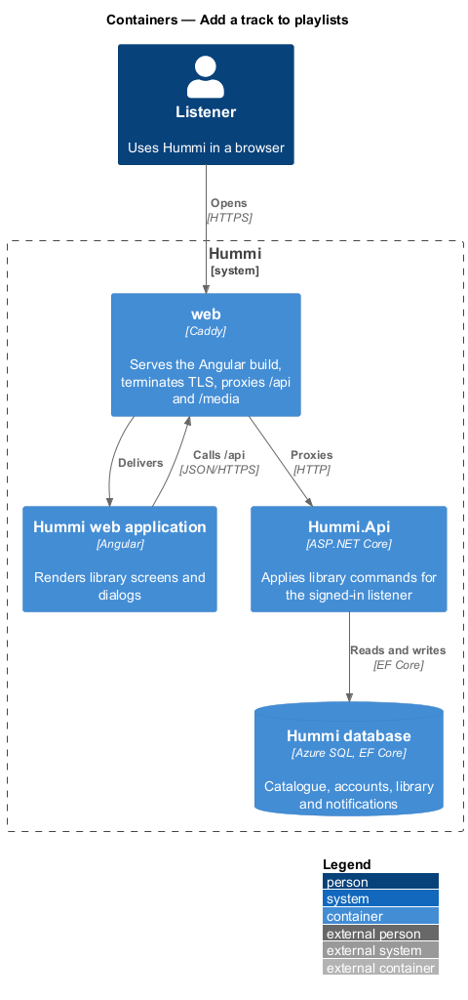
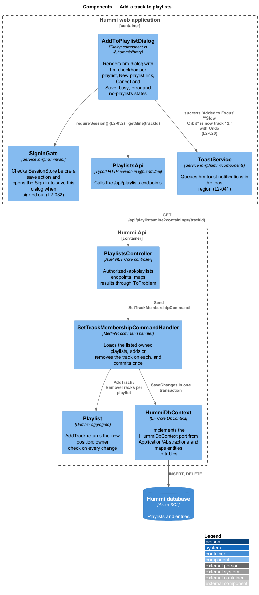
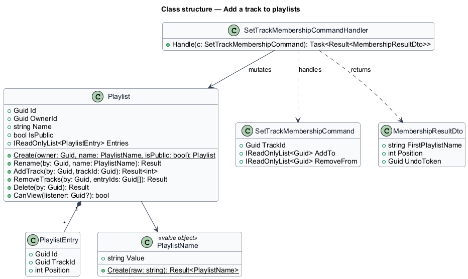
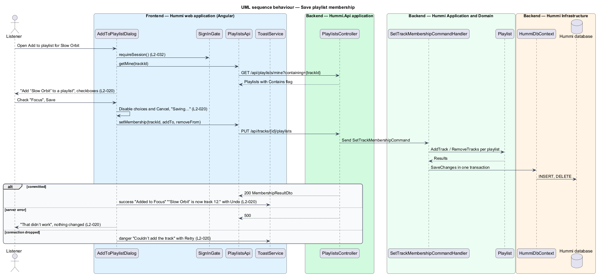

# Add a track to playlists

## Overview

"Add to playlist" puts a track into one or more of the listener's own playlists. The dialog lists every
owned playlist as a checkbox, pre-checked where the playlist already holds the track, so one Save both
adds and removes. A direct add from a row's More actions skips the dialog and warns when the track is
already present.

- **membership change** — set of playlists to add the track to and set to remove it from, computed from the checkbox diff
- **undo** — toast action that reverses the last membership change

The change is all-or-nothing: if saving fails, no playlist changes.

## Description

The dialog sends one command with the full membership change, applied in one transaction.

**Frontend — Hummi web application (Angular)**

- **`AddToPlaylistDialog`** — Dialog component in @hummi/library, opened through `PlaylistDialogs` and rendered by the shell. Renders `hm-dialog` with `hm-checkbox` per playlist, New playlist, Cancel and Save; busy, error and no-playlists states; membership mode for one track, append mode for a selection or an album (ADR 0013)
- **`SignInGate`** — Service in @hummi/api. Checks `SessionStore` before a save action and opens the Sign in to save this dialog when signed out (`L2-032`)
- **`PlaylistsApi`** — Typed HTTP service in @hummi/api. Calls the `/api/playlists` endpoints
- **`ToastService`** — Service in @hummi/components. `showCard` adds the success (Undo), warning (Add again) and danger (Retry) toasts

**Backend — Hummi.Api application**

- **`PlaylistsController`** — ASP.NET Core controller. `/api/playlists` endpoints, every change for the owner only; maps results to ProblemDetails with `ToProblem`

**Backend — Hummi Application and Domain**

- **`SetTrackMembershipCommandHandler`** — MediatR command handler. Loads the listed owned playlists, adds or removes the track on each, and commits once; `AddTracksToPlaylistCommandHandler` appends and answers 409 for a duplicate unless allowed
- **`Playlist`** — Domain aggregate. `AddTrack` returns the new position; owner check on every change

**Backend — Hummi Infrastructure**

- **`HummiDbContext`** — EF Core DbContext. Implements the `IHummiDbContext` port from `Application/Abstractions` and maps entities to tables
- **`Hummi database`** — Azure SQL. Playlists and entries

## Requirements

The feature realizes the following level-2 (L2) requirements. Each L2 requirement refines a level-1 (L1) requirement in `docs/specs/L1.md`; the text is copied from `docs/specs/L2.md`.

| L2 ID | Refines (L1) | Requirement |
|-------|--------------|-------------|
| `L2-020` | `L1-005` | **Add to playlist.** 1. Given a signed-in listener with playlists, when they open "Add to playlist" for Slow Orbit, then the dialog "Add “Slow Orbit” to a playlist" reads "Pick one or more. You can change this later." and lists their playlists as checkboxes with track counts (playlists already holding the track checked), a "New playlist" link, "Cancel" and "Save". 2. Given selections, when they activate "Save", then the track is added to the newly checked playlists and removed from unchecked ones, and the success toast "Added to {playlist}" with "“{title}” is now track {n}." and an "Undo" action is shown. 3. Given saving is in progress, when the dialog renders, then the choices are disabled, "Cancel" is disabled and the button reads "Saving…". 4. Given saving fails, when the dialog renders, then it shows "That didn’t work" with "We couldn’t save your changes. Nothing was added; try again." and no playlist is changed. 5. Given the listener has no playlists, when the dialog opens, then it reads "You don’t have a playlist yet." with "No playlists" and "Create one and “Slow Orbit” goes in it.", and the buttons "Cancel" and "Create playlist". 6. Given the track is already in the chosen playlist, when the listener adds it from a track's actions, then the warning toast "Already in this playlist" with "“{title}” is in {playlist}. Add it again?" and an "Add again" action is shown. 7. Given the connection drops while adding, when it fails, then the danger toast "Couldn’t add the track" with "The connection dropped before we could save. Nothing was added." and a "Retry" action is shown. |

## Diagrams

### System context

A signed-in listener adds a track to playlists in Hummi. No external system takes part.

### Containers

The Angular application is delivered by the `web` container, which also proxies `/api` to `Hummi.Api`; the API reads and writes the Hummi database through EF Core.

### Components

`AddToPlaylistDialog` calls `PlaylistsApi`; `PlaylistsController` sends `SetTrackMembershipCommand`, whose handler mutates `Playlist` aggregates.

### Class structure

`Playlist` composes `PlaylistEntry` items and guards changes by owner. The handler applies a `SetTrackMembershipCommand` across playlists.

### Behaviour — save playlist membership

The dialog sends the full diff once, and the handler applies every add and remove before a single `SaveChanges`. A failure therefore leaves every playlist unchanged, as `L2-020` requires.

