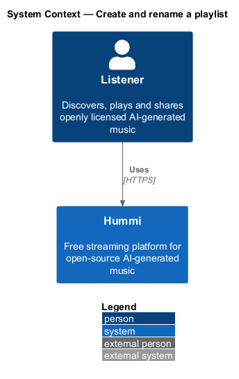
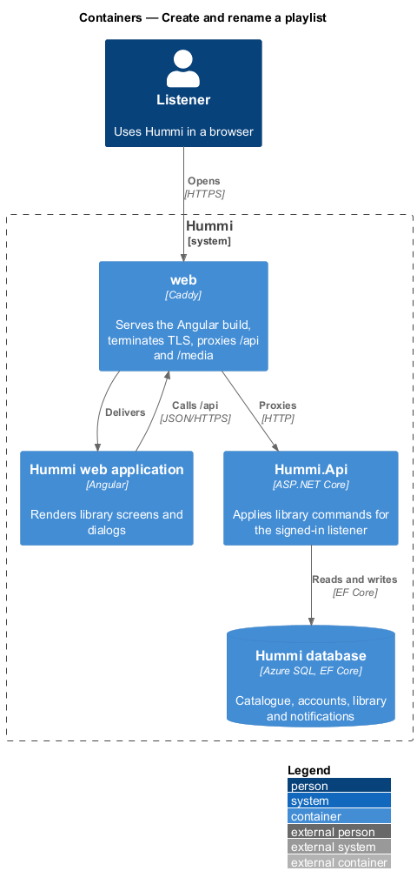
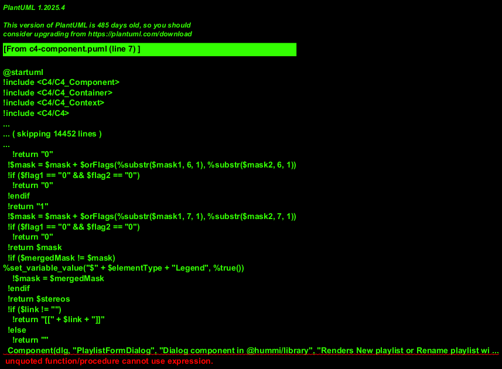
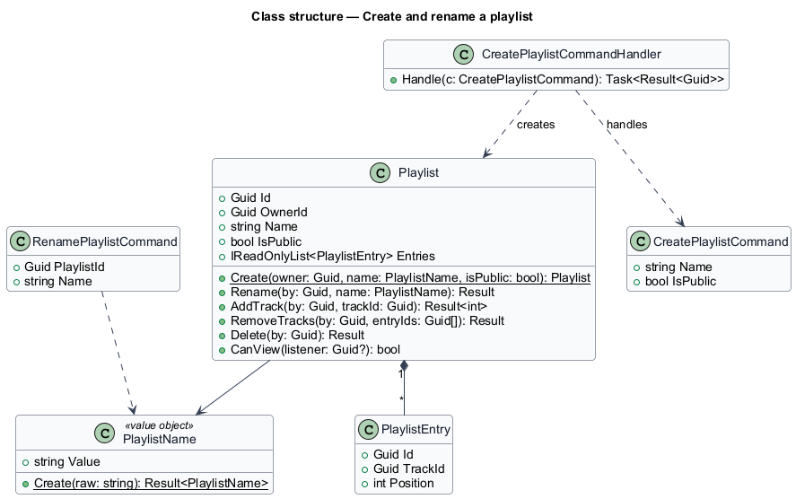
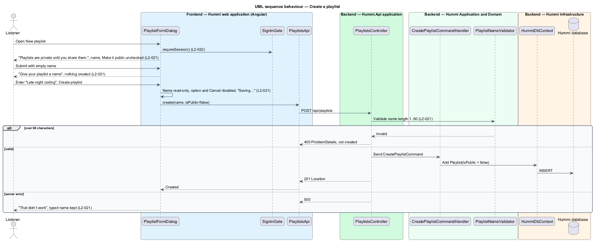

# Create and rename a playlist

## Overview

A playlist is a named, ordered list of tracks owned by one listener. This feature creates one and
renames one. A new playlist is private unless the listener checks "Make it public". Names are required
and at most 60 characters.

- **private playlist** — playlist visible only to its owner and to holders of its share link
- **public playlist** — playlist anyone can find in search and open

## Description

Both dialogs share one form component; the name rule lives in the `PlaylistName` value object and is mirrored in the form for immediate feedback.

**Frontend — Hummi web application (Angular)**

- **`PlaylistFormDialog`** — Dialog component in @hummi/library. Renders New playlist or Rename playlist with `hm-text-field` (help "Up to 60 characters"), `hm-checkbox` Make it public, busy and error states
- **`SignInGate`** — Service in @hummi/api. Checks `SessionStore` before a save action and opens the Sign in to save this dialog when signed out (`L2-032`)
- **`PlaylistsApi`** — Typed HTTP service in @hummi/api. Calls the `/api/playlists` endpoints

**Backend — Hummi.Api application**

- **`PlaylistsController`** — ASP.NET Core controller. Authorized `/api/playlists` endpoints; maps results through `ProblemDetailsMapper`

**Backend — Hummi Application and Domain**

- **`CreatePlaylistCommandHandler`** — MediatR command handlers. `CreatePlaylistCommand` and `RenamePlaylistCommand`
- **`PlaylistNameValidator`** — FluentValidation validator. Rejects empty and over-60-character names

**Backend — Hummi Infrastructure**

- **`HummiDbContext`** — EF Core DbContext. Implements the `IHummiDbContext` port from `Application/Abstractions` and maps entities to tables
- **`Hummi database`** — Azure SQL. Playlists

## Requirements

The feature realizes the following level-2 (L2) requirements. Each L2 requirement refines a level-1 (L1) requirement in `docs/specs/L1.md`; the text is copied from `docs/specs/L2.md`.

| L2 ID | Refines (L1) | Requirement |
|-------|--------------|-------------|
| `L2-021` | `L1-005` | **Create and rename a playlist.** 1. Given a signed-in listener, when they open "New playlist", then the dialog reads "Playlists are private until you share them." and shows "Playlist name" (required, help "Up to 60 characters"), an unchecked "Make it public" option ("Anyone can find and listen to it. You can change this later."), "Cancel" and "Create playlist". 2. Given a name, when they activate "Create playlist", then a playlist with that name is created, private unless "Make it public" is checked. 3. Given an empty name, when they submit, then the field shows "Give your playlist a name" and nothing is created. 4. Given a name over 60 characters, when they submit, then the playlist is not created. 5. Given the owner of "Late-night coding", when they activate "Rename", then the dialog "Rename playlist" reads "Choose a new name for this playlist.", is prefilled with "Late-night coding" and saves with "Save name". 6. Given saving is in progress, when the dialog renders, then the name is read-only, the public option and "Cancel" are disabled, and the button reads "Saving…". 7. Given saving fails, when the dialog renders, then it shows "That didn’t work" with "The playlist wasn’t saved. Your name is still here; try again." and the typed name is kept. |

## Diagrams

### System context

A signed-in listener creates or renames a playlist in Hummi. No external system takes part.

### Containers

The Angular application is delivered by the `web` container, which also proxies `/api` to `Hummi.Api`; the API reads and writes the Hummi database through EF Core.

### Components

`PlaylistFormDialog` calls `PlaylistsApi`; `PlaylistsController` validates with `PlaylistNameValidator` and sends the command.

### Class structure

`PlaylistName` holds the length rule; `CreatePlaylistCommandHandler` creates a `Playlist` through `Playlist.Create`.

### Behaviour — create a playlist

The form checks the name before submission; the server repeats the check in `PlaylistNameValidator` and `PlaylistName`, so an over-long name is rejected even if the client is bypassed. Rename follows the same path with `PUT /api/playlists/{id}/name`, prefilled, and saves with "Save name".

