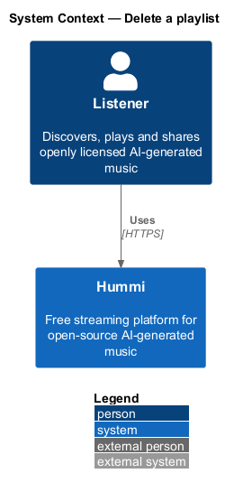
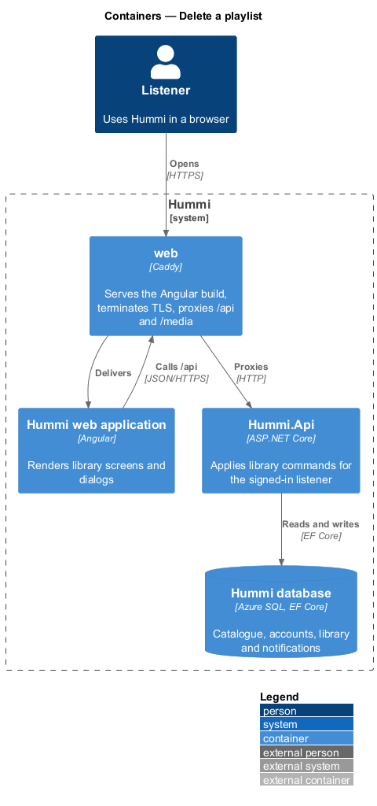
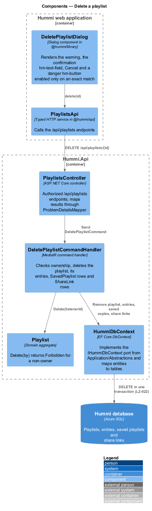
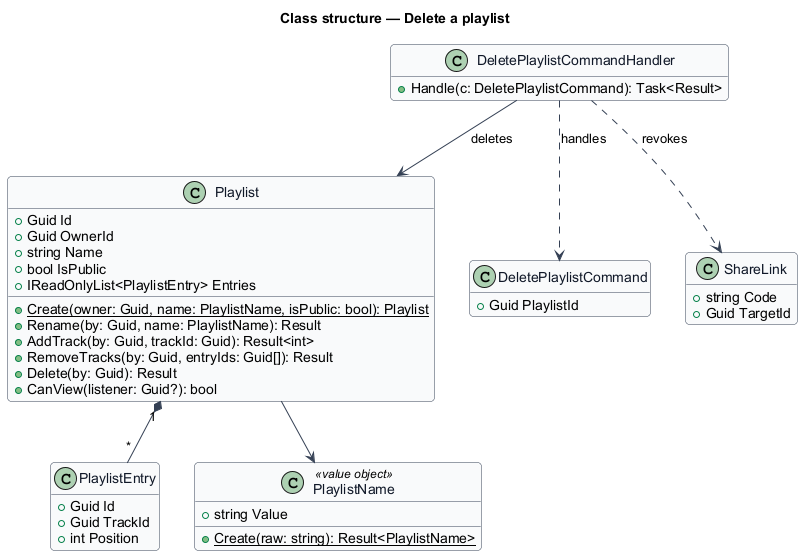
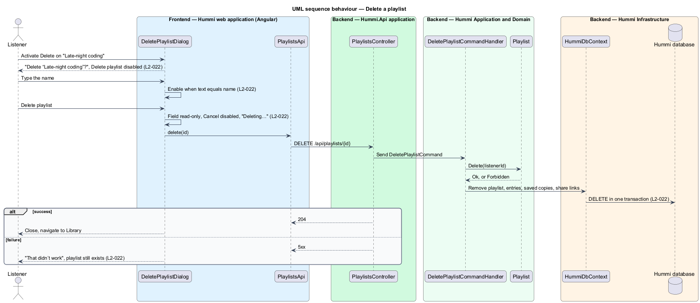

# Delete a playlist

## Overview

The owner of a playlist may delete it. Deletion cannot be undone, so the dialog asks the owner to type
the playlist name before the danger button enables. Deleting removes the playlist and its entries;
the tracks stay on Hummi. Share links to the playlist stop working and listeners who saved it lose it.

- **typed confirmation** — field whose value equals the playlist name to enable a destructive action

## Description

Deletion is a single command; share links and saved copies are removed in the same transaction.

**Frontend — Hummi web application (Angular)**

- **`DeletePlaylistDialog`** — Dialog component in @hummi/library. Renders the warning, the confirmation `hm-text-field`, Cancel and a danger `hm-button` enabled only on an exact match
- **`PlaylistsApi`** — Typed HTTP service in @hummi/api. Calls the `/api/playlists` endpoints

**Backend — Hummi.Api application**

- **`PlaylistsController`** — ASP.NET Core controller. Authorized `/api/playlists` endpoints; maps results through `ProblemDetailsMapper`

**Backend — Hummi Application and Domain**

- **`DeletePlaylistCommandHandler`** — MediatR command handler. Checks ownership, deletes the playlist, its entries, `SavedPlaylist` rows and `ShareLink` rows
- **`Playlist`** — Domain aggregate. `Delete(by)` returns Forbidden for a non-owner

**Backend — Hummi Infrastructure**

- **`HummiDbContext`** — EF Core DbContext. Implements the `IHummiDbContext` port from `Application/Abstractions` and maps entities to tables
- **`Hummi database`** — Azure SQL. Playlists, entries, saved playlists and share links

## Requirements

The feature realizes the following level-2 (L2) requirements. Each L2 requirement refines a level-1 (L1) requirement in `docs/specs/L1.md`; the text is copied from `docs/specs/L2.md`.

| L2 ID | Refines (L1) | Requirement |
|-------|--------------|-------------|
| `L2-022` | `L1-005` | **Delete a playlist.** 1. Given the owner of "Late-night coding", when they activate "Delete", then the dialog "Delete “Late-night coding”?" reads "You can’t undo this. People you shared it with lose access." with "Cancel" and a danger "Delete playlist" button. 2. Given the confirmation field "Type the playlist name to confirm" (help "This deletes 24 tracks from the playlist, not from Hummi."), when the typed text does not match the playlist name, then "Delete playlist" stays disabled. 3. Given the typed name matches, when they activate "Delete playlist", then the playlist is deleted, its tracks remain on Hummi, and people it was shared with lose access. 4. Given deletion is in progress, when the dialog renders, then the field is read-only, "Cancel" is disabled and the button reads "Deleting…". 5. Given deletion fails, when the dialog renders, then it shows "That didn’t work" with "The playlist wasn’t deleted. Try again, or reload the page." and the playlist still exists. |

## Diagrams

### System context

A playlist owner deletes a playlist in Hummi. No external system takes part.

### Containers

The Angular application is delivered by the `web` container, which also proxies `/api` to `Hummi.Api`; the API reads and writes the Hummi database through EF Core.

### Components

`DeletePlaylistDialog` calls `PlaylistsApi`; `PlaylistsController` sends `DeletePlaylistCommand` to its handler, which asks `Playlist` to authorize the delete.

### Class structure

`DeletePlaylistCommandHandler` deletes the `Playlist` aggregate and revokes its `ShareLink` rows.

### Behaviour — delete a playlist

The confirm button enables only on an exact match. On the server, removal of share links and saved copies happens in the same transaction as the playlist, which ends access for everyone it was shared with.

