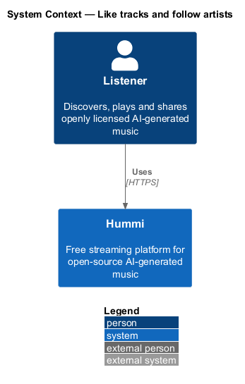
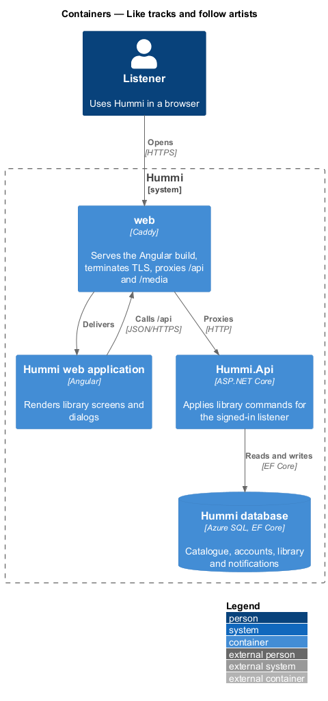
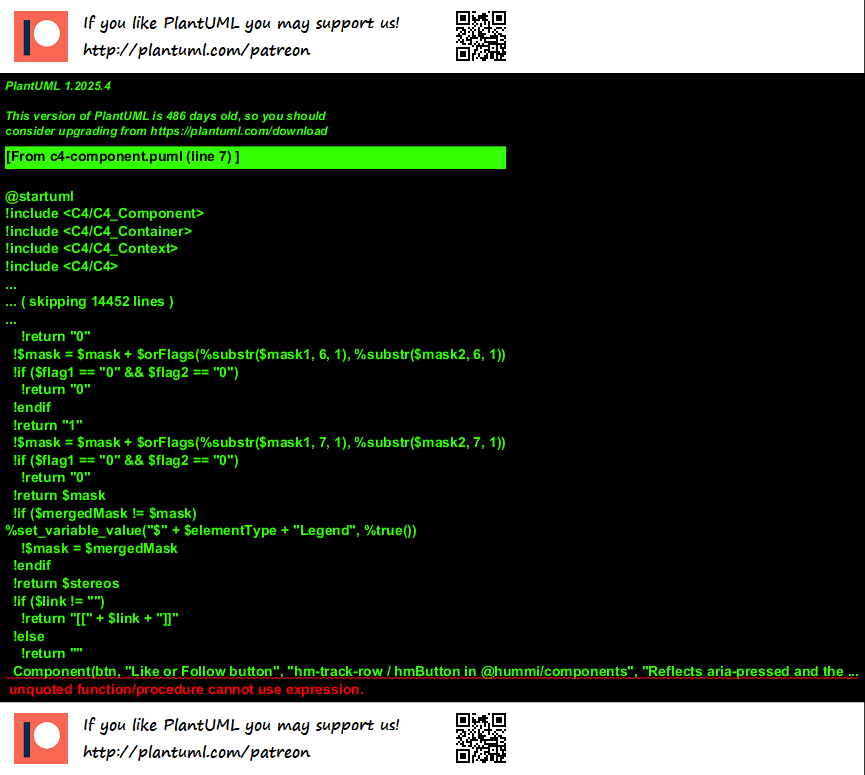
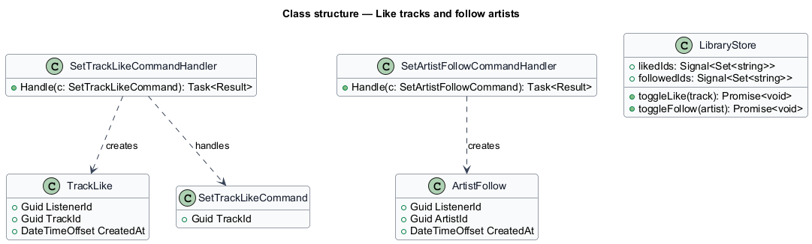
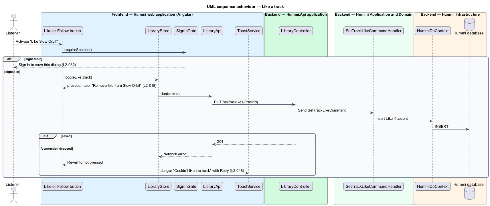

# Like tracks and follow artists

## Overview

The library subsystem holds what a signed-in listener keeps: liked tracks, followed artists and
playlists. It is stored on the server so it is the same on every device. This feature covers the two
one-click saves: liking a track and following an artist.

- **like** — listener's mark on a track, listed in Library > Liked
- **follow** — listener's subscription to an artist, listed in Library > Following and used for new-release notifications (`L2-036`)
- **optimistic update** — UI change applied before the server confirms, reverted on failure

Both actions require an account; a signed-out listener gets the sign-in prompt (`L2-032`). Like and
follow are idempotent: repeating one has no further effect.

## Description

Each toggle is a `PUT` or `DELETE` on an idempotent resource, applied optimistically in the browser.

**Frontend — Hummi web application (Angular)**

- **`Like or Follow button`** — `hm-track-row` like button and `hmButton` with `pressed` in @hummi/components. Reflects `aria-pressed` and the label "Like {title}" or "Remove like from {title}"
- **`LibraryStore`** — Signal store in @hummi/api. Holds liked track ids and followed artist slugs read from `GET /api/me/library`; applies optimistic toggles, reverts on failure and exposes the failure for the danger toast (ADR 0012)
- **`SignInGate`** — Service in @hummi/api. Checks `SessionStore` before a save action and opens the Sign in to save this dialog when signed out (`L2-032`)
- **`LibraryApi`** — Typed HTTP service in @hummi/api. Calls the authorized `/api/me/*` library endpoints
- **`ToastService`** — Service in @hummi/components. Queues toasts in `hm-toast-region`; `showDanger` adds the danger toast with Retry (`L2-018` AC4)

**Backend — Hummi.Api application**

- **`LibraryController`** — ASP.NET Core controller. `PUT`/`DELETE /api/me/likes/{trackId}` and `/api/me/follows/{artistSlug}`, 204 and idempotent; `[Authorize]`

**Backend — Hummi Application and Domain**

- **`SetTrackLikeCommandHandler`** — MediatR command handlers. `SetTrackLikeCommand` and `SetArtistFollowCommand` with an on/off flag; each inserts or deletes one row if needed

**Backend — Hummi Infrastructure**

- **`HummiDbContext`** — EF Core DbContext. Implements the `IHummiDbContext` port from `Application/Abstractions` and maps entities to tables
- **`Hummi database`** — Azure SQL. `TrackLikes` and `ArtistFollows`, keyed by (ListenerId, TargetId)

## Requirements

The feature realizes the following level-2 (L2) requirements. Each L2 requirement refines a level-1 (L1) requirement in `docs/specs/L1.md`; the text is copied from `docs/specs/L2.md`.

| L2 ID | Refines (L1) | Requirement |
|-------|--------------|-------------|
| `L2-018` | `L1-005` | **Liking tracks and following artists.** 1. Given a signed-in listener, when they activate "Like {title}", then the button becomes pressed, its label becomes "Remove like from {title}", and the track appears in Library > Liked. 2. Given a liked track, when they activate "Remove like from {title}", then the like is removed. 3. Given a signed-in listener on an artist page, when they activate "Follow", then it becomes pressed and the artist appears in Library > Following. 4. Given liking fails because the connection dropped, when the request fails, then the danger toast "Couldn’t like the track" with "Check your connection and try again." and a "Retry" action is shown. |

## Diagrams

### System context

A signed-in listener saves tracks and artists in Hummi. No external system takes part.

### Containers

The Angular application is delivered by the `web` container, which also proxies `/api` to `Hummi.Api`; the API reads and writes the Hummi database through EF Core.

### Components

Buttons call `SignInGate` and `LibraryStore`; the store calls `LibraryApi`. `LibraryController` sends the like and follow commands.

### Class structure

`TrackLike` and `ArtistFollow` are join entities keyed by listener and target. One handler per command creates or removes a row.

### Behaviour — like a track

`SignInGate` blocks signed-out listeners. For signed-in listeners `LibraryStore` flips the button at once, sends an idempotent `PUT`, and reverts with a danger toast if the request fails. Follow follows the same path with `SetArtistFollowCommand`.

