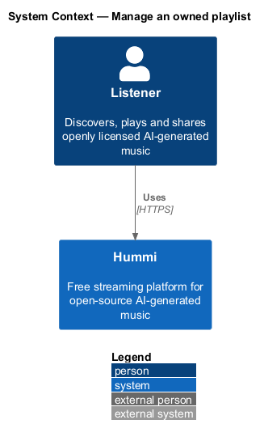
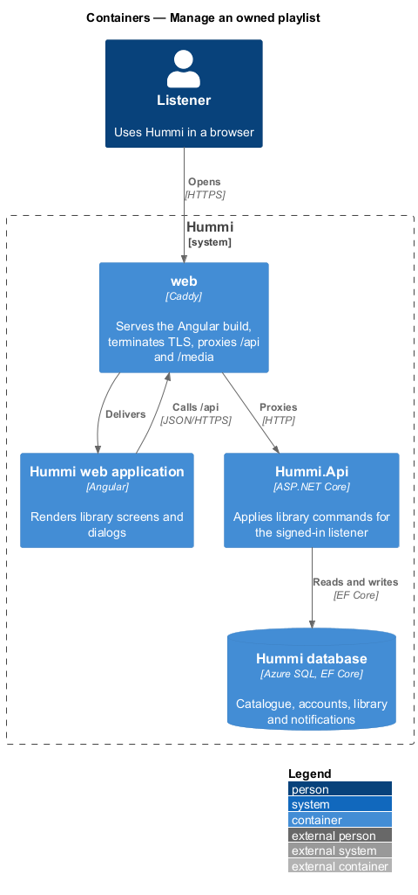
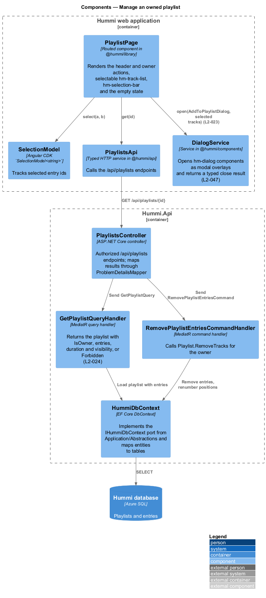
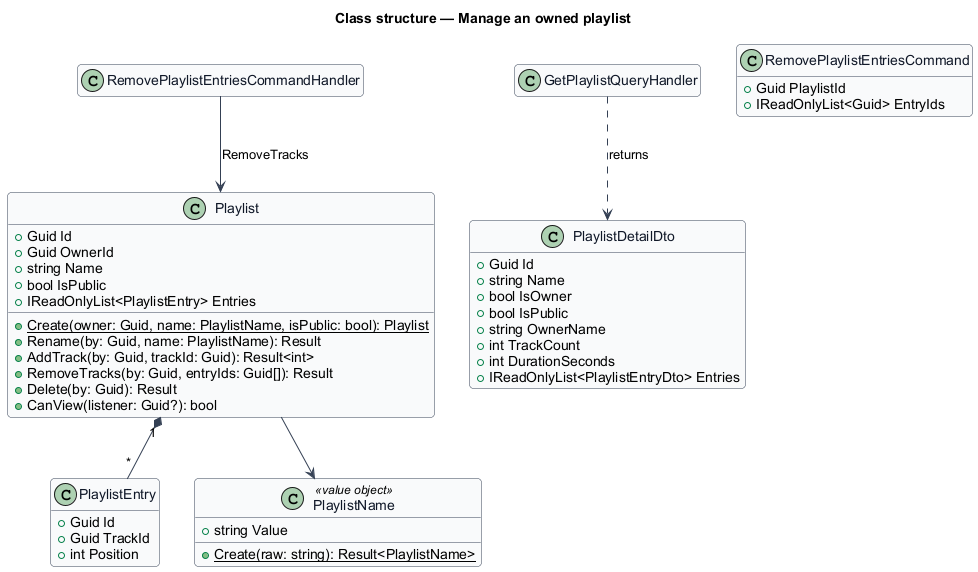
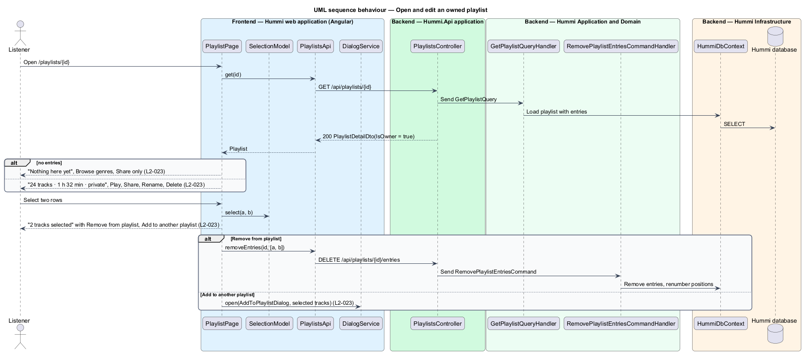

# Manage an owned playlist

## Overview

The playlist page (`/playlists/{id}`) of a playlist the listener owns shows its track count, duration
and visibility, and the owner actions Play, Share, Rename and Delete. The owner can select rows and
remove them or add them to another playlist in one step.

- **selection bar** — info bar that appears when one or more rows are selected, reading "{n} tracks selected"

## Description

The page reads the playlist with an `IsOwner` flag; the bulk remove is one command.

**Frontend — Hummi web application (Angular)**

- **`PlaylistPage`** — Routed component in @hummi/library. Renders the header and owner actions, selectable `hm-track-list`, the `hm-alert` selection bar and the empty state
- **`Selection`** — Signal of selected row indexes in `PlaylistComponent`; rows map to entry ids (ADR 0013)
- **`PlaylistsApi`** — Typed HTTP service in @hummi/api. Calls the `/api/playlists` endpoints
- **`PlaylistDialogs`** — Service in @hummi/api. Opens Add to playlist for the selected tracks; Rename and Delete are local dialogs of the page

**Backend — Hummi.Api application**

- **`PlaylistsController`** — ASP.NET Core controller. `/api/playlists` endpoints, every change for the owner only; maps results to ProblemDetails with `ToProblem`

**Backend — Hummi Application and Domain**

- **`GetPlaylistQueryHandler`** — MediatR query handler. Returns the playlist with `IsOwner`, entries, duration and visibility, or Forbidden (`L2-024`)
- **`RemovePlaylistEntriesCommandHandler`** — MediatR command handler. Calls `Playlist.RemoveTracks` for the owner

**Backend — Hummi Infrastructure**

- **`HummiDbContext`** — EF Core DbContext. Implements the `IHummiDbContext` port from `Application/Abstractions` and maps entities to tables
- **`Hummi database`** — Azure SQL. Playlists and entries

## Requirements

The feature realizes the following level-2 (L2) requirements. Each L2 requirement refines a level-1 (L1) requirement in `docs/specs/L1.md`; the text is copied from `docs/specs/L2.md`.

| L2 ID | Refines (L1) | Requirement |
|-------|--------------|-------------|
| `L2-023` | `L1-005` | **Own playlist page and multi-select.** 1. Given the owner opens "Road trip to the north coast", when it loads, then the subtitle shows "{n} tracks · {duration} · {private|public}" (e.g. "24 tracks · 1 h 32 min · private") and the actions "Play", "Share", "Rename" and "Delete". 2. Given an empty owned playlist, when it opens, then it shows "Nothing here yet" with "Add tracks from anywhere with Add to playlist, or start from a genre.", a "Browse genres" button, and only the "Share" action. 3. Given the owner selects tracks, when two are selected, then an info bar reads "2 tracks selected" with "Remove from playlist" and "Add to another playlist". 4. Given selected tracks, when the owner activates "Remove from playlist", then they are removed from the playlist; when they activate "Add to another playlist", then the Add to playlist dialog opens for them. |

## Diagrams

### System context

A playlist owner edits a playlist in Hummi. No external system takes part.

### Containers

The Angular application is delivered by the `web` container, which also proxies `/api` to `Hummi.Api`; the API reads and writes the Hummi database through EF Core.

### Components

`PlaylistPage` keeps a CDK `SelectionModel`, calls `PlaylistsApi` and opens dialogs; `PlaylistsController` sends the query and the remove command.

### Class structure

`GetPlaylistQueryHandler` returns `PlaylistDetailDto` with `IsOwner`. `RemovePlaylistEntriesCommandHandler` calls `Playlist.RemoveTracks`.

### Behaviour — open and edit an owned playlist

The query flags ownership so the page shows owner actions. Selections feed either a bulk remove command or the Add to playlist dialog.

