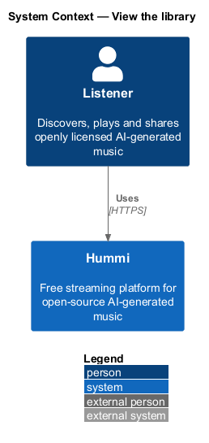
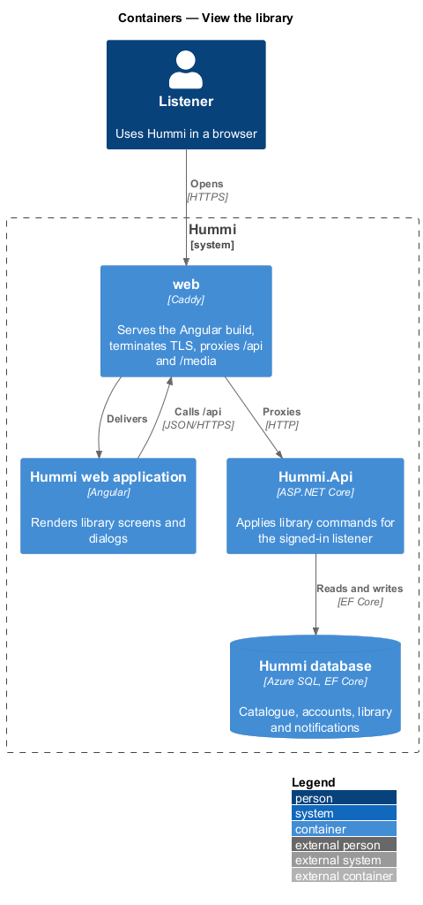
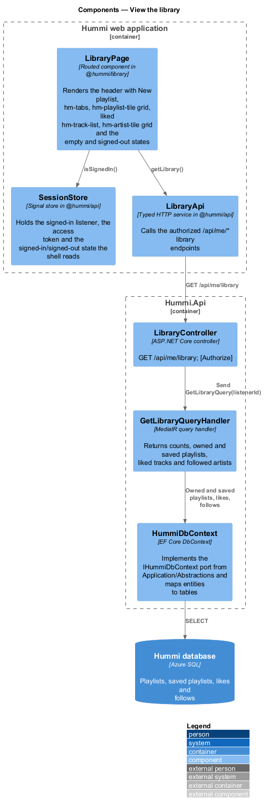
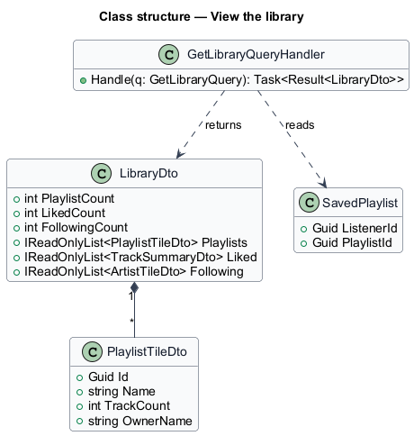
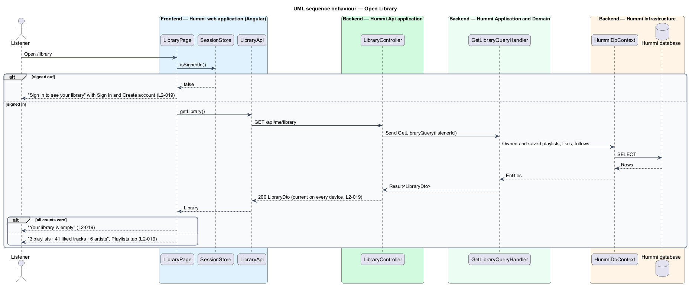

# View the library

## Overview

Library (`/library`) shows everything a signed-in listener has kept, in three tabs: Playlists (owned or
saved), Liked tracks and Following artists. The subtitle counts each. Because the library is stored
on the server, a change made on one device appears on another the next time it loads Library.

- **saved playlist** — someone else's playlist the listener added to their library (`L2-024`)

A signed-out visitor sees a prompt to sign in; an empty library points to creating a playlist or
browsing genres.

## Description

Library is one aggregate read for the signed-in listener; no client-side cache outlives a page load, which gives cross-device consistency.

**Frontend — Hummi web application (Angular)**

- **`LibraryPage`** — Routed component in @hummi/library. Renders the header with New playlist, `hm-tabs`, `hm-playlist-tile` grid, liked `hm-track-list`, `hm-artist-tile` grid and the empty and signed-out states
- **`SessionStore`** — Signal store in @hummi/api. Holds the signed-in listener, the access token and the signed-in/signed-out state the shell reads
- **`LibraryApi`** — Typed HTTP service in @hummi/api. Calls the authorized `/api/me/*` library endpoints

**Backend — Hummi.Api application**

- **`LibraryController`** — ASP.NET Core controller. `GET /api/me/library`; `[Authorize]`

**Backend — Hummi Application and Domain**

- **`GetLibraryQueryHandler`** — MediatR query handler. Returns counts, owned and saved playlists, liked tracks and followed artists

**Backend — Hummi Infrastructure**

- **`HummiDbContext`** — EF Core DbContext. Implements the `IHummiDbContext` port from `Application/Abstractions` and maps entities to tables
- **`Hummi database`** — Azure SQL. Playlists, saved playlists, likes and follows

## Requirements

The feature realizes the following level-2 (L2) requirements. Each L2 requirement refines a level-1 (L1) requirement in `docs/specs/L1.md`; the text is copied from `docs/specs/L2.md`.

| L2 ID | Refines (L1) | Requirement |
|-------|--------------|-------------|
| `L2-019` | `L1-005` | **Library.** 1. Given a signed-in listener, when they open Library (`/library`), then the subtitle shows counts (e.g. "3 playlists · 41 liked tracks · 6 artists"), a "New playlist" button is shown, and tabs "Playlists" (selected), "Liked" and "Following" are shown. 2. Given the Playlists tab, when it renders, then it shows a tile for each playlist the listener owns or saved with "{n} tracks · {owner}". 3. Given an empty library, when it opens, then it shows "Your library is empty" with "Like a track or create a playlist and it will live here, on every device you sign in on." and the buttons "Create a playlist" and "Browse genres". 4. Given a signed-out listener, when they open Library, then it shows "Sign in to see your library" with "Playlists and liked tracks are saved to your account." and the buttons "Sign in" and "Create account". 5. Given a listener signed in on two devices, when they change their library on one, then the other shows the change the next time it loads the library. |

## Diagrams

### System context

A listener views their saved music in Hummi. No external system takes part.

### Containers

The Angular application is delivered by the `web` container, which also proxies `/api` to `Hummi.Api`; the API reads and writes the Hummi database through EF Core.

### Components

`LibraryPage` reads `SessionStore` and calls `LibraryApi`; `LibraryController` sends `GetLibraryQuery`.

### Class structure

`GetLibraryQueryHandler` reads playlists, `SavedPlaylist` rows, likes and follows into one `LibraryDto`.

### Behaviour — open Library

The page checks the session before any request. For a signed-in listener it reads the library fresh on each load, which satisfies the cross-device criterion of `L2-019` without push synchronization.

