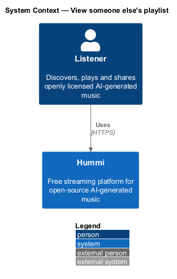
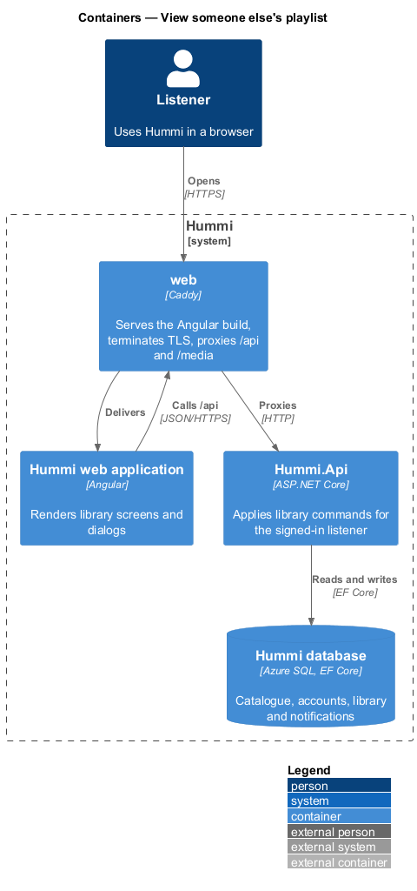
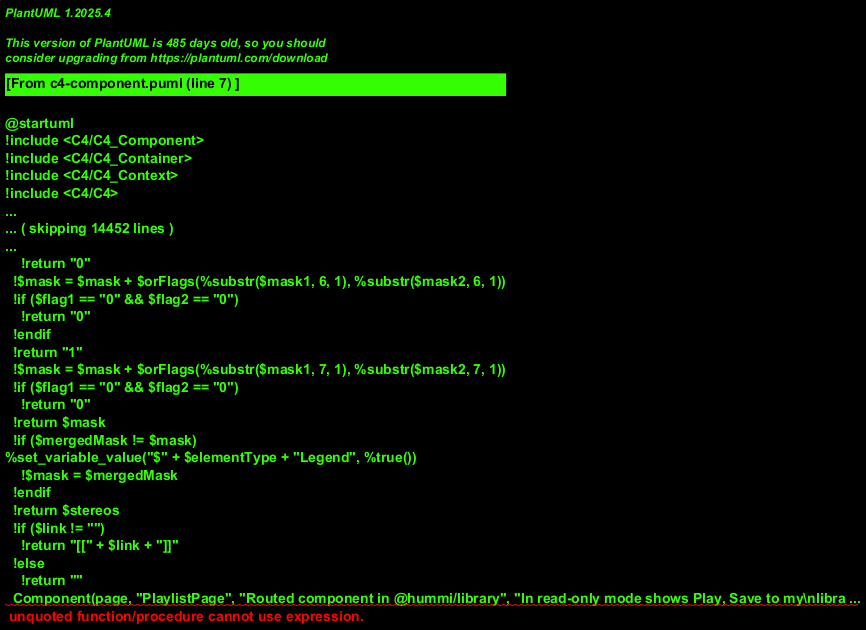
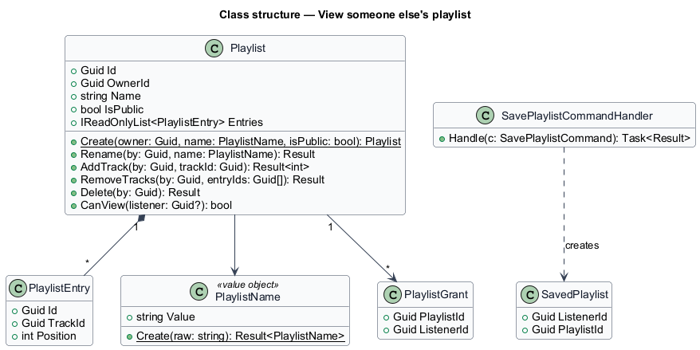
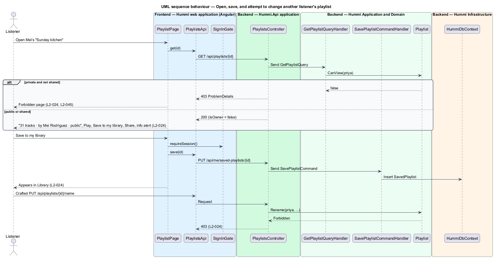

# View someone else's playlist

## Overview

A listener may open a playlist owned by someone else when it is public or shared with them. They can
play it and save it to their library, but not change it. The server enforces this: every playlist
command checks the owner, whatever the client shows. A private playlist that was not shared yields
the Forbidden page (`L2-045`).

- **shared with** — access granted to a listener through a share link or a direct share notification (`L2-036`)

## Description

The page is the same `PlaylistPage` in read-only mode; saving creates a `SavedPlaylist` row.

**Frontend — Hummi web application (Angular)**

- **`PlaylistPage`** — Routed component in @hummi/library. In read-only mode shows Play, Save to my library, Share and the info `hm-alert` "This playlist belongs to {owner}"
- **`PlaylistsApi`** — Typed HTTP service in @hummi/api. Calls the `/api/playlists` endpoints
- **`SignInGate`** — Service in @hummi/api. Checks `SessionStore` before a save action and opens the Sign in to save this dialog when signed out (`L2-032`)

**Backend — Hummi.Api application**

- **`PlaylistsController`** — ASP.NET Core controller. Authorized `/api/playlists` endpoints; maps results through `ProblemDetailsMapper`

**Backend — Hummi Application and Domain**

- **`GetPlaylistQueryHandler`** — MediatR query handler. Calls `Playlist.CanView(listener)`; Forbidden when false
- **`SavePlaylistCommandHandler`** — MediatR command handler. Adds a `SavedPlaylist` row for the listener
- **`Playlist`** — Domain aggregate. `CanView` allows the owner, any listener when public, and grantees of a share

**Backend — Hummi Infrastructure**

- **`HummiDbContext`** — EF Core DbContext. Implements the `IHummiDbContext` port from `Application/Abstractions` and maps entities to tables
- **`Hummi database`** — Azure SQL. Playlists, grants and saved playlists

## Requirements

The feature realizes the following level-2 (L2) requirements. Each L2 requirement refines a level-1 (L1) requirement in `docs/specs/L1.md`; the text is copied from `docs/specs/L2.md`.

| L2 ID | Refines (L1) | Requirement |
|-------|--------------|-------------|
| `L2-024` | `L1-005` | **Someone else's playlist.** 1. Given Priya opens Mei's public playlist "Sunday kitchen", when it loads, then the subtitle reads "31 tracks · by Mei Rodríguez · public", the actions are "Play", "Save to my library" and "Share", and an info alert reads "This playlist belongs to Mei Rodríguez" with "You can listen and save a copy to your library. Only Mei can change the tracks." 2. Given a playlist the listener does not own, when it renders, then no rename, delete or remove controls are shown, and the server rejects such changes from that listener. 3. Given "Save to my library", when activated, then the playlist appears in the listener's Library. 4. Given a private playlist that was not shared with the listener, when they open it, then the Forbidden page (L2-045) is shown. |

## Diagrams

### System context

A listener opens a playlist owned by someone else in Hummi. No external system takes part.

### Containers

The Angular application is delivered by the `web` container, which also proxies `/api` to `Hummi.Api`; the API reads and writes the Hummi database through EF Core.

### Components

`PlaylistPage` calls `PlaylistsApi`; `PlaylistsController` sends `GetPlaylistQuery` and `SavePlaylistCommand`, and the `Playlist` aggregate enforces access.

### Class structure

`Playlist` holds `PlaylistGrant` entries consulted by `CanView`. `SavePlaylistCommandHandler` creates `SavedPlaylist`.

### Behaviour — open, save, and attempt to change another listener's playlist

Visibility is decided by `Playlist.CanView`, and every mutation re-checks the owner in the aggregate, so a crafted request from a non-owner receives 403.

