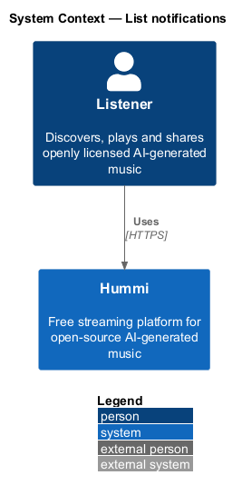
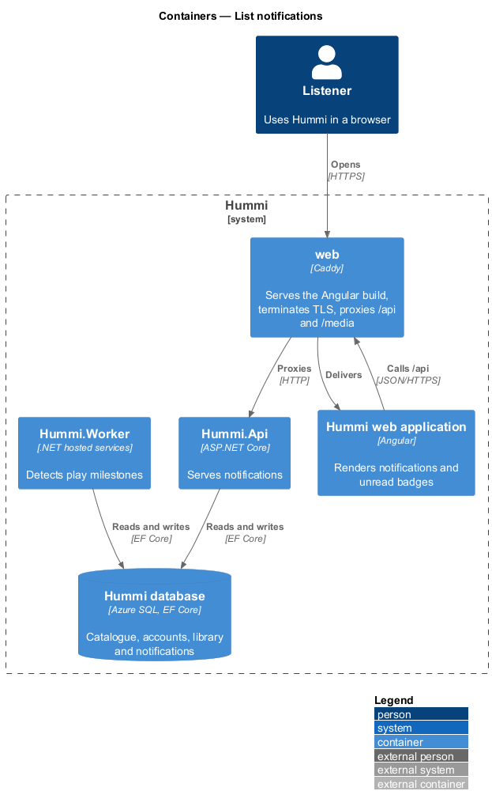
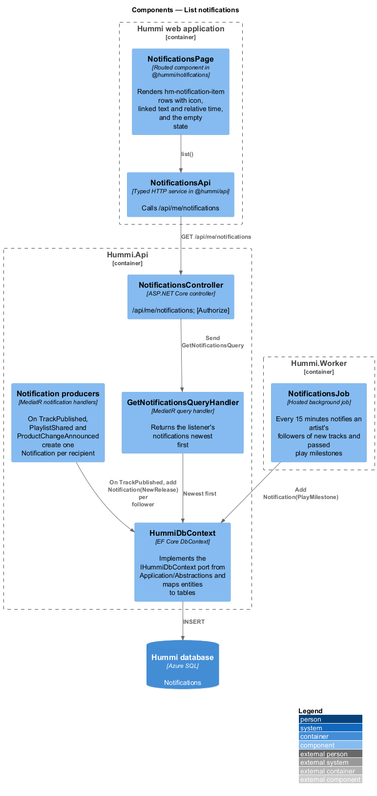
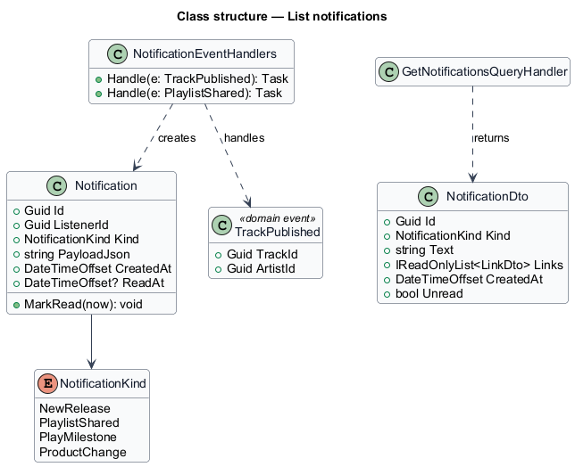
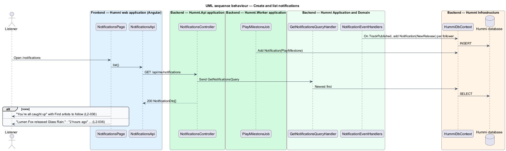

# List notifications

## Overview

The notification centre (`/notifications`) keeps a list of events relevant to a signed-in listener. Four
kinds exist: a followed artist released a track, someone shared a playlist with the listener, a track
passed a play milestone, and a product change.

- **notification** — stored event addressed to one listener, with kind, payload, creation time and read time
- **play milestone** — play count threshold a track crosses <TO SUPPLY: thresholds; mock shows 25,000>

Notifications are created on the server by domain events and a worker job; the page only reads them.

## Description

Domain events create notifications; the page reads a paged list.

**Frontend — Hummi web application (Angular)**

- **`NotificationsPage`** — Routed component in @hummi/notifications. Renders `hm-notification-item` rows with icon, linked text and relative time, and the empty state
- **`NotificationsApi`** — Typed HTTP service in @hummi/api. Calls `/api/me/notifications`

**Backend — Hummi.Api application**

- **`NotificationsController`** — ASP.NET Core controller. `/api/me/notifications`; `[Authorize]`

**Backend — Hummi.Worker application**

- **`PlayMilestoneJob`** — Hosted background job. Detects tracks whose play count crossed a milestone and notifies <TO SUPPLY: recipients>

**Backend — Hummi Application and Domain**

- **`GetNotificationsQueryHandler`** — MediatR query handler. Returns the listener's notifications newest first
- **`NotificationEventHandlers`** — MediatR notification handlers. On `TrackPublished`, `PlaylistShared` and `ProductChangeAnnounced` create one `Notification` per recipient

**Backend — Hummi Infrastructure**

- **`HummiDbContext`** — EF Core DbContext. Implements the `IHummiDbContext` port from `Application/Abstractions` and maps entities to tables
- **`Hummi database`** — Azure SQL. Notifications

## Requirements

The feature realizes the following level-2 (L2) requirements. Each L2 requirement refines a level-1 (L1) requirement in `docs/specs/L1.md`; the text is copied from `docs/specs/L2.md`.

| L2 ID | Refines (L1) | Requirement |
|-------|--------------|-------------|
| `L2-036` | `L1-009` | **Notification list.** 1. Given a signed-in listener, when they open Notifications (`/notifications`), then each item shows an icon, its text with links, and a relative or dated time (e.g. "2 hours ago", "Yesterday", "Sat 24 Oct"). 2. Given the four notification kinds, when listed, then they read like: a followed artist releasing a track ("Kaiso Collective released Road March Riddim."), a playlist shared with the listener ("Mei Rodríguez shared the playlist Sunday kitchen with you."), a play milestone ("Tidewater Waltz passed 25,000 plays.") and a product change ("Hummi now shows the model that generated each track."). 3. Given no notifications, when the page opens, then it shows "You’re all caught up" with "New releases from artists you follow and playlist shares show up here." and "Find artists to follow", which opens Browse. |

## Diagrams

### System context

A signed-in listener reads notifications in Hummi. No external system takes part.

### Containers

`Hummi.Api` creates and serves notifications; `Hummi.Worker` adds play-milestone notifications to the same database.

### Components

`NotificationsPage` calls `NotificationsApi`; `NotificationsController` sends `GetNotificationsQuery`. Domain event handlers and `PlayMilestoneJob` write rows.

### Class structure

`Notification` has a `NotificationKind`. `NotificationEventHandlers` create notifications from domain events such as `TrackPublished`.

### Behaviour — create and list notifications

Notifications are written when events happen, so reading is a single query. The page formats times as relative ("2 hours ago") or dated ("Sat 24 Oct").

