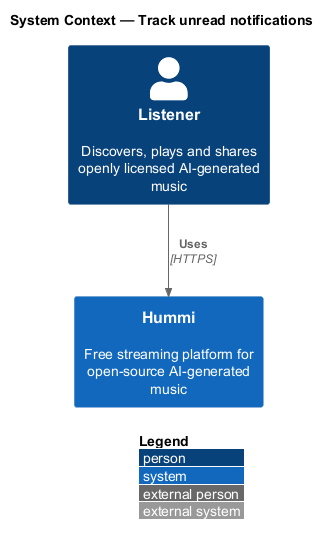
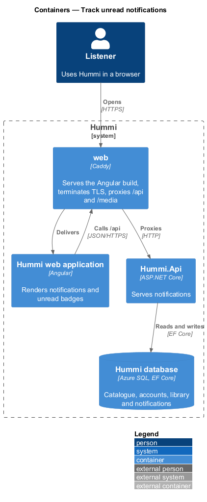
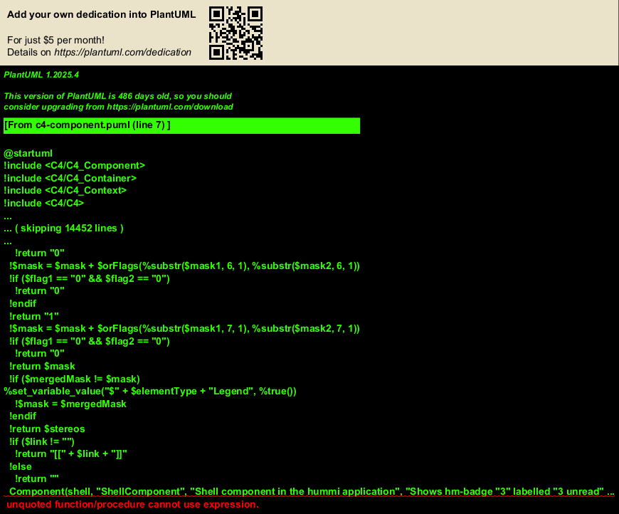
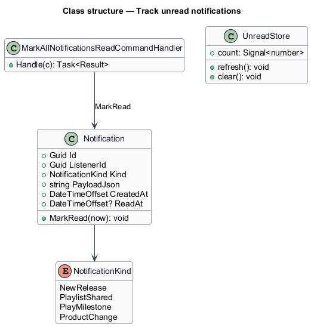
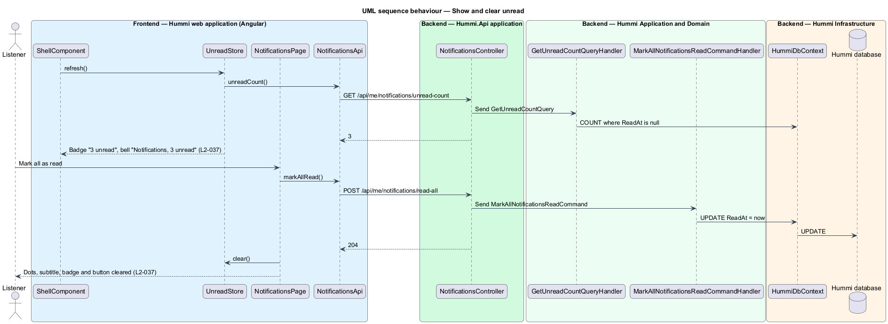

# Track unread notifications

## Overview

Unread notifications are counted in the shell: a badge on the sidebar Notifications link and in the
label of the top-bar bell. On the Notifications page each unread item shows a dot, and Mark all as
read clears every dot and the badge.

- **unread** — notification whose `ReadAt` is null

## Description

A count endpoint feeds the shell; a command marks all as read.

**Frontend — Hummi web application (Angular)**

- **`ShellComponent`** — Shell component in the hummi application. Shows the bell link with `.badge--count` "3" labelled "3 unread" and the label "Notifications, 3 unread"
- **`UnreadStore`** — Signal store in @hummi/api. Holds the unread count; refreshes at sign-in and after every navigation; no polling (ADR 0017)
- **`NotificationsPage`** — Routed component in @hummi/notifications. Shows unread dots, the "3 unread" subtitle and Mark all as read
- **`NotificationsApi`** — Typed HTTP service in @hummi/api. Calls `/api/me/notifications`

**Backend — Hummi.Api application**

- **`NotificationsController`** — ASP.NET Core controller. `/api/me/notifications`; `[Authorize]`

**Backend — Hummi Application and Domain**

- **`GetUnreadCountQueryHandler`** — MediatR query handler. Counts notifications with null `ReadAt`
- **`MarkAllNotificationsReadCommandHandler`** — MediatR command handler. Sets `ReadAt` on every unread notification of the listener

**Backend — Hummi Infrastructure**

- **`HummiDbContext`** — EF Core DbContext. Implements the `IHummiDbContext` port from `Application/Abstractions` and maps entities to tables
- **`Hummi database`** — Azure SQL. Notifications indexed by (ListenerId, ReadAt)

## Requirements

The feature realizes the following level-2 (L2) requirements. Each L2 requirement refines a level-1 (L1) requirement in `docs/specs/L1.md`; the text is copied from `docs/specs/L2.md`.

| L2 ID | Refines (L1) | Requirement |
|-------|--------------|-------------|
| `L2-037` | `L1-009` | **Unread notifications.** 1. Given 3 unread notifications, when any shell page renders for a signed-in listener, then the header Notifications bell shows a "3" badge labelled "3 unread" and the top-bar bell is labelled "Notifications, 3 unread". 2. Given unread notifications, when the Notifications page renders, then the subtitle reads "3 unread", each unread item shows a dot labelled "Unread", and a "Mark all as read" button is shown. 3. Given "Mark all as read", when activated, then all items lose their unread dot, the subtitle and badge clear, and the button is hidden. |

## Diagrams

### System context

A signed-in listener sees and clears unread notifications in Hummi. No external system takes part.

### Containers

The Angular application is delivered by the `web` container, which also proxies `/api` to `Hummi.Api`; the API reads and writes the Hummi database through EF Core.

### Components

`ShellComponent` reads `UnreadStore`; both it and `NotificationsPage` call `NotificationsApi`.

### Class structure

`MarkAllNotificationsReadCommandHandler` calls `Notification.MarkRead` on unread rows; `UnreadStore` holds the count.

### Behaviour — show and clear unread

The shell reads one count. Mark all as read updates every row in a single statement and clears the shared `UnreadStore`, so the badge and page agree.

