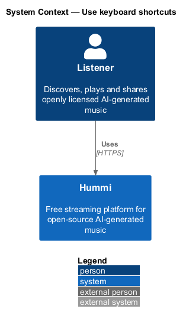
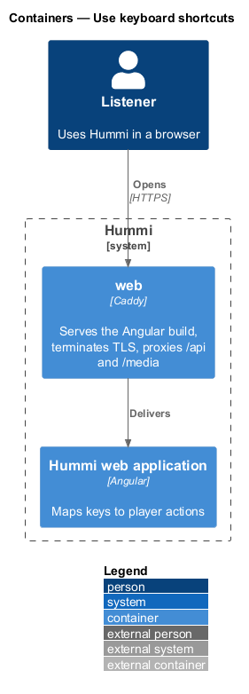
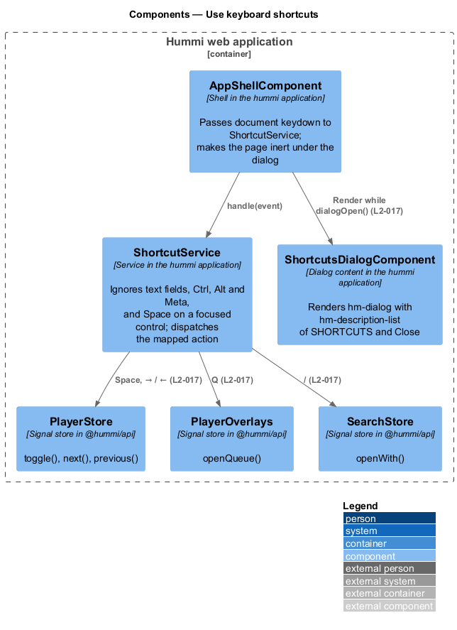
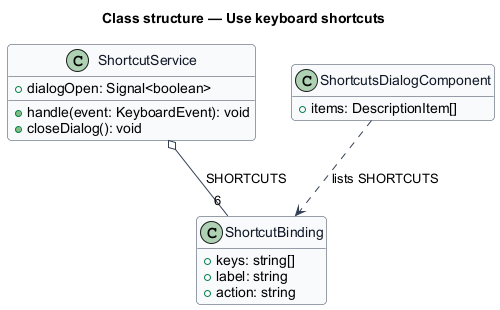
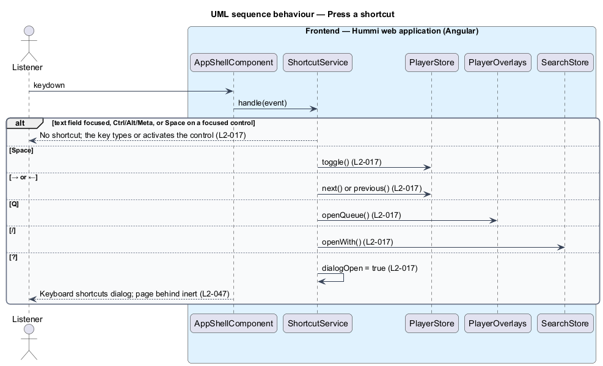

# Use keyboard shortcuts

## Overview

Keyboard shortcuts let a listener control playback without a pointer. They work while the page has
focus and no text field does, so typing in search or a form never triggers them. The "?" key opens a
dialog that lists them.

| Key | Action |
|-----|--------|
| Space | Play or pause |
| → / ← | Next or previous track |
| L | Like the current track |
| Q | Open the queue |
| / | Focus search |
| ? | Open Keyboard shortcuts |

- **text field** — focused `input`, `textarea`, `select` or element with `contenteditable`
- **control** — focused button, link or menu item; Space activates it instead of toggling playback (L2-048)

## Description

The slice is frontend-only. L waits for the like flow of journey 09 and does nothing until then.

**Frontend — Hummi web application (Angular)**

- **`AppShellComponent`** — Shell in the hummi application. Passes every `document` keydown to `ShortcutService`, renders the dialog while it is open and makes the header, main and player bar `inert` behind it (`L2-047`)
- **`ShortcutService`** — Service in the hummi application. Ignores events whose target is a text field, that carry Ctrl, Alt or Meta, Space on a focused control, and every key while search or the dialog is open; dispatches the mapped action
- **`PlayerStore`** — Signal store in @hummi/api. `toggle()`, `next()`, `previous()`
- **`PlayerOverlays`** — Signal store in @hummi/api. `openQueue()`; Q on Now playing closes the layer first
- **`SearchStore`** — Signal store in @hummi/api. `openWith()` opens the search layer with its field focused
- **`ShortcutsDialogComponent`** — Dialog content in the hummi application. Renders `hm-dialog` with `hm-description-list` (keys) of `SHORTCUTS` and Close

## Requirements

The feature realizes the following level-2 (L2) requirements. Each L2 requirement refines a level-1 (L1) requirement in `docs/specs/L1.md`; the text is copied from `docs/specs/L2.md`.

| L2 ID | Refines (L1) | Requirement |
|-------|--------------|-------------|
| `L2-017` | `L1-004` | **Keyboard shortcuts.** 1. Given the page is focused and no text field is, when the listener presses Space, then playback toggles between play and pause; on a focused button or link, Space activates that control instead (L2-048). 2. Given the same condition, when they press → or ←, then the next or previous track plays. 3. Given the same condition, when they press L, then the current track is liked; Q opens the queue; / opens search; ? opens the "Keyboard shortcuts" dialog. 4. Given a text field has focus, when any of these keys is pressed, then the key types into the field and no shortcut fires. 5. Given the "Keyboard shortcuts" dialog, when it opens, then it reads "Work while the page is focused and no text field is." and lists the six shortcuts above with a "Close" button. |

## Diagrams

### System context

A listener controls Hummi with the keyboard. No external system takes part.

### Containers

Shortcuts run entirely in the Angular application.

### Components

`ShortcutService` dispatches to `PlayerStore`, `PlayerOverlays`, `SearchStore` and the dialog.

### Class structure

`ShortcutService` answers the six `ShortcutBinding` entries of `SHORTCUTS` that `ShortcutsDialogComponent` also lists, so the dialog cannot drift from the bindings.

### Behaviour — press a shortcut

`ShortcutService` filters out text fields and controls first, then dispatches each key to the store, overlays, search or dialog.

