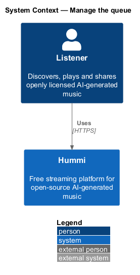
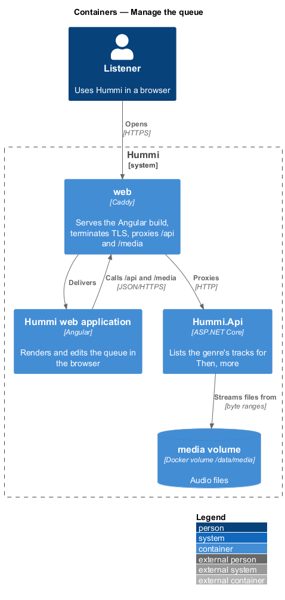
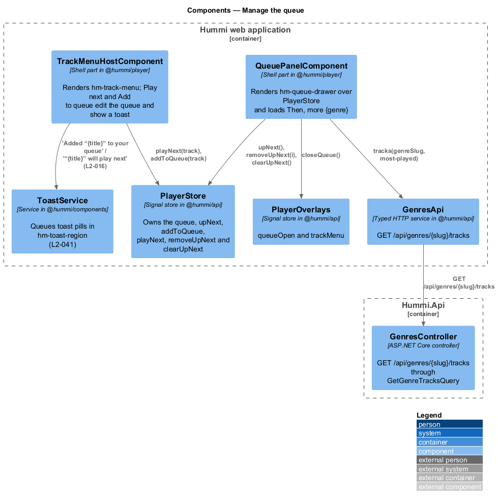
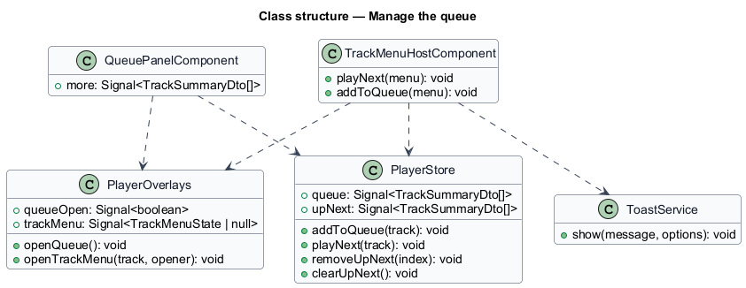
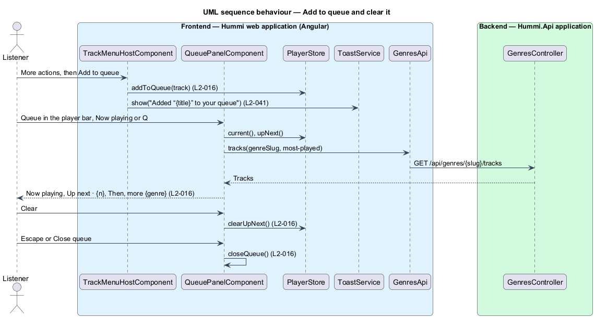

# Manage the queue

## Overview

The queue is the ordered list of tracks that play after the current one. The queue drawer opens from
the player bar's Queue, Now playing's Queue or the Q shortcut: a non-modal panel at the top right,
without a backdrop, with the current track under "Now playing", "Up next · {n}" with Clear and a
remove button per row, and a dimmed "Then, more {genre}" list. A listener lines a track up with Play
next or Add to queue from any track menu, and a toast confirms it.

- **up next** — queue entries after the current one; with Repeat on, the queue's start follows its end
- **play next** — insertion directly after the current track
- **then, more** — up to four tracks of the current track's genre, most played first, that are not queued; shown for orientation only

The queue lives in the browser (`PlayerStore`) for every listener. Saving it to the account for
signed-in listeners waits for accounts (journey 07) and is not part of this slice (ADR 0009).

## Description

The slice is frontend-only apart from the genre's tracks, which `GET /api/genres/{slug}/tracks` already serves.

**Frontend — Hummi web application (Angular)**

- **`QueuePanelComponent`** — Shell part in @hummi/player, rendered by the shell while `PlayerOverlays.queueOpen()`. Renders `hm-queue-drawer` over `PlayerStore` and loads "Then, more {genre}"
- **`QueueDrawerComponent`** — `hm-queue-drawer` in @hummi/components. The `drawer-queue` aside labelled "Queue", Close focused on open, Escape and Close emit dismiss
- **`TrackMenuHostComponent`** — Shell part in @hummi/player. Renders `hm-track-menu` for `PlayerOverlays.trackMenu()`; Play next and Add to queue edit the queue and show the toast; More from {artist} opens search for the artist; Go to {genre} opens the genre
- **`TrackMenuComponent`** — `hm-track-menu` in @hummi/components. The "Track actions" menu (L2-053), placed below its opener or above it, inside the viewport
- **`PlayerStore`** — Signal store in @hummi/api. Owns the queue: `upNext`, `addToQueue`, `playNext`, `removeUpNext`, `clearUpNext`
- **`PlayerOverlays`** — Signal store in @hummi/api. Whether the queue drawer is open and which track menu is, with the element focus returns to
- **`ToastService`** — Service in @hummi/components. Queues toast pills in `hm-toast-region`, each dismissed after 4 seconds (`L2-041`)
- **`GenresApi`** — Typed HTTP service in @hummi/api. `GET /api/genres/{slug}/tracks`

**Backend — Hummi.Api application**

- **`GenresController`** — ASP.NET Core controller. `GET /api/genres/{slug}/tracks` through `GetGenreTracksQuery` (journey 03); every track summary now carries `genreSlug` and `genreName`

Decisions:

- Every queue entry is its own object, so a track queued twice is two entries and removing one leaves the other.
- Add to queue or Play next with nothing loaded makes the track current, paused, so the player bar appears.
- Queue from Now playing closes the layer first, because the drawer sits below it in the z-order.

## Requirements

The feature realizes the following level-2 (L2) requirements. Each L2 requirement refines a level-1 (L1) requirement in `docs/specs/L1.md`; the text is copied from `docs/specs/L2.md`.

| L2 ID | Refines (L1) | Requirement |
|-------|--------------|-------------|
| `L2-016` | `L1-004` | **Queue.** 1. Given a queue, when the listener opens it from the player bar or Now playing, then a non-modal drawer opens at the top right of the page without a backdrop, headed "Queue" with a "Close" button, showing a "Now playing" card with the current track and an "Up next · {n}" list. 2. Given a non-empty "Up next" list, when the listener activates "Clear", then it is emptied; given a row, when the listener activates its remove button, then only that track is removed. 3. Given the queue, when it renders, then a "Then, more {genre}" list of up to four tracks follows, dimmed and showing durations. 4. Given an empty queue, when the drawer opens, then it reads "Use Play next or Add to queue on any track to line it up here." 5. Given a track's menu, when the listener chooses "Add to queue", then the toast "Added “{title}” to your queue" is shown; when they choose "Play next", then the toast "“{title}” will play next" is shown (L2-041), and the track is placed accordingly. 6. Given the drawer is open, when the listener presses Escape or activates "Close", then it closes. |

## Diagrams

### System context

A listener manages what plays next in Hummi. No external system takes part.

### Containers

The queue lives in the Angular application; `Hummi.Api` only lists the genre's tracks for "Then, more".

### Components

`TrackMenuHostComponent` and `QueuePanelComponent` call `PlayerStore`; the panel asks `GenresApi` for the genre's tracks.

### Class structure

`PlayerStore` owns the queue edits; `PlayerOverlays` holds what the shell shows.

### Behaviour — add to queue and clear it

Queue edits change `PlayerStore` and confirm with a toast; the drawer renders the store and the genre's tracks.

