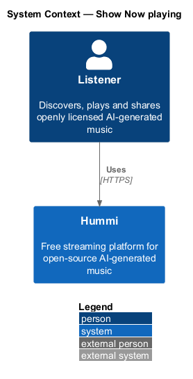
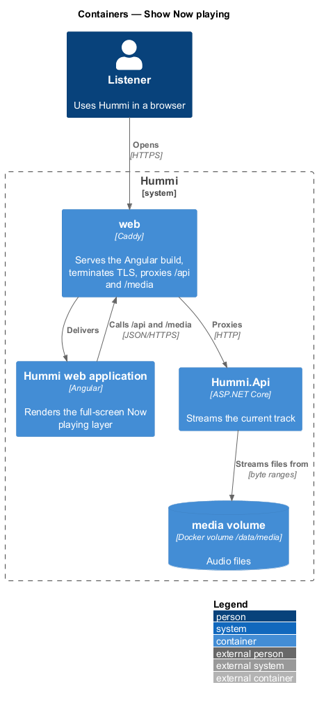
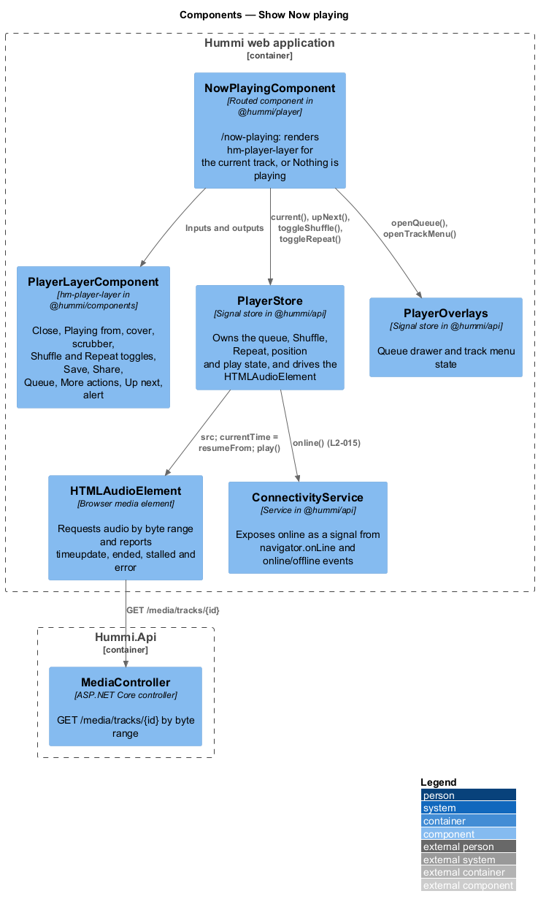
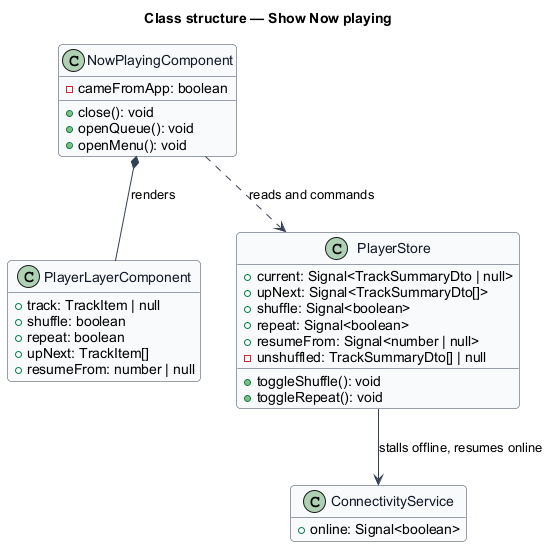
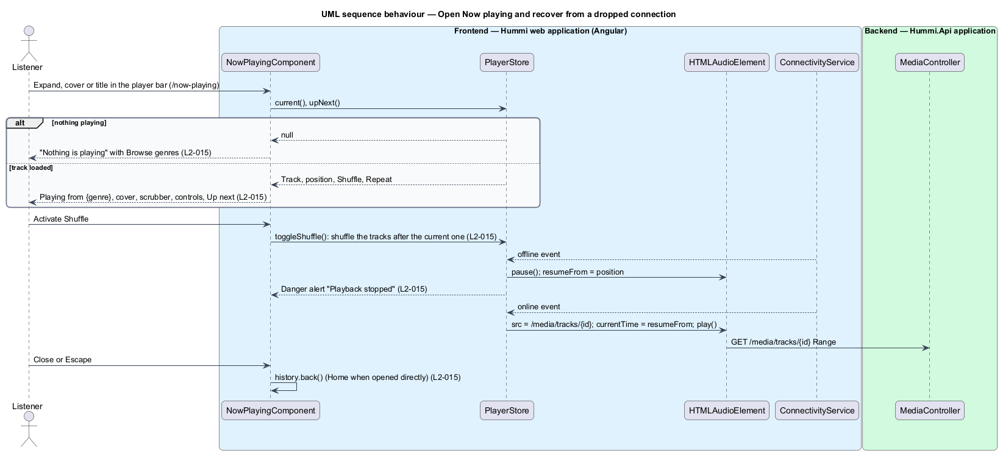

# Show Now playing

## Overview

Now playing (`/now-playing`) is the full-screen layer for the current track. It fades in over the page
with "Close" and "Playing from {genre}", a large cover, the title and artist, the full scrubber with
elapsed and total time, and the controls Shuffle, Previous track, Play or Pause, Next track and Repeat.
Below them sit Save, Share, Queue and More actions, and an "Up next" list of the next two tracks.

- **shuffle mode** — the tracks after the current one play in random order; turning it off restores the order they came in, from the current track on
- **repeat mode** — after the last track the queue starts again from its first; there is no repeat-one (ADR 0009)
- **resume position** — playback position kept when the connection drops, used to resume once online

Now playing has no data of its own; it renders `PlayerStore`. The player bar is hidden on this route
(`data.hidePlayer`) and is back as soon as the layer closes.

## Description

The slice is frontend-only; the genre it names comes with every track summary (`genreSlug`, `genreName`).

**Frontend — Hummi web application (Angular)**

- **`NowPlayingComponent`** — Routed component in @hummi/player. Renders `hm-player-layer` for `PlayerStore.current()`, or "Nothing is playing" with a "Browse genres" link. Close and Escape go back with `history.back()` when the app navigated here, otherwise to Home. Queue closes the layer and opens the queue drawer; More actions opens the track menu. Save and Share render now and are wired by the library (journey 09) and sharing (journey 11) journeys
- **`PlayerLayerComponent`** — `hm-player-layer` in @hummi/components. The `layer-player` dialog with Close focused on open, `hm-scrubber`, Shuffle and Repeat as `aria-pressed` toggles, the danger `hm-alert` while stalled, the Up next `srow` list and `hm-empty-state`
- **`PlayerStore`** — Signal store in @hummi/api. Owns the queue, Shuffle, Repeat, position and play state, and drives the `HTMLAudioElement`
- **`HTMLAudioElement`** — Browser media element. Requests audio by byte range and reports `timeupdate`, `ended`, `stalled` and `error`
- **`ConnectivityService`** — Service in @hummi/api. Exposes `online` as a signal from `navigator.onLine` and `online`/`offline` events

**Backend — Hummi.Api application**

- **`MediaController`** — ASP.NET Core controller. `GET /media/tracks/{id}` streams the audio by byte range (journey 02)

Decisions:

- Shuffle reorders only the tracks after the current one and keeps the order it came from; playing a list with Shuffle on starts at the chosen track and shuffles the rest.
- With Repeat on, Next and the end of the last track start the queue again, and Up next continues with the queue's start.
- On an `offline` event, a stream error or a stall, the store pauses, keeps the position and shows "Playback stopped"; on `online` it reloads the stream and seeks to that position. Play while stalled retries from the same position.
- Now playing renders the scrubber, not a waveform; the waveform stays on the track page (L2-008).

## Requirements

The feature realizes the following level-2 (L2) requirements. Each L2 requirement refines a level-1 (L1) requirement in `docs/specs/L1.md`; the text is copied from `docs/specs/L2.md`.

| L2 ID | Refines (L1) | Requirement |
|-------|--------------|-------------|
| `L2-015` | `L1-004` | **Now playing.** 1. Given a track is loaded, when the listener opens Now playing from the player bar, then a full-screen layer fades in with a "Close" button, the line "Playing from {genre}", the large cover, the title, the artist, a full scrubber with elapsed and total time, and the controls "Shuffle", "Previous track", "Pause"/"Play", "Next track" and "Repeat". 2. Given "Shuffle" or "Repeat", when activated, then its pressed state toggles and playback order or repetition follows it. 3. Given Now playing, when it renders, then it shows "Save" (reading "Saved" once saved), "Share", "Queue" and "More actions" buttons; "Share" opens the Share dialog (L2-025), "Queue" the queue drawer (L2-016) and "More actions" the track menu (L2-053). 4. Given Now playing, when it renders, then an "Up next" list shows the next two queued tracks with cover, title, artist and duration. 5. Given Now playing is open, when the listener activates "Close" or presses Escape, then it closes and the player bar remains. 6. Given nothing is playing, when Now playing is opened directly, then it shows "Nothing is playing" with "Press play on any track and it shows up here with the waveform and queue." and a "Browse genres" button. 7. Given the connection drops while streaming, when Now playing renders, then a danger alert reads "Playback stopped" with "We lost the connection while streaming {title}. We’ll resume from {position} once you’re back online.", and playback resumes from that position when the connection returns. |

## Diagrams

### System context

A listener views and controls the current track in Hummi. No external system takes part.

### Containers

Now playing runs in the Angular application; only the audio stream reaches `Hummi.Api`.

### Components

`NowPlayingComponent` renders `hm-player-layer` from `PlayerStore`, which watches `ConnectivityService`.

### Class structure

`PlayerStore` adds Shuffle, Repeat, Up next and the resume position, and listens to `ConnectivityService`.

### Behaviour — open Now playing and recover from a dropped connection

The page renders `PlayerStore` state. When the connection drops the store keeps the position and resumes from it when `ConnectivityService` reports the connection back.

