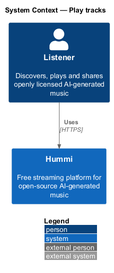
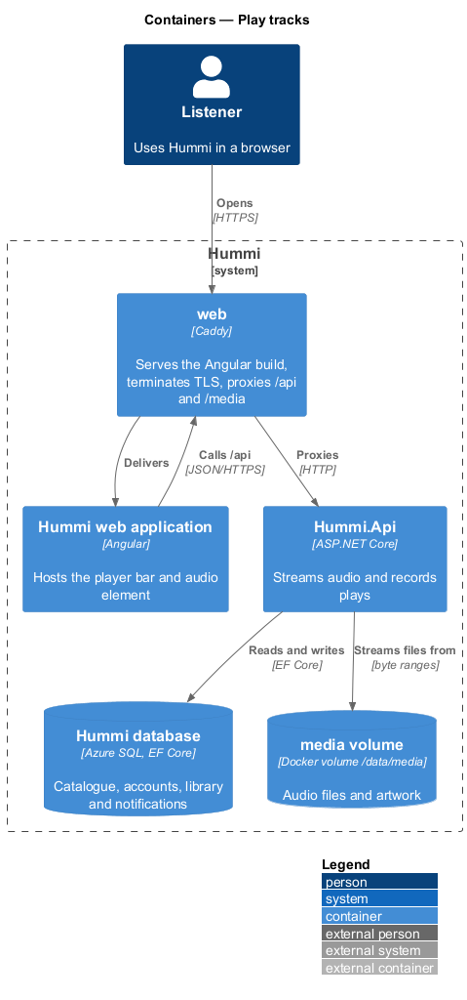
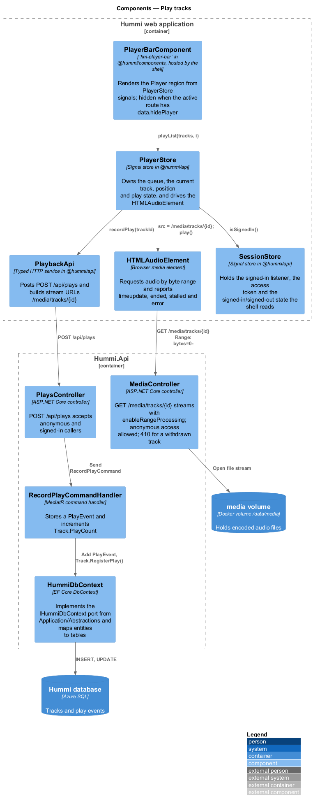
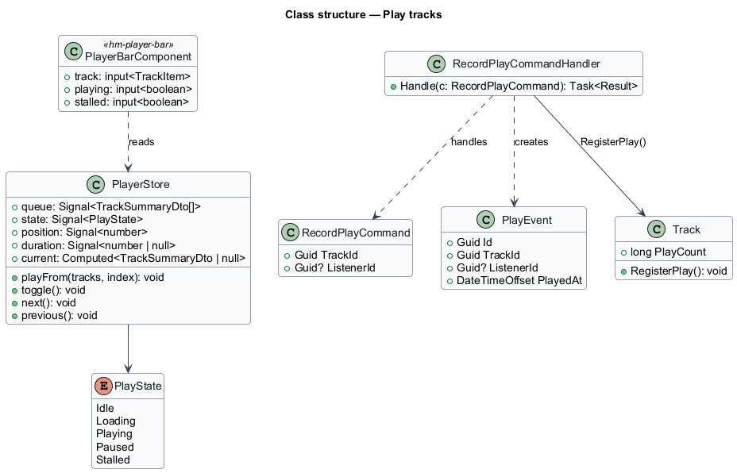
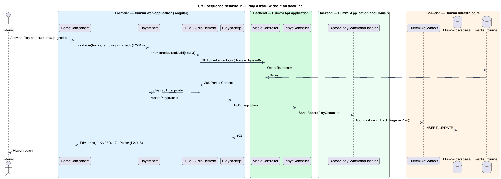
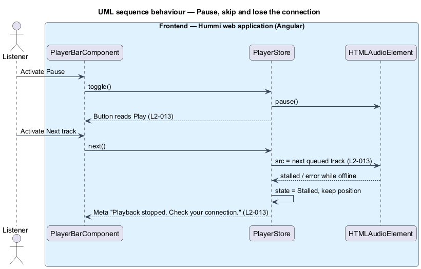

# Play tracks

## Overview

The playback subsystem turns a list of tracks into sound. Its centre is the player bar, a persistent
region at the bottom of most shell pages that shows the current track and the transport controls.
Anyone can play: playback does not require an account, so a signed-out listener hears music
immediately and the shell offers Sign in and Sign up instead of account controls.

- **player bar** — persistent "Player" region with cover, title, artist, Previous track, Play/Pause, Next track, Track position, Queue and Volume
- **queue** — ordered list of tracks the player plays next; owned by `PlayerStore`
- **play event** — record that a listener (or an anonymous session) started a track, used for play counts and history
- **stream** — audio file served by byte range from the media volume

The player bar is hidden until a track is loaded, and on Settings, Notifications, Licence, Shared track,
auth and error pages; the route data of each of those pages declares `hidePlayer: true`.

## Description

State lives in one browser-side store shared by every feature library. The backend streams audio and records plays.

**Frontend — Hummi web application (Angular)**

- **`PlayerBarComponent`** — `hm-player-bar` in @hummi/components, hosted by the shell. Renders the Player region from inputs the shell binds to `PlayerStore` signals; the shell omits it when nothing is loaded or the active route has `data.hidePlayer`
- **`HomeComponent`** — Routed page in the `@hummi/player` feature library. Loads `GET /api/home` through `apiResource` and plays a shelf card or track row through `PlayerStore`
- **`PlayerStore`** — Signal store in @hummi/api. Owns the queue, the current track, position and play state, and drives the `HTMLAudioElement`
- **`HTMLAudioElement`** — Browser media element. Requests audio by byte range and reports `timeupdate`, `ended`, `stalled` and `error`
- **`PlaybackApi`** — Typed HTTP service in @hummi/api. Posts `POST /api/plays`, builds stream URLs `/media/tracks/{id}` and reads `GET /api/home`
- **`ShellComponent`** — Shell component in the hummi application. Shows Sign in and Sign up when `SessionStore` is signed out, otherwise the bell and avatar (`L2-014`)
- **`SessionStore`** — Signal store in @hummi/api. Holds the signed-in listener, the access token and the signed-in/signed-out state the shell reads

**Backend — Hummi.Api application**

- **`MediaController`** — ASP.NET Core controller. `GET /media/tracks/{id}` streams with `enableRangeProcessing`; anonymous access allowed; 404 for an unknown track or missing file, 410 for a withdrawn track
- **`HomeController`** — ASP.NET Core controller. `GET /api/home` returns the Recently added shelf and the Top 10 list through `GetHomeQuery`
- **`PlaysController`** — ASP.NET Core controller. `POST /api/plays` accepts anonymous and signed-in callers

**Backend — Hummi Application and Domain**

- **`RecordPlayCommandHandler`** — MediatR command handler. Stores a `PlayEvent` and increments `Track.PlayCount`. A play counts as soon as playback starts (no minimum listened time); the browser posts it once per track start

**Backend — Hummi Infrastructure**

- **`HummiDbContext`** — EF Core DbContext. Implements the `IHummiDbContext` port from `Application/Abstractions` and maps entities to tables
- **`Hummi database`** — Azure SQL. Tracks and play events
- **`media volume`** — Docker volume /data/media (`MediaStorage:RootPath`). Holds encoded audio files at `tracks/{trackId}.wav`; `IMediaStore` resolves them

Out of scope here and covered by later journeys: the Queue drawer, Now playing and Expand (journey 06), the like button's effect (journey 09) and Share (journey 11). Their buttons render in the player bar now.

## Requirements

The feature realizes the following level-2 (L2) requirements. Each L2 requirement refines a level-1 (L1) requirement in `docs/specs/L1.md`; the text is copied from `docs/specs/L2.md`.

| L2 ID | Refines (L1) | Requirement |
|-------|--------------|-------------|
| `L2-013` | `L1-004` | **Player bar.** 1. Given a track is loaded, when the listener is on any page, then a "Player" region at the bottom slides in and shows the cover, title and artist (opening Now playing), a like button, a "More actions" button, "Previous track", "Pause"/"Play" and "Next track" buttons, a "Track position" scrubber with elapsed and total time (e.g. "1:14" and "3:42"), and "Share", "Queue", "Volume" and "Expand" buttons. 2. Given nothing is loaded, when a page renders, then no player bar is shown, and it appears as soon as any track is played. 3. Given a track is playing, when the listener activates "Pause", then playback pauses and the button becomes "Play"; activating "Play" resumes it; a track that is playing shows an animated equaliser before its title. 4. Given "Next track" or "Previous track", when activated, then the next or previous queued track plays. 5. Given "Queue", when activated, then the queue drawer opens (L2-016); given its cover, title or "Expand", then Now playing opens (L2-015). 6. Given playback stops because the connection dropped, when the player renders, then its meta line reads "Playback stopped. Check your connection." |
| `L2-014` | `L1-004` | **Listening without an account.** 1. Given a signed-out listener, when they press play on any playable track, then it plays without asking them to sign in. 2. Given a signed-out listener, when the shell renders, then the header shows "Sign in" and "Sign up" instead of the notifications bell and account avatar. |

## Diagrams

### System context

A listener, signed in or not, plays music in Hummi. No external system takes part.

### Containers

The browser streams audio from `/media`, which `web` proxies to `Hummi.Api`; the API reads files from the media volume and records plays in the database.

### Components

`PlayerBarComponent` and every play button call `PlayerStore`, which drives `HTMLAudioElement` and `PlaybackApi`. `MediaController` streams files; `PlaysController` sends `RecordPlayCommand`.

### Class structure

`PlayerStore` holds the queue, index, position and `PlayState`. `RecordPlayCommandHandler` creates a `PlayEvent` and calls `Track.RegisterPlay()`.

### Behaviour — play a track without an account

Pressing play needs no session (`L2-014`). The audio element fetches byte ranges from `MediaController`, and `PlayerStore` records the play in the background.

### Behaviour — pause, skip and lose the connection

Transport buttons call `PlayerStore`, which drives the audio element. A stalled stream sets `PlayState.Stalled` and the bar shows the connection message.

