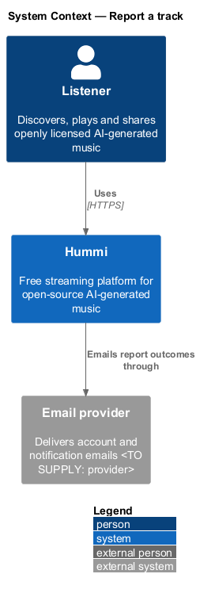
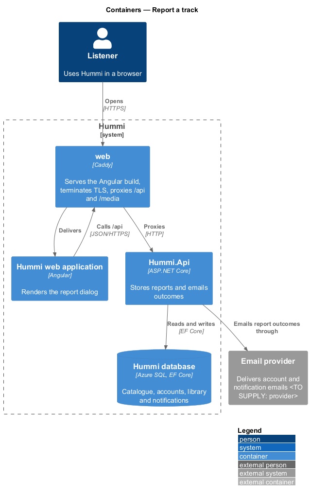
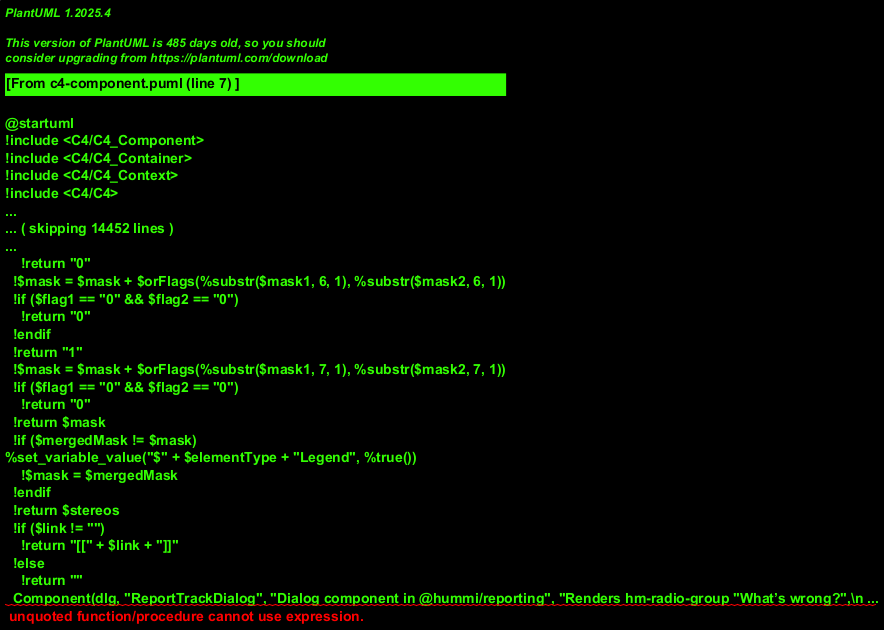
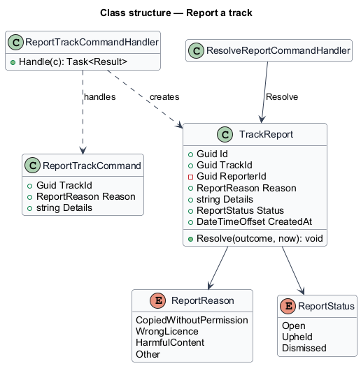
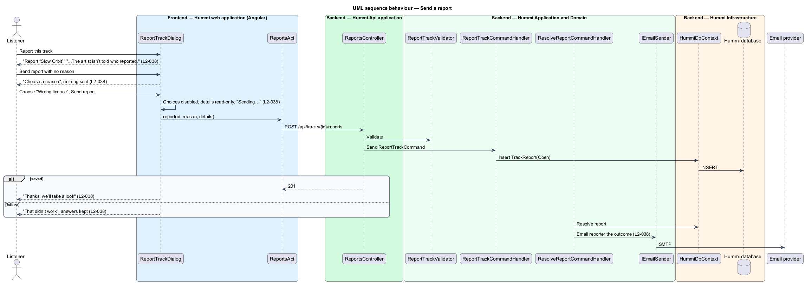

# Report a track

## Overview

Any listener may report a track for copyright, licence or safety problems. The artist is never told
who reported. Reports are reviewed within 2 working days and the reporter is emailed the outcome.
Hummi has no moderation tooling in the product; reviewers work outside it <TO SUPPLY: review channel>.

- **report** — record of a track, a reason and optional details, linked to the reporter for the outcome email only
- **reason** — one of `CopiedWithoutPermission`, `WrongLicence`, `HarmfulContent`, `Other`

Whether a signed-out listener may report, and how they then receive the outcome, is <TO SUPPLY>.

## Description

A command stores the report; the reporter identity is excluded from every artist-facing projection.

**Frontend — Hummi web application (Angular)**

- **`ReportTrackDialog`** — Dialog component in @hummi/reporting. Renders `hm-radio-group` "What’s wrong?", `hm-textarea` Details, busy, success and error states
- **`ReportsApi`** — Typed HTTP service in @hummi/api. Calls `POST /api/tracks/{id}/reports`

**Backend — Hummi.Api application**

- **`ReportsController`** — ASP.NET Core controller. `POST /api/tracks/{id}/reports`

**Backend — Hummi Application and Domain**

- **`ReportTrackValidator`** — FluentValidation validator. Reason required; details at most <TO SUPPLY> characters
- **`ReportTrackCommandHandler`** — MediatR command handler. Stores `TrackReport` with status `Open`
- **`ResolveReportCommandHandler`** — MediatR command handler. Records the outcome and emails the reporter
- **`IEmailSender`** — Application port. Sends the outcome email

**Backend — Hummi Infrastructure**

- **`HummiDbContext`** — EF Core DbContext. Implements the `IHummiDbContext` port from `Application/Abstractions` and maps entities to tables
- **`Hummi database`** — Azure SQL. Track reports

## Requirements

The feature realizes the following level-2 (L2) requirements. Each L2 requirement refines a level-1 (L1) requirement in `docs/specs/L1.md`; the text is copied from `docs/specs/L2.md`.

| L2 ID | Refines (L1) | Requirement |
|-------|--------------|-------------|
| `L2-038` | `L1-010` | **Report a track.** 1. Given a track page, when the listener activates "Report this track", then the dialog "Report “{title}”" reads "Tell us what’s wrong. The artist isn’t told who reported." with the required choice "What’s wrong?" (options "Copied from an artist without permission", "Wrong licence", "Harmful or hateful content", "Something else"), an optional "Details" text area, "Cancel" and "Send report". 2. Given no reason chosen, when they submit, then the choice shows "Choose a reason" and nothing is sent. 3. Given sending is in progress, when the dialog renders, then the choices are disabled, the details are read-only, "Cancel" is disabled and the button reads "Sending…". 4. Given a successful report, when the dialog renders, then it shows "Thanks, we’ll take a look" with "Reports are reviewed within 2 working days. We’ll email you the outcome." and "Close". 5. Given a stored report, when the artist's data is viewed, then the reporter's identity is not exposed; when the report is resolved, then the reporter is emailed the outcome. 6. Given sending fails, when the dialog renders, then it shows "That didn’t work" with "Your report wasn’t sent. Your answers are still here; try again." and the answers are kept. |

## Diagrams

### System context

A listener reports a track to Hummi; the outcome is emailed through the email provider.

### Containers

`Hummi.Api` stores reports in the database and sends outcome emails through the provider.

### Components

`ReportTrackDialog` calls `ReportsApi`; `ReportsController` validates and sends `ReportTrackCommand`. `ResolveReportCommandHandler` uses `IEmailSender`.

### Class structure

`TrackReport` holds a `ReportReason` and `ReportStatus`; the reporter id is private and never projected to artists.

### Behaviour — send a report

`ReporterId` is private to the report and appears in no artist-facing DTO. When a reviewer resolves a report, `ResolveReportCommandHandler` emails the outcome.

