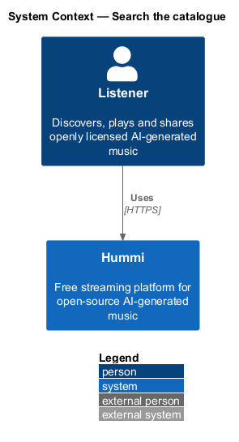
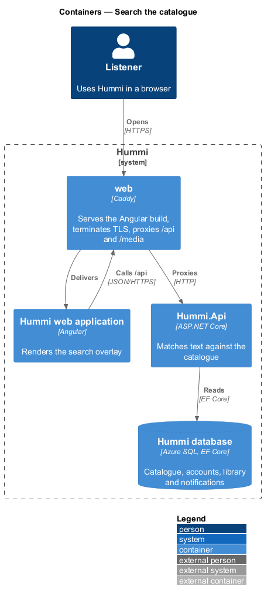
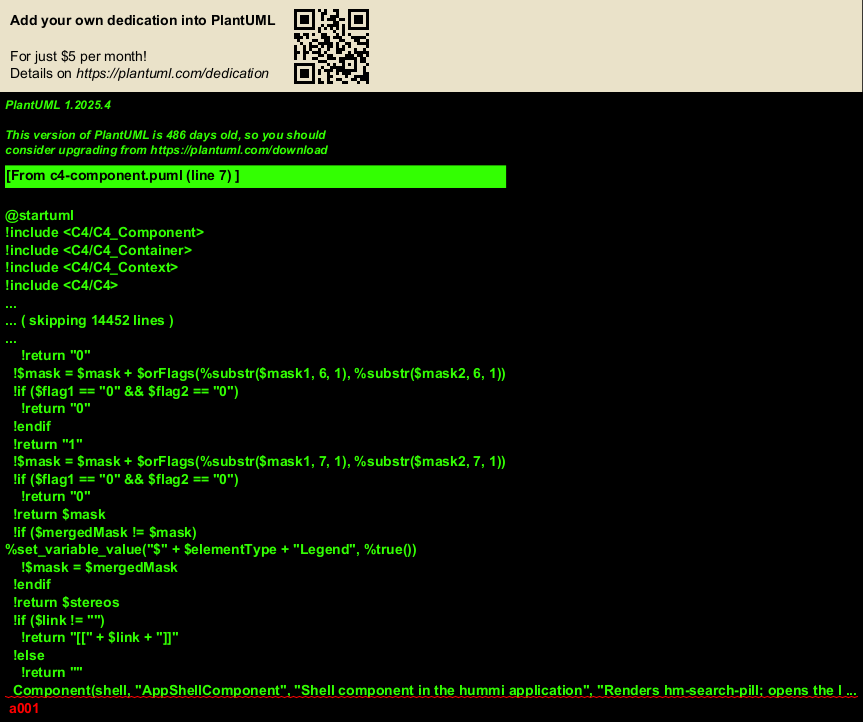
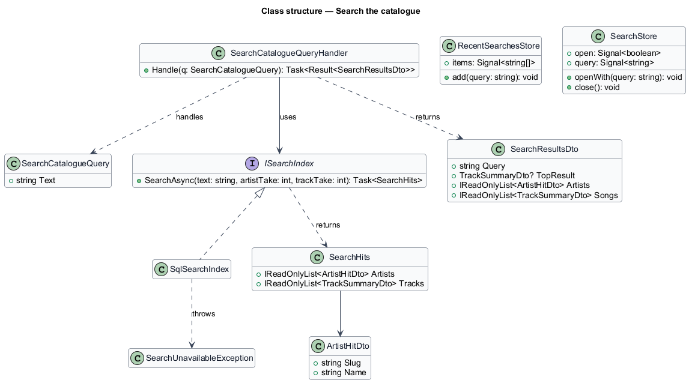
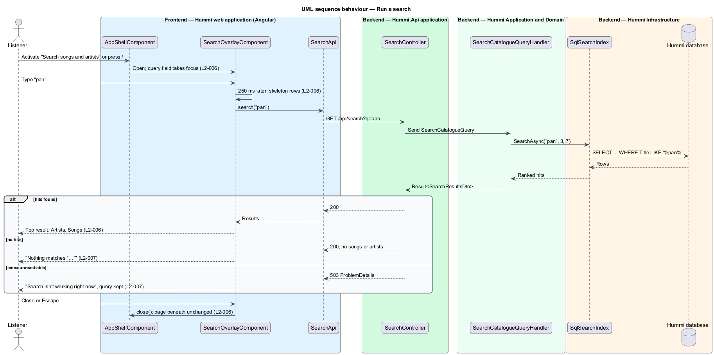
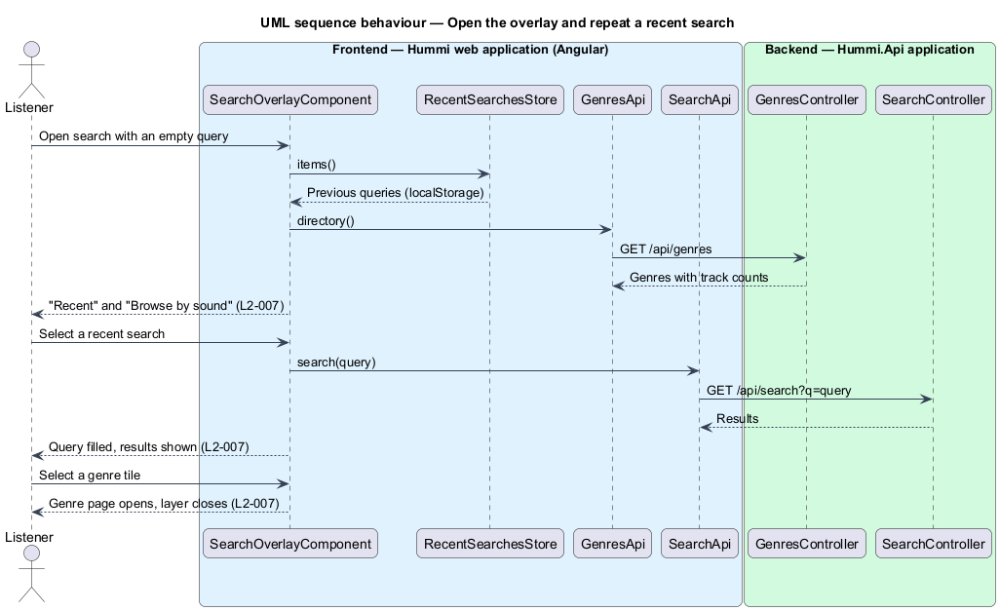

# Search the catalogue

## Overview

Search is a layer that drops in from the top over the current page (ADR 0004). A listener opens it
from the header search field ("Search songs and artists"), with `/`, or by opening `/search`; the
query field takes focus and results appear as they type. Close or Escape removes the layer and leaves
the page beneath unchanged.

- **query** — free text the listener types, 1 to 100 characters once trimmed
- **top result** — the best matching song, shown as a large card
- **recent search** — query the listener ran earlier on this device, listed while the query is empty so it can run again

Only published (not withdrawn) tracks and their artists are searchable. A query with no match shows a
no-results state; an unreachable search backend shows an error that keeps the query in the field.
Playlists and result-type tabs are not part of the overlay (ADR 0008).

## Description

Search is a read slice. The first release matches text in the database with `LIKE`; the matching technique is isolated behind the `ISearchIndex` port so a dedicated engine can replace it (ADR 0008).

**Frontend — Hummi web application (Angular)**

- **`AppShellComponent`** — Shell component in the hummi application. Renders `hm-search-pill` in the header end slot, opens the layer on activation or on `/` while no text field is focused, and renders `hm-search-overlay` while `SearchStore.open()` is true
- **`SearchOverlayComponent`** (`hm-search-overlay`) — Component in @hummi/search, exported for the shell. Composes `hm-search-layer` with the Top result, Artists (up to 3) and Songs (up to 7) lists, skeleton rows while busy, and the empty, no-results and error states. Searches 250 ms after the last keystroke; Enter searches at once
- **`RecentSearchesStore`** — Signal store in @hummi/search. Keeps the last 6 queries, newest first and without duplicates, in `localStorage` under `hummi.recent-searches`. A query is added when the listener presses Enter or chooses a result
- **`SearchStore`** — Signal store in @hummi/api. Holds whether the layer is open and the query it opens with, so the shell, routes and later the track menu can open it
- **`searchRoutes`** — Route table of @hummi/search. `/search?q=` opens the layer with that query over Home, so "Search Hummi" links keep working
- **`SearchApi`** — Typed HTTP service in @hummi/api. Calls `GET /api/search?q=`

**Backend — Hummi.Api application**

- **`SearchController`** — ASP.NET Core controller. Exposes `GET /api/search?q=` for any visitor; returns 422 ProblemDetails for an empty or too long query and 503 (`SEARCH_UNAVAILABLE`) when the index is unreachable

**Backend — Hummi Application and Domain**

- **`SearchCatalogueQueryHandler`** — MediatR query handler. Trims and validates the query (1 to 100 characters), asks `ISearchIndex` for up to 3 artists and 7 songs, and returns the first song as the top result. A `SearchUnavailableException` from the port becomes the 503 error
- **`ISearchIndex`** — Application port. `SearchAsync(text, artistTake, trackTake)` returns ranked artists and songs

**Backend — Hummi Infrastructure**

- **`SqlSearchIndex`** — Infrastructure adapter. Implements `ISearchIndex` with `EF.Functions.Like` over track titles and artist names (wildcards in the query escaped). Matches starting with the query rank first, then the most played tracks and the artists with the most monthly listeners. A database failure becomes `SearchUnavailableException`
- **`Hummi database`** — Azure SQL. Tracks and artists

## Requirements

The feature realizes the following level-2 (L2) requirements. Each L2 requirement refines a level-1 (L1) requirement in `docs/specs/L1.md`; the text is copied from `docs/specs/L2.md`.

| L2 ID | Refines (L1) | Requirement |
|-------|--------------|-------------|
| `L2-006` | `L1-002` | **Search overlay and results.** 1. Given any page, when the listener activates the header search field ("Search songs and artists"), presses "/" with no text field focused, or chooses "More from {artist}" in a track menu, then the search overlay drops in from the top over the page and the query field takes focus. 2. Given the overlay, when it is open, then it shows a Search field with a "Clear" button (only once text is typed) and a "Close" button; given the listener activates "Close" or presses Escape, then it closes and the page beneath is unchanged. 3. Given the query "pan", when results return, then the overlay shows a "Top result" card (cover, title, "{artist} · {duration}"), an "Artists" list of up to 3 and a "Songs" list of up to 7, each song with cover, title, artist, duration and a "More actions for {title}" button on hover. 4. Given a song result, when it is the current track, then its title is coral and shows an equaliser while it plays. 5. Given a search in progress, when results have not returned, then skeleton rows are shown in place of the lists. |
| `L2-007` | `L1-002` | **Search empty, no-results and error states.** 1. Given an empty query, when the overlay opens, then it shows a "Recent" list of earlier searches (e.g. "Kaiso Collective", "panorama", "lullaby", "Shanique"), each with a clock icon, and a "Browse by sound" grid of genre tiles, each with its title and "{n} tracks". 2. Given a recent search, when the listener selects it, then it fills the query and runs it again. 3. Given a genre tile, when the listener selects it, then the Genre page opens. 4. Given the query "rainfall in b-flat" with no matches, when results return, then the overlay shows "Nothing matches “rainfall in b-flat”" with "Try an artist name, or a sound like soca, pan or lullaby." 5. Given search is unreachable, when the query is run, then the overlay shows "Search isn’t working right now" with "We couldn’t reach search. Your query is still in the box; try again in a moment." and the query remains in the field. |

The "More from {artist}" entry of L2-006 AC1 arrives with the track menu (L2-053); `SearchStore.openWith(query)` is the hook it calls.

## Diagrams

### System context

A listener searches Hummi. No external system takes part in the first release.

### Containers

The Angular application is delivered by the `web` container, which also proxies `/api` to `Hummi.Api`; the API reads the Hummi database through EF Core.

### Components

The shell opens `SearchOverlayComponent` through `SearchStore`; the overlay calls `SearchApi`. `SearchController` sends `SearchCatalogueQuery`; the handler uses the `ISearchIndex` port, implemented by `SqlSearchIndex`.

### Class structure

`SearchCatalogueQueryHandler` depends on the `ISearchIndex` abstraction, which `SqlSearchIndex` realizes. The port returns `SearchHits`; the handler shapes them into `SearchResultsDto`.

### Behaviour — run a search

Typing searches after a short pause. The handler delegates matching to `ISearchIndex`; an unreachable index becomes a 503 that the overlay renders as the error state of `L2-007`.

### Behaviour — open the overlay and repeat a recent search

With no query, the overlay lists the device's recent searches from `RecentSearchesStore` and the genres from `GenresApi`; selecting a recent search fills the field and runs it.

