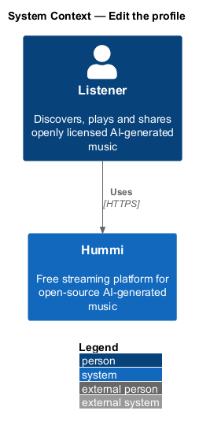
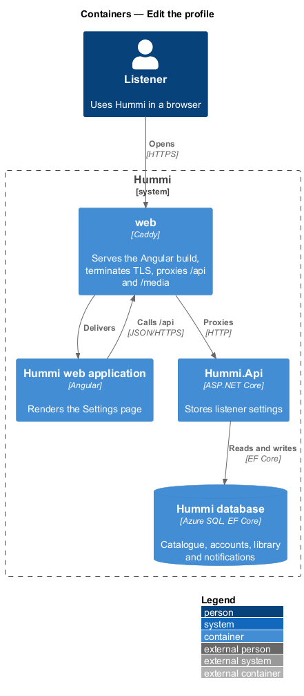
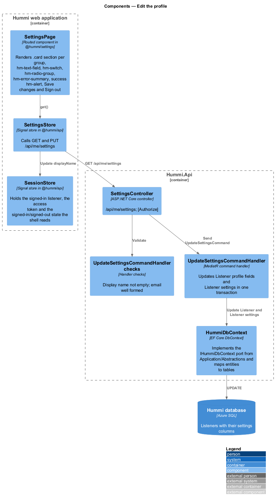
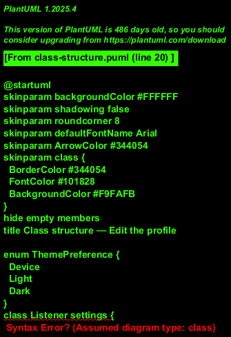
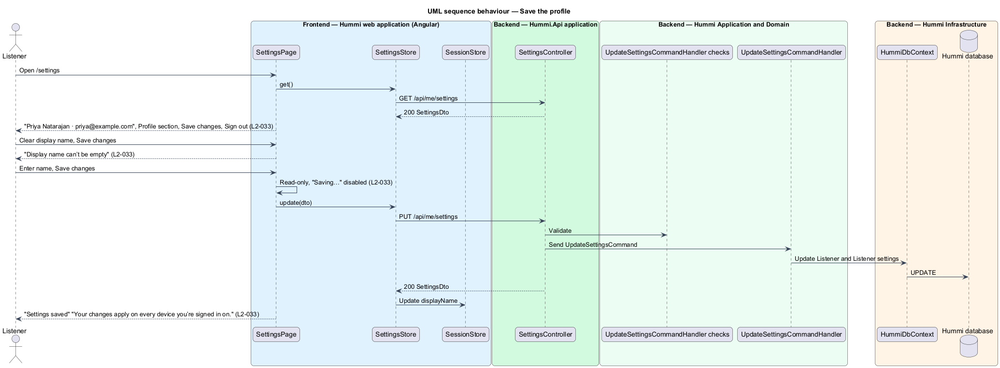

# Edit the profile

## Overview

Settings (`/settings`) is one page of sections: Profile, Playback, Appearance and Notifications, with
Save changes and Sign out at the bottom. This feature covers the Profile section: display name and
email. Settings are stored on the server, so a saved change applies on every device the listener
signs in on.

- **profile** — listener's display name and sign-in email

Changing the email address re-starts confirmation with a fresh link; sign-in uses the new address at once (ADR 0016).

## Description

One form saves every section with a single command; this slice describes the profile fields.

**Frontend — Hummi web application (Angular)**

- **`SettingsPage`** — Routed component in @hummi/settings. Renders a `.card` section per group, `hm-text-field`, `hm-switch`, `hm-radio-group`, `hm-error-summary`, success `hm-alert`, Save changes and Sign out
- **`SettingsStore`** — Signal store in @hummi/api. Calls `GET` and `PUT /api/me/settings` and applies the theme and Playback switches
- **`SessionStore`** — Signal store in @hummi/api. Holds the signed-in listener, the access token and the signed-in/signed-out state the shell reads

**Backend — Hummi.Api application**

- **`SettingsController`** — ASP.NET Core controller. `/api/me/settings`; `[Authorize]`

**Backend — Hummi Application and Domain**

- **`UpdateSettingsCommandHandler` checks** — Display name not empty; email well formed and not taken (422)
- **`UpdateSettingsCommandHandler`** — MediatR command handler. Updates the `Listener` profile and settings columns in one save

**Backend — Hummi Infrastructure**

- **`HummiDbContext`** — EF Core DbContext. Implements the `IHummiDbContext` port from `Application/Abstractions` and maps entities to tables
- **`Hummi database`** — Azure SQL. Listeners with their settings columns

## Requirements

The feature realizes the following level-2 (L2) requirements. Each L2 requirement refines a level-1 (L1) requirement in `docs/specs/L1.md`; the text is copied from `docs/specs/L2.md`.

| L2 ID | Refines (L1) | Requirement |
|-------|--------------|-------------|
| `L2-033` | `L1-008` | **Settings profile.** 1. Given a signed-in listener, when they open Settings (`/settings`), then the subtitle shows their name and email (e.g. "Nadia Charles · nadia@example.com") and a "Profile" section shows "Display name" (required) and "Email" (help "We use this for sign-in and account emails only."). 2. Given an empty display name, when they submit, then the summary and field show "Display name can’t be empty" and nothing is saved. 3. Given saving is in progress, when the form renders, then the fields are read-only and the button reads "Saving…" and is disabled. 4. Given a successful save, when the form renders, then a success alert reads "Settings saved" with "Your changes apply on every device you’re signed in on.", and the changes apply on every device the listener is signed in on. 5. Given the form, when it renders, then "Save changes" and "Sign out" are shown at the bottom. |

## Diagrams

### System context

A signed-in listener edits their profile in Hummi. No external system takes part.

### Containers

The Angular application is delivered by the `web` container, which also proxies `/api` to `Hummi.Api`; the API reads and writes the Hummi database through EF Core.

### Components

`SettingsPage` calls `SettingsStore`; `SettingsController` validates and sends `UpdateSettingsCommand`.

### Class structure

`UpdateSettingsCommandHandler` updates `Listener` and `Listener settings`, which holds every preference with its default.

### Behaviour — save the profile

The server stores the profile, so every device reads the same values on its next load. The session store updates the name in the shell immediately.

