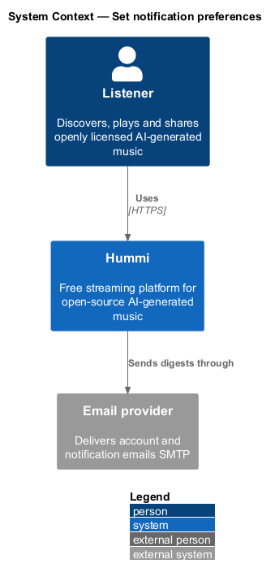
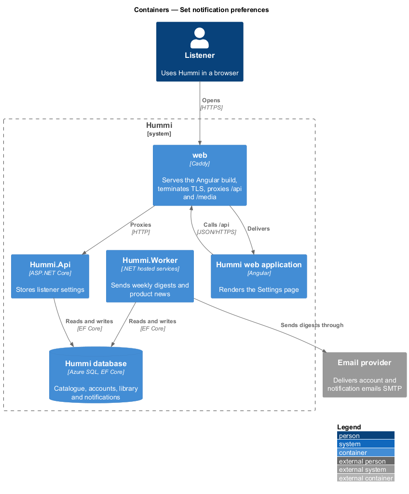
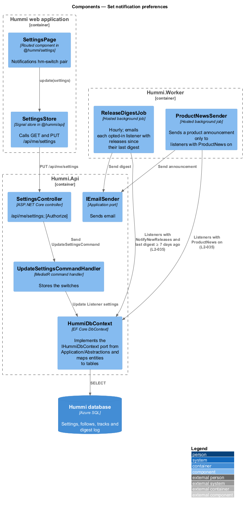
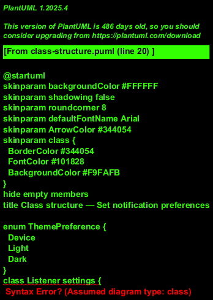
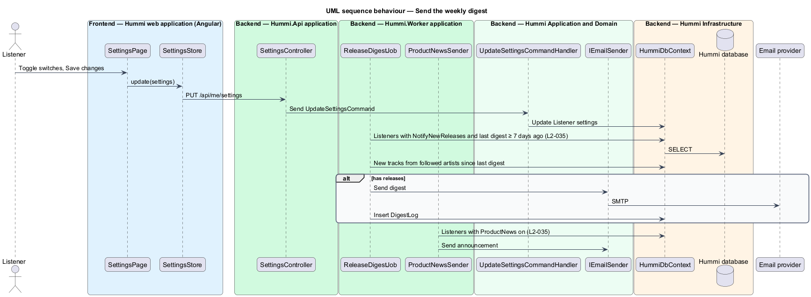

# Set notification preferences

## Overview

The Notifications section of Settings controls email. "New tracks from artists I follow" sends at most
one digest email a week; "Product news" sends occasional product announcements. In-app notifications
(`L2-036`) are not affected.

- **release digest** — weekly email that lists new tracks from followed artists, sent at most once per 7 days

## Description

Preferences are saved with the Settings command; a worker job sends the digest and product news honour them.

**Frontend — Hummi web application (Angular)**

- **`SettingsPage`** — Routed component in @hummi/settings. Notifications `hm-switch` pair
- **`SettingsStore`** — Signal store in @hummi/api. Calls `GET` and `PUT /api/me/settings` and applies the theme and Playback switches

**Backend — Hummi.Api application**

- **`SettingsController`** — ASP.NET Core controller. `/api/me/settings`; `[Authorize]`

**Backend — Hummi.Worker application**

- **`ReleaseDigestJob`** — Hosted background job. Hourly; emails each opted-in listener whose last digest is at least 7 days old, with followed artists' tracks added since (ADR 0016)
- **`ProductNewsSender`** — Hosted background job. Sends a product announcement only to listeners with `ProductNews` on

**Backend — Hummi Application and Domain**

- **`UpdateSettingsCommandHandler`** — MediatR command handler. Stores the switches
- **`IEmailSender`** — Application port. Sends email

**Backend — Hummi Infrastructure**

- **`HummiDbContext`** — EF Core DbContext. Implements the `IHummiDbContext` port from `Application/Abstractions` and maps entities to tables
- **`Hummi database`** — Azure SQL. Settings, follows, tracks and digest log

## Requirements

The feature realizes the following level-2 (L2) requirements. Each L2 requirement refines a level-1 (L1) requirement in `docs/specs/L1.md`; the text is copied from `docs/specs/L2.md`.

| L2 ID | Refines (L1) | Requirement |
|-------|--------------|-------------|
| `L2-035` | `L1-008` | **Settings notification preferences.** 1. Given Settings, when it renders, then a "Notifications" section shows the switches "New tracks from artists I follow" ("At most one email a week.", on by default) and "Product news" ("Rare, and never about other people’s data.", off by default). 2. Given "New tracks from artists I follow" is on, when followed artists release tracks, then the listener receives at most one email per week about them; given it is off, then no such emails are sent. 3. Given "Product news" is off, when product news is sent, then the listener does not receive it; given it is on, then they do. |

## Diagrams

### System context

A signed-in listener chooses which emails Hummi sends through the email provider.

### Containers

`Hummi.Api` stores the preferences; `Hummi.Worker` reads them and sends emails through the provider.

### Components

`SettingsPage` saves through `SettingsStore`; in the worker, `ReleaseDigestJob` and `ProductNewsSender` query preferences and call `IEmailSender`.

### Class structure

`ReleaseDigestJob` reads `Listener settings.NotifyNewReleases` and records each send in `DigestLog`.

### Behaviour — send the weekly digest

`ReleaseDigestJob` uses `DigestLog` to guarantee at most one email per week. Listeners with the switch off are never selected.

