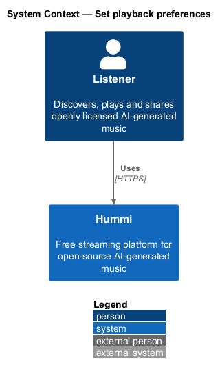
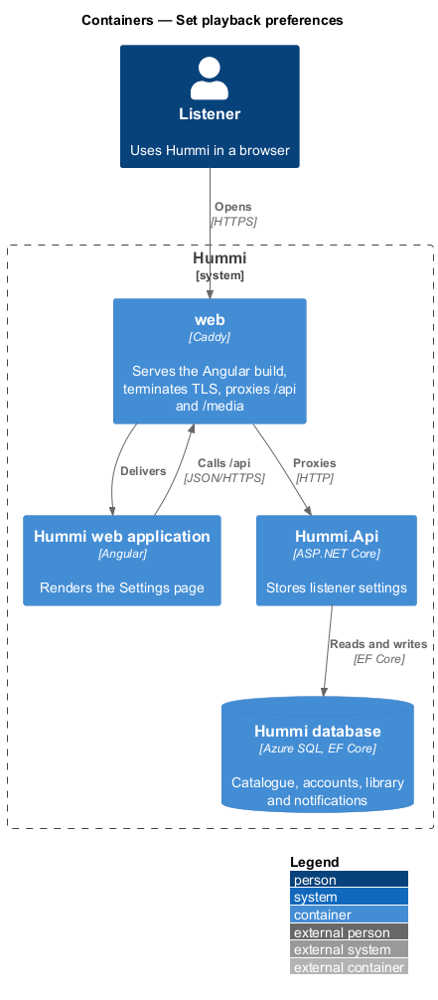
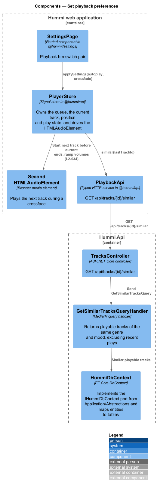
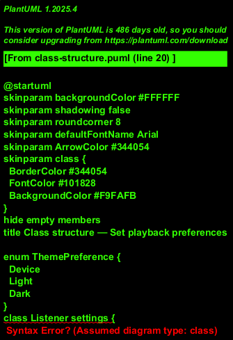
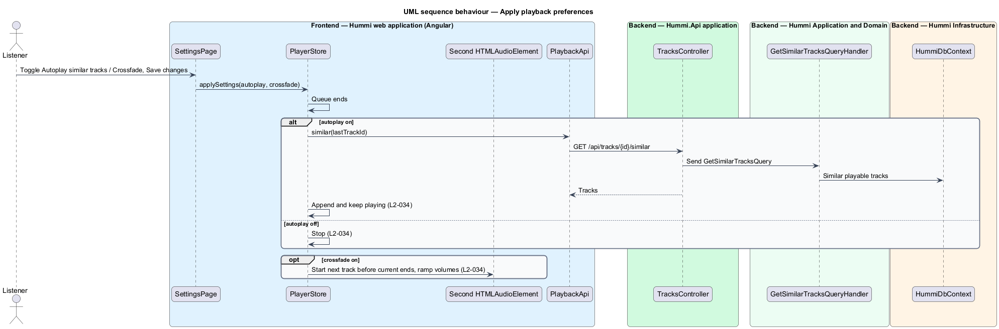

# Set playback preferences

## Overview

The Playback section of Settings holds two switches that change how the player behaves at track and
queue boundaries.

- **autoplay similar** — when the queue ends, the player appends similar tracks and keeps playing (on by default)
- **crossfade** — the last seconds of a track overlap with the start of the next (off by default); overlap length 6 seconds (ADR 0016)

## Description

The switches are saved with the Settings command; `PlayerStore` applies them in the browser.

**Frontend — Hummi web application (Angular)**

- **`SettingsPage`** — Routed component in @hummi/settings. Playback `hm-switch` pair
- **`PlayerStore`** — Signal store in @hummi/api. Owns the queue, the current track, position and play state, and drives the `HTMLAudioElement`
- **`Second HTMLAudioElement`** — Browser media element. Plays the next track during a crossfade
- **`PlaybackApi`** — Typed HTTP service in @hummi/api. `GET /api/tracks/{id}/similar`

**Backend — Hummi.Api application**

- **`TracksController`** — ASP.NET Core controller. `GET /api/tracks/{id}/similar`

**Backend — Hummi Application and Domain**

- **`GetSimilarTracksQueryHandler`** — MediatR query handler. Returns playable tracks of the same genre and mood, excluding recent plays

**Backend — Hummi Infrastructure**

- **`HummiDbContext`** — EF Core DbContext. Implements the `IHummiDbContext` port from `Application/Abstractions` and maps entities to tables
- **`Hummi database`** — Azure SQL. Tracks and settings

## Requirements

The feature realizes the following level-2 (L2) requirements. Each L2 requirement refines a level-1 (L1) requirement in `docs/specs/L1.md`; the text is copied from `docs/specs/L2.md`.

| L2 ID | Refines (L1) | Requirement |
|-------|--------------|-------------|
| `L2-034` | `L1-008` | **Settings playback preferences.** 1. Given Settings, when it renders, then a "Playback" section shows the switches "Autoplay similar tracks" ("Keep playing when your queue ends.", on by default) and "Crossfade" ("Blend the end of one track into the next.", off by default). 2. Given Autoplay is on, when the queue ends, then similar tracks keep playing; given it is off, when the queue ends, then playback stops. 3. Given Crossfade is on, when a track ends, then its end blends into the next track; given it is off, then tracks do not overlap. |

## Diagrams

### System context

A signed-in listener sets how playback continues in Hummi. No external system takes part.

### Containers

The Angular application is delivered by the `web` container, which also proxies `/api` to `Hummi.Api`; the API reads and writes the Hummi database through EF Core.

### Components

`SettingsPage` updates `PlayerStore`, which calls `PlaybackApi` for similar tracks and drives a second audio element for crossfade.

### Class structure

`PlayerStore` mirrors `AutoplaySimilar` and `Crossfade` from `Listener settings`.

### Behaviour — apply playback preferences

Settings travel with the Settings command of the edit-profile feature. `PlayerStore` reads them at sign-in and after save, and fetches similar tracks only when autoplay is on.

