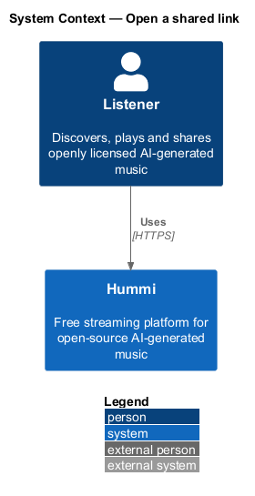
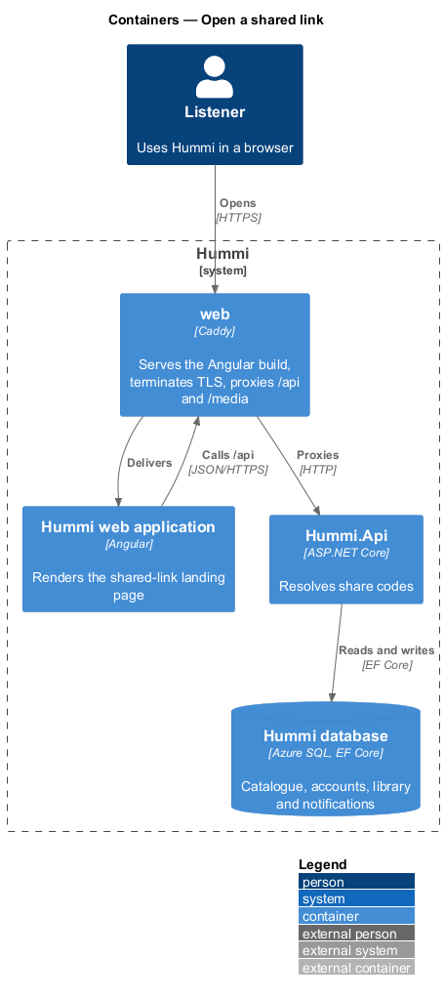
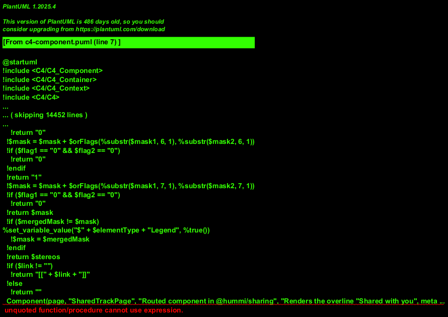
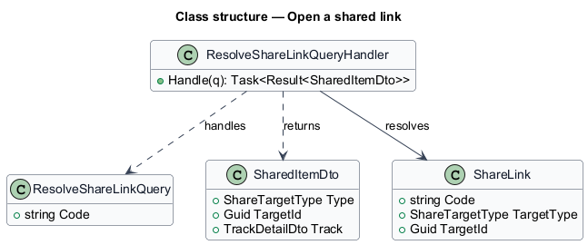
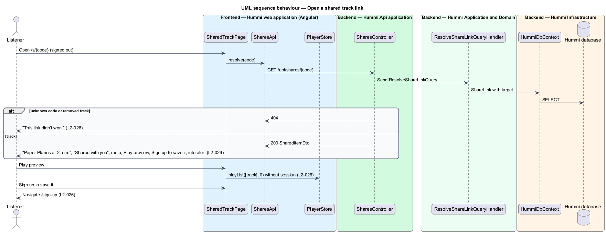

# Open a shared link

## Overview

A shared link (`/s/{code}`) opens a landing page meant for people who do not use Hummi yet. For a
track it shows the title, artist, album, duration, licence and a waveform, with Play preview and
Sign up to save it. The visitor can listen without an account. A playlist code redirects to the
playlist page with read access granted by the link.

- **landing page** — standalone page without the player bar that introduces Hummi to a visitor
- **play preview** — playback of the full track through the shared player without an account, from `?t=` when the link carries a start (ADR 0014)

An unknown code or a removed track shows "This link didn’t work".

## Description

The page resolves the code with one anonymous query.

**Frontend — Hummi web application (Angular)**

- **`SharedTrackPage`** — Routed component in @hummi/sharing at `/s/{code}`. Renders the overline "Shared with you", meta line, Play preview, Sign up to save it, `hm-waveform`, the info `hm-alert` and the failure state; a playlist code redirects to `/playlists/{id}?share={code}`; the player bar stays so the preview can be controlled
- **`SharesApi`** — Typed HTTP service in @hummi/api. Calls `GET /api/shares/{code}`; `TracksApi` then loads the track
- **`PlayerStore`** — Signal store in @hummi/api. Owns the queue, the current track, position and play state, and drives the `HTMLAudioElement`

**Backend — Hummi.Api application**

- **`SharesController`** — ASP.NET Core controller. `GET /api/shares/{code}`; `[AllowAnonymous]`

**Backend — Hummi Application and Domain**

- **`ResolveShareLinkQueryHandler`** — MediatR query handler. Loads the target; NotFound for an unknown code, a withdrawn track or a deleted playlist

**Backend — Hummi Infrastructure**

- **`HummiDbContext`** — EF Core DbContext. Implements the `IHummiDbContext` port from `Application/Abstractions` and maps entities to tables
- **`Hummi database`** — Azure SQL. Share links and their targets

## Requirements

The feature realizes the following level-2 (L2) requirements. Each L2 requirement refines a level-1 (L1) requirement in `docs/specs/L1.md`; the text is copied from `docs/specs/L2.md`.

| L2 ID | Refines (L1) | Requirement |
|-------|--------------|-------------|
| `L2-026` | `L1-006` | **Shared track landing page.** 1. Given a signed-out visitor, when they open a share link `/s/{code}` for Wine Slow, then the page shows the heading "Wine Slow", the overline "Shared with you", "Marisol Vega · Slow Wine · 2:56 · CC BY 4.0", the buttons "Play preview" and "Sign up to save it", and a waveform. 2. Given the landing page, when it renders, then an info alert reads "Free to listen, free to keep" with "Hummi is free. Create an account to save this track to a playlist, follow Marisol Vega and keep your place." 3. Given "Play preview", when activated, then the track plays without an account; given "Sign up to save it", when activated, then Sign up opens. 4. Given an incomplete link or a removed track, when the page loads, then it shows "This link didn’t work" with "The link may be incomplete or the track may have been removed." |

## Diagrams

### System context

A visitor without an account opens a shared link to Hummi. No external system takes part.

### Containers

The Angular application is delivered by the `web` container, which also proxies `/api` to `Hummi.Api`; the API reads and writes the Hummi database through EF Core.

### Components

`SharedTrackPage` calls `SharesApi` and `PlayerStore`; `SharesController` sends `ResolveShareLinkQuery`.

### Class structure

`ResolveShareLinkQueryHandler` resolves a `ShareLink` code to a `SharedItemDto`.

### Behaviour — open a shared track link

The query runs anonymously. A missing or removed target returns 404, which the page renders as its own failure state rather than the global Not found page.

