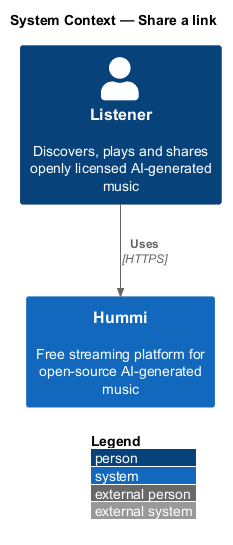
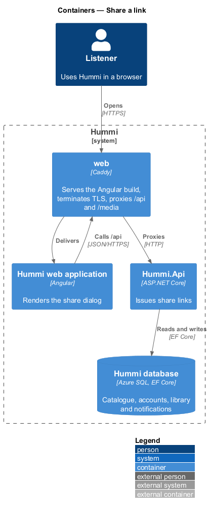
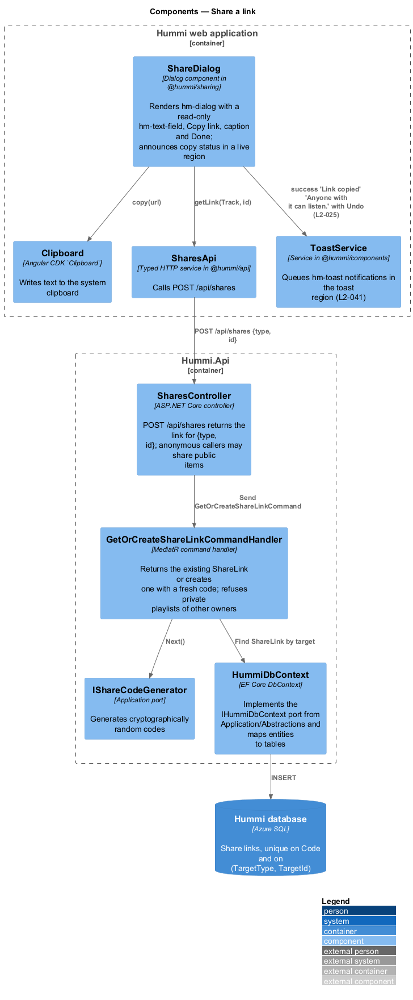
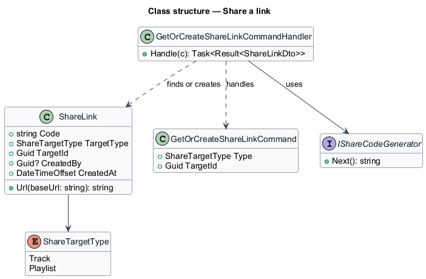
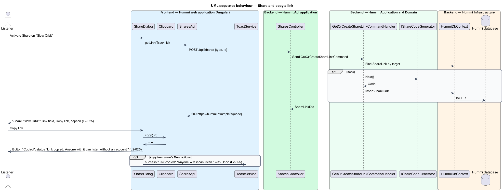

# Share a link

## Overview

The sharing subsystem lets a listener send a track or playlist to anyone. Sharing produces a short
link of the form `https://hummi.example/s/{code}` that opens without an account. The link grants
listening only; nobody who opens it can change the shared item.

- **share link** — stable URL that identifies one track or playlist by a short random code
- **share code** — 8-character URL-safe random string <TO SUPPLY: length and alphabet>

One code exists per item and is reused on every share, so repeated sharing does not mint new links.
Sharing a private playlist grants read access through the link.

## Description

The dialog asks the API for the item's link, creating it on first use, and copies it with the Clipboard API.

**Frontend — Hummi web application (Angular)**

- **`ShareDialog`** — Dialog component in @hummi/sharing. Renders `hm-dialog` with a read-only `hm-text-field`, Copy link, caption and Done; announces copy status in a live region
- **`Clipboard`** — Angular CDK `Clipboard`. Writes text to the system clipboard
- **`SharesApi`** — Typed HTTP service in @hummi/api. Calls `POST /api/shares`
- **`ToastService`** — Service in @hummi/components. Queues `hm-toast` notifications in the toast region (`L2-041`)

**Backend — Hummi.Api application**

- **`SharesController`** — ASP.NET Core controller. `POST /api/shares` returns the link for `{type, id}`; anonymous callers may share public items

**Backend — Hummi Application and Domain**

- **`GetOrCreateShareLinkCommandHandler`** — MediatR command handler. Returns the existing `ShareLink` or creates one with a fresh code; refuses private playlists of other owners
- **`IShareCodeGenerator`** — Application port. Generates cryptographically random codes

**Backend — Hummi Infrastructure**

- **`HummiDbContext`** — EF Core DbContext. Implements the `IHummiDbContext` port from `Application/Abstractions` and maps entities to tables
- **`Hummi database`** — Azure SQL. Share links, unique on Code and on (TargetType, TargetId)

## Requirements

The feature realizes the following level-2 (L2) requirements. Each L2 requirement refines a level-1 (L1) requirement in `docs/specs/L1.md`; the text is copied from `docs/specs/L2.md`.

| L2 ID | Refines (L1) | Requirement |
|-------|--------------|-------------|
| `L2-025` | `L1-006` | **Share dialog.** 1. Given a track or playlist, when the listener activates "Share", then the dialog "Share “{name}”" reads "Send this link by message or email." and shows a read-only link field (format `https://hummi.example/s/{code}`), a "Copy link" button, the caption "Anyone with the link can listen. They can’t change anything." and "Done". 2. Given "Copy link", when activated, then the link is copied to the clipboard, the button reads "Copied", and the status "Link copied. Anyone with it can listen without an account." is announced. 3. Given a link copied outside the dialog, when the copy succeeds, then the success toast "Link copied" with "Anyone with it can listen." and an "Undo" action is shown. 4. Given anyone opens a shared link, when they are not the owner, then they can listen but cannot change the shared item. |

## Diagrams

### System context

A listener shares a track or playlist link from Hummi. Recipients use the link outside the product.

### Containers

The Angular application is delivered by the `web` container, which also proxies `/api` to `Hummi.Api`; the API reads and writes the Hummi database through EF Core.

### Components

`ShareDialog` calls `SharesApi` and the CDK `Clipboard`; `SharesController` sends `GetOrCreateShareLinkCommand`, which uses `IShareCodeGenerator`.

### Class structure

`ShareLink` maps a code to a `ShareTargetType` and target id. The handler finds or creates it through `IShareCodeGenerator`.

### Behaviour — share and copy a link

The handler reuses an existing link for the target or creates one with a random code. Copy writes to the clipboard and announces the status; copies outside the dialog confirm with a toast.

