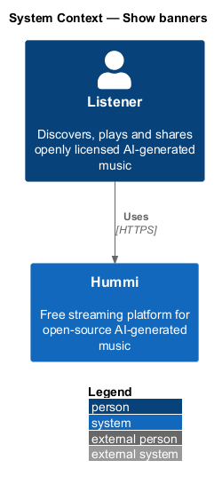
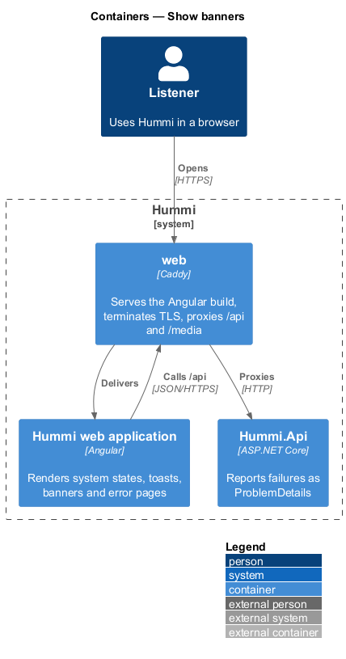
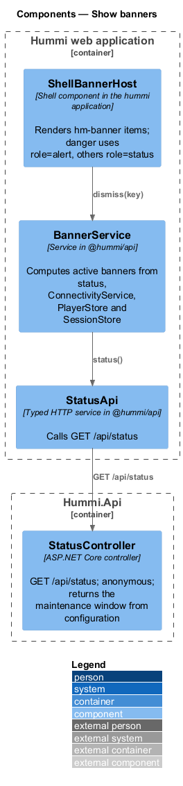
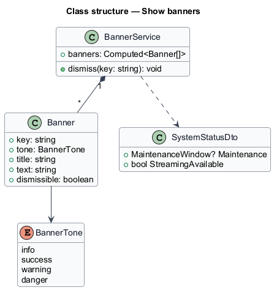
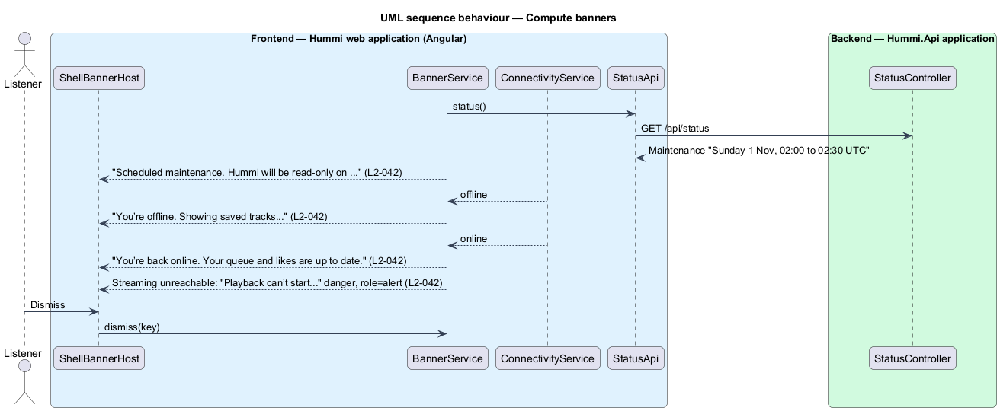

# Show banners

## Overview

A banner is a page-wide message above the top bar for conditions that affect the whole product:
scheduled maintenance, lost or restored connectivity, an unreachable streaming service, and an
unconfirmed email address (`L2-028`).

- **system status** — server-published message such as a maintenance window, read from `GET /api/status`
- **dismissible banner** — banner with a Dismiss button; the email-confirmation banner is not dismissible

## Description

A banner service merges server status, connectivity and session state into an ordered list.

**Frontend — Hummi web application (Angular)**

- **`ShellBannerHost`** — Shell component in the hummi application. Renders `hm-banner` items; danger uses `role=alert`, others `role=status`
- **`BannerService`** — Service in @hummi/api. Computes active banners from status, `ConnectivityService`, `PlayerStore` and `SessionStore`
- **`ConnectivityService`** — Service in @hummi/api. Online signal
- **`StatusApi`** — Typed HTTP service in @hummi/api. Calls `GET /api/status`

**Backend — Hummi.Api application**

- **`StatusController`** — ASP.NET Core controller. `GET /api/status`; anonymous; returns the maintenance window from configuration

## Requirements

The feature realizes the following level-2 (L2) requirements. Each L2 requirement refines a level-1 (L1) requirement in `docs/specs/L1.md`; the text is copied from `docs/specs/L2.md`.

| L2 ID | Refines (L1) | Requirement |
|-------|--------------|-------------|
| `L2-042` | `L1-011` | **Banners.** 1. Given a page-wide message, when it is active, then a banner above the top bar shows its icon, bold title and text, and a "Dismiss" button; danger banners are announced as alerts, others as status. 2. Given scheduled maintenance, when the banner shows, then it reads "Scheduled maintenance. Hummi will be read-only on {window}. Playback keeps working." (e.g. "Sunday 1 Nov, 02:00 to 02:30 UTC"). 3. Given connectivity is lost, when the banner shows, then it reads "You’re offline. Showing saved tracks. Reconnect to stream anything new."; when connectivity returns, then it reads "You’re back online. Your queue and likes are up to date." 4. Given the streaming service is unreachable, when the banner shows, then it reads "Playback can’t start. We can’t reach the streaming service right now. We’re on it." 5. Given the email-confirmation banner (L2-028), when it renders, then it stays until the email is confirmed. |

## Diagrams

### System context

Any listener sees page-wide messages in Hummi. No external system takes part.

### Containers

Banners render in the Angular application; maintenance status comes from `Hummi.Api` configuration.

### Components

`ShellBannerHost` renders `BannerService`, which combines `StatusApi` and `ConnectivityService`.

### Class structure

`BannerService` composes `Banner` items from `SystemStatusDto` and client state.

### Behaviour — compute banners

`BannerService` derives every banner from signals, so a banner appears and disappears with its condition. The email banner is never dismissible (`L2-042`).

