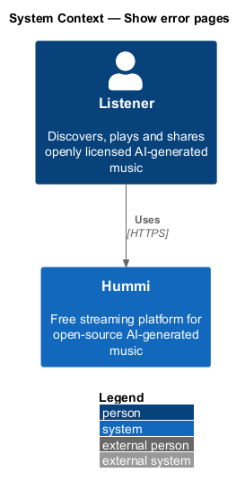
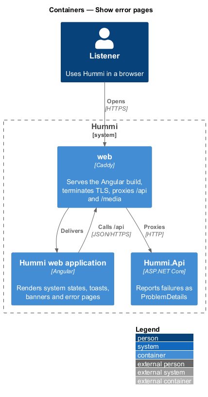
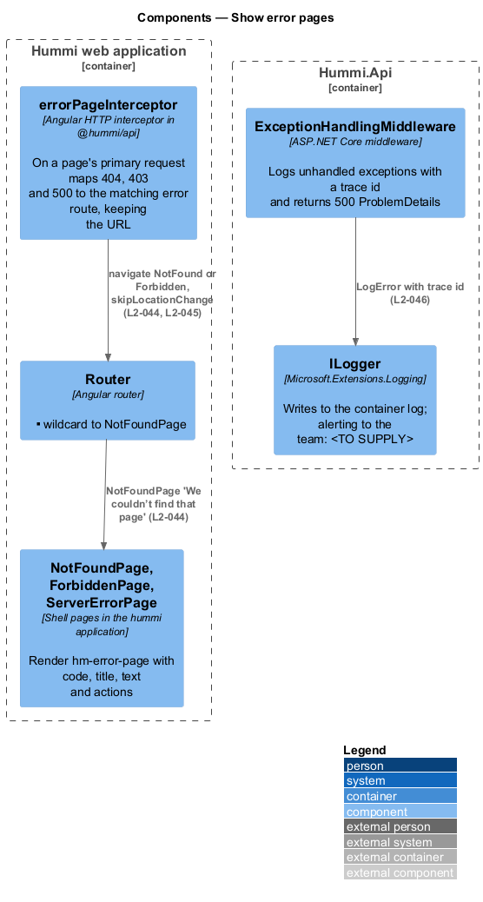
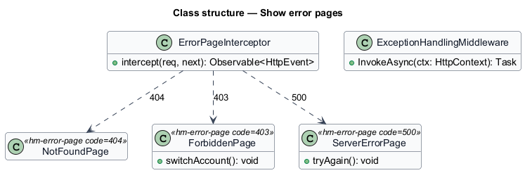
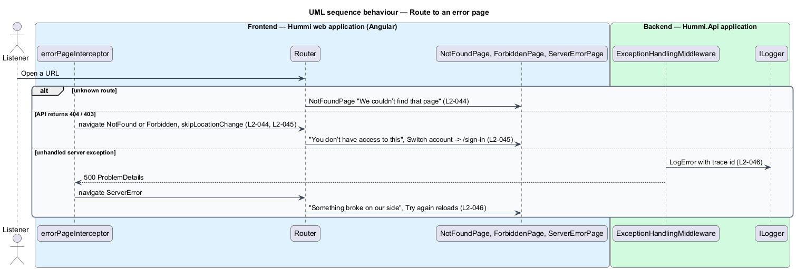

# Show error pages

## Overview

Three full pages replace content when a route cannot render: Not found (404) for an unknown route or a
removed track or playlist, Forbidden (403) for a private playlist without access, and Server error
(500) for an unexpected failure. Each offers a way forward. Server failures are recorded so the team
is told.

- **error route** — `/not-found`, `/forbidden` or `/error` route rendered without the player bar

## Description

An HTTP interceptor and a wildcard route map failures to the three pages; the API logs 500s.

**Frontend — Hummi web application (Angular)**

- **`errorPageInterceptor`** — Angular HTTP interceptor in @hummi/api. On a page's primary request maps 404, 403 and 500 to the matching error route, keeping the URL
- **`Router`** — Angular router. `**` wildcard to `NotFoundPage`
- **`NotFoundPage, ForbiddenPage, ServerErrorPage`** — Shell pages in the hummi application. Render `hm-error-page` with code, title, text and actions

**Backend — Hummi.Api application**

- **`ExceptionHandlingMiddleware`** — ASP.NET Core middleware. Logs unhandled exceptions with a trace id and returns 500 ProblemDetails
- **`ILogger`** — Microsoft.Extensions.Logging. Writes to the container log; alerting to the team: <TO SUPPLY>

## Requirements

The feature realizes the following level-2 (L2) requirements. Each L2 requirement refines a level-1 (L1) requirement in `docs/specs/L1.md`; the text is copied from `docs/specs/L2.md`.

| L2 ID | Refines (L1) | Requirement |
|-------|--------------|-------------|
| `L2-044` | `L1-011` | **Not found page.** 1. Given an unknown route or a removed track or playlist, when it is opened, then the page shows "404", "We couldn’t find that page" with "The link may be old or mistyped. The track or playlist might also have been removed by its owner.", "Go to Home" and "Search Hummi". |
| `L2-045` | `L1-011` | **Forbidden page.** 1. Given a private playlist the listener has no access to, when it is opened, then the page shows "403", "You don’t have access to this" with "This playlist is private. Ask the owner to share it with you, or sign in with the account they invited.", "Go to Home" and "Switch account", which opens Sign in. |
| `L2-046` | `L1-011` | **Server error page.** 1. Given an unexpected server failure, when a page cannot render, then the page shows "500", "Something broke on our side" with "We’ve been told and we’re fixing it. Nothing you saved is lost; try again in a minute.", "Try again" (reloads) and "Go to Home". 2. Given such a failure, when it occurs, then it is recorded so the team is told. |

## Diagrams

### System context

A listener reaches a missing, forbidden or failing page in Hummi. No external system takes part.

### Containers

Pages render in the Angular application; `Hummi.Api` logs server failures to the container log.

### Components

`errorPageInterceptor` and the router choose the page; `ExceptionHandlingMiddleware` logs through `ILogger`.

### Class structure

`ErrorPageInterceptor` maps status codes to the three page components; `ExceptionHandlingMiddleware` produces 500s.

### Behaviour — route to an error page

The wildcard route covers unknown paths; the interceptor maps API status codes to pages without changing the address bar, so Try again reloads the original URL.

