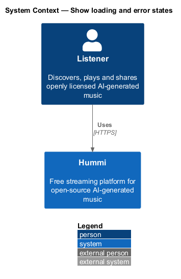
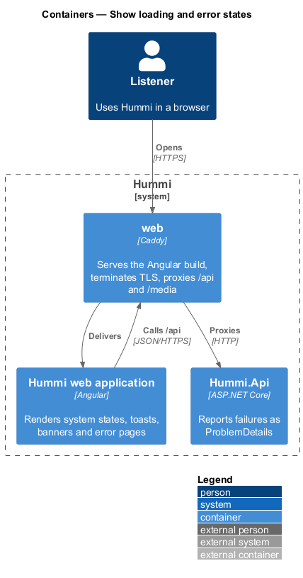
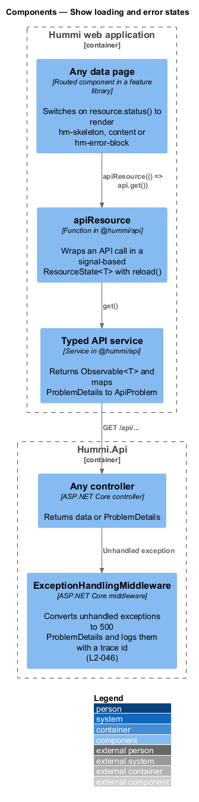
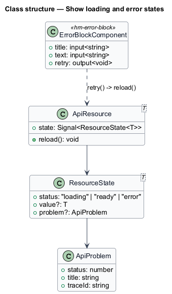
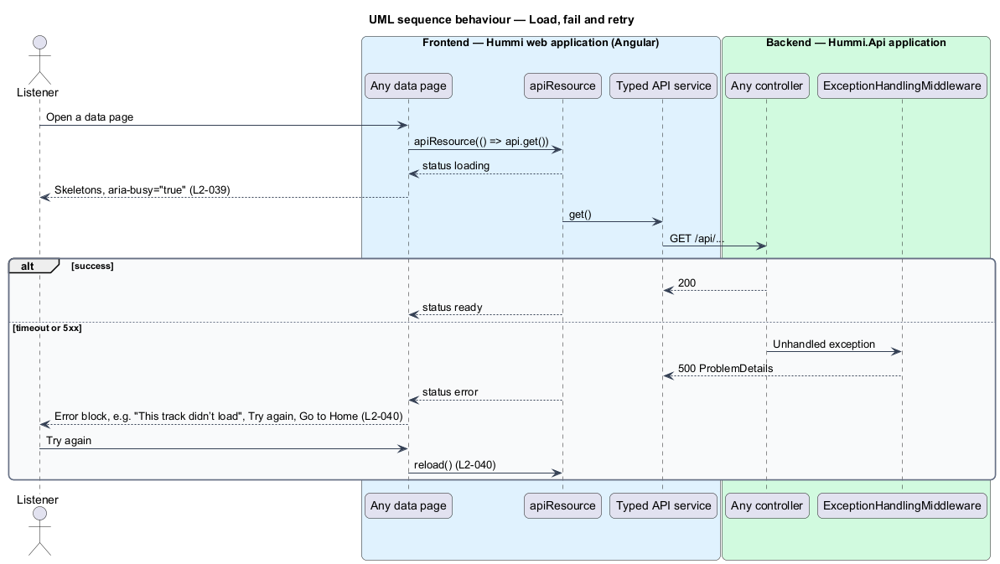

# Show loading and error states

## Overview

The system-feedback subsystem tells the listener what is happening at all times. This feature covers
the two states every data page shares: loading, shown as skeletons in the page's layout, and a failed
load, shown as an error block with Try again. Sign in, Sign up and Reset password need no data and
render at once.

- **skeleton** — placeholder shapes in the layout of the content they stand for, inside a region with `aria-busy="true"`
- **error block** — `hm-error-block` with page-specific title, explanation, Try again and Go to Home, announced with `role="alert"`
- **resource state** — discriminated union `{ status: 'loading' } | { status: 'ready', value } | { status: 'error', problem }`

## Description

A single resource helper gives every page the same loading and error behaviour.

**Frontend — Hummi web application (Angular)**

- **`Any data page`** — Routed component in a feature library. Switches on `resource.status()` to render `hm-skeleton`, content or `hm-error-block`
- **`apiResource`** — Function in @hummi/api. Wraps an API call in a signal-based `ResourceState<T>` with `reload()`
- **`Typed API service`** — Service in @hummi/api. Returns `Observable<T>` and maps ProblemDetails to `ApiProblem`

**Backend — Hummi.Api application**

- **`Any controller`** — ASP.NET Core controller. Returns data or ProblemDetails
- **`ExceptionHandlingMiddleware`** — ASP.NET Core middleware. Converts unhandled exceptions to 500 ProblemDetails and logs them with a trace id (`L2-046`)

## Requirements

The feature realizes the following level-2 (L2) requirements. Each L2 requirement refines a level-1 (L1) requirement in `docs/specs/L1.md`; the text is copied from `docs/specs/L2.md`.

| L2 ID | Refines (L1) | Requirement |
|-------|--------------|-------------|
| `L2-039` | `L1-011` | **Loading states.** 1. Given Home, Browse, Genre, Search, Track, Artist, Album, Playlist, Library, Now playing, Queue, Shared track, Settings, Notifications or Licence, when its data has not arrived, then skeleton placeholders matching the page's layout are shown and marked busy. 2. Given Sign in, Sign up or Reset password, when they open, then they render immediately with no loading state. |
| `L2-040` | `L1-011` | **Error states with retry.** 1. Given a page's data fails to load, when it renders, then an error block announced as an alert shows the page-specific title (e.g. "We couldn’t load this page", "This track didn’t load", "Your library didn’t load", "Settings didn’t load"), an explanation (default "The server didn’t answer in time. Your music hasn’t gone anywhere; try again in a moment."), "Try again" and "Go to Home". 2. Given the error block, when the listener activates "Try again", then the page requests its data again. |

## Diagrams

### System context

Every listener-facing page in Hummi uses these states. No external system takes part.

### Containers

The states render in the Angular application from responses and failures of `Hummi.Api`.

### Components

A page uses `apiResource`, which calls a typed API service; controllers and `ExceptionHandlingMiddleware` produce data or ProblemDetails.

### Class structure

`ApiResource<T>` exposes a `ResourceState<T>` signal; `ErrorBlockComponent` triggers `reload()`.

### Behaviour — load, fail and retry

Every page builds its data through `apiResource`, so skeleton and error behaviour are uniform. Try again calls `reload()`, which repeats the request. Request timeout: <TO SUPPLY>.

