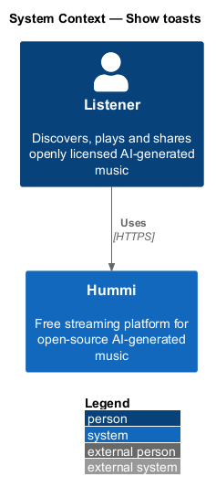
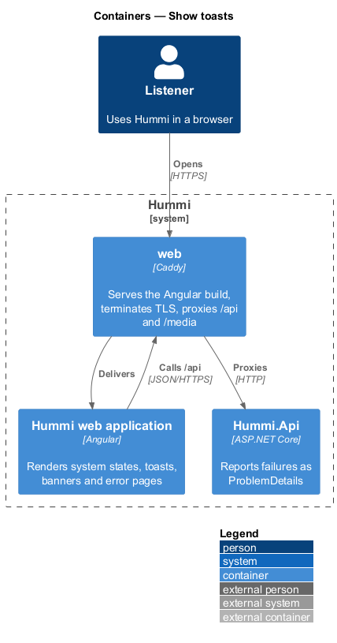
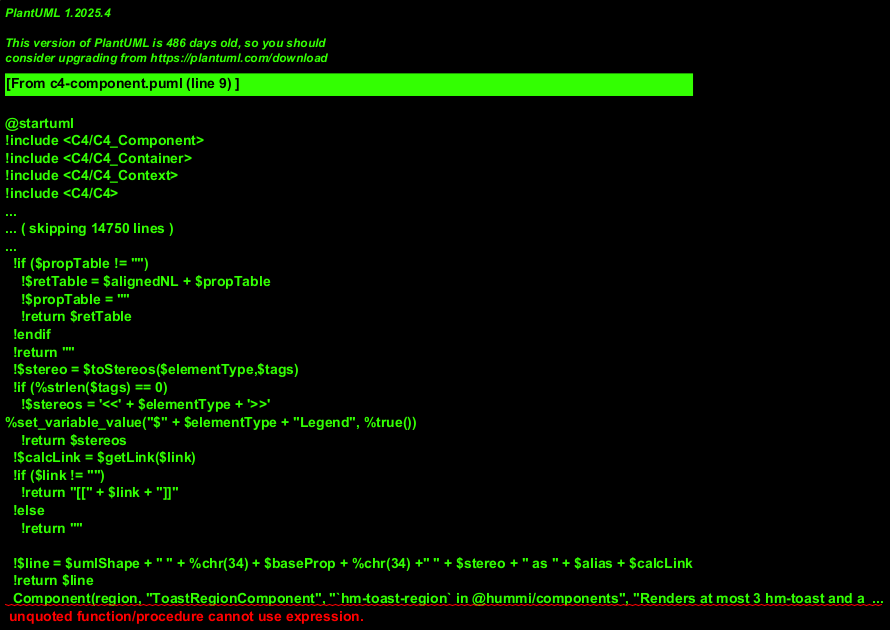
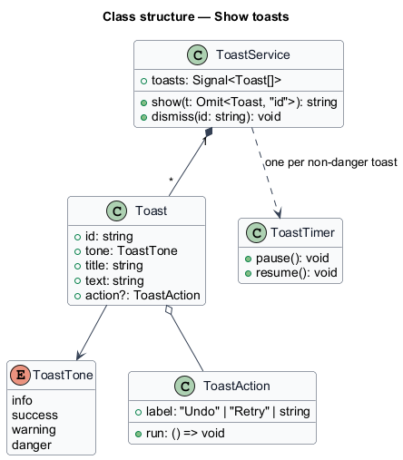
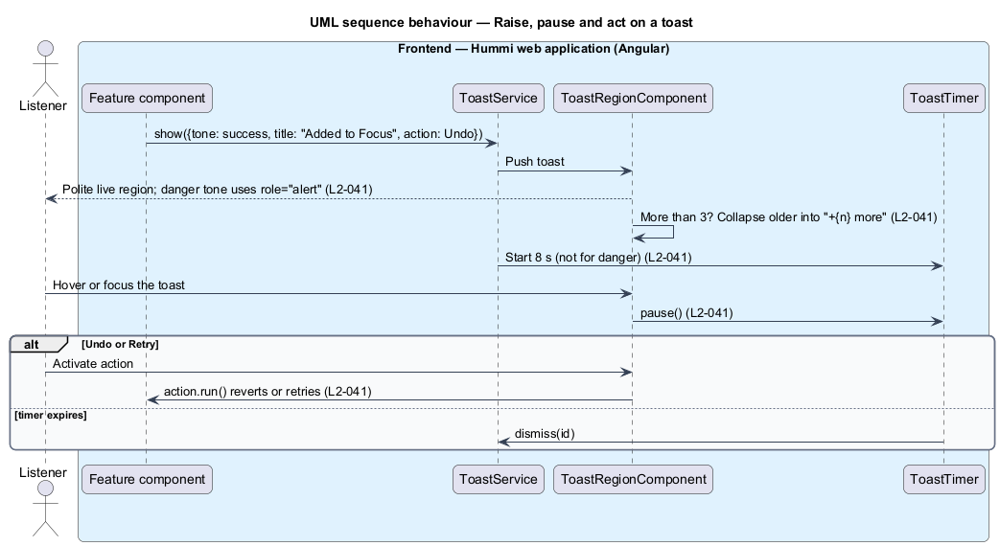

# Show toasts

## Overview

A toast is a short message that confirms or reports the result of an action without interrupting the
listener. Toasts appear in a stack; info, success and warning toasts dismiss themselves after 8 seconds,
and danger toasts stay until dismissed. Toasts may carry Undo or Retry.

- **toast region** — fixed container holding the stack, a polite live region
- **toast action** — optional button that calls back into the feature that raised the toast

The feature is frontend-only.

## Description

One service owns the stack; features pass a callback for the action.

**Frontend — Hummi web application (Angular)**

- **`Feature component`** — Any feature library. Calls `ToastService.show(...)` after an action
- **`ToastService`** — Service in @hummi/components. Queues `hm-toast` notifications in the toast region (`L2-041`)
- **`ToastRegionComponent`** — `hm-toast-region` in @hummi/components. Renders at most 3 `hm-toast` and a "+{n} more" collapse, newest at the bottom
- **`ToastTimer`** — Class in @hummi/components. Counts down 8 s; pauses on `mouseenter`/`focusin` and resumes on leave

## Requirements

The feature realizes the following level-2 (L2) requirements. Each L2 requirement refines a level-1 (L1) requirement in `docs/specs/L1.md`; the text is copied from `docs/specs/L2.md`.

| L2 ID | Refines (L1) | Requirement |
|-------|--------------|-------------|
| `L2-041` | `L1-011` | **Toasts.** 1. Given an action completes, when a toast appears, then it is a pill centred horizontally above the player bar (or near the bottom when no player is shown) that shows the track cover (or a coral dot when there is none), a message and an optional "Undo" action, in a polite live region. 2. Given a toast, when 4 seconds pass, then it dismisses itself. 3. Given a toast with "Undo", when activated, then the action it reports is reverted. 4. Given the messages: "“{title}” will play next", "Added “{title}” to your queue", "Saved “{title}” to your library", "Removed “{title}” from your library", "Added {album} to your library" and "Downloads are saved for offline listening on this device", when the matching action completes, then that toast is shown; saved and removed offer "Undo". |

## Diagrams

### System context

Any listener sees toasts after actions in Hummi. No external system takes part.

### Containers

Toasts run entirely in the Angular application.

### Components

Features call `ToastService`, which feeds `ToastRegionComponent` and a `ToastTimer` per toast.

### Class structure

`ToastService` composes `Toast` items with an optional `ToastAction`; non-danger toasts get a `ToastTimer`.

### Behaviour — raise, pause and act on a toast

Toast timing lives in `ToastTimer`, which pauses while the toast is hovered or focused. The action is a callback into the feature, so Undo and Retry reuse that feature's own command.

