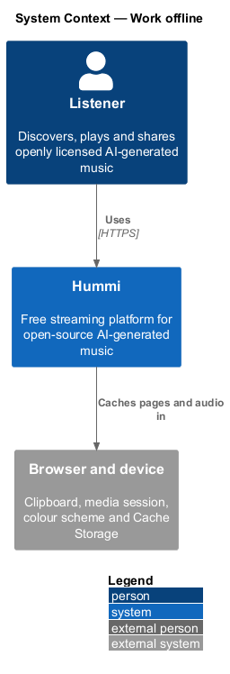
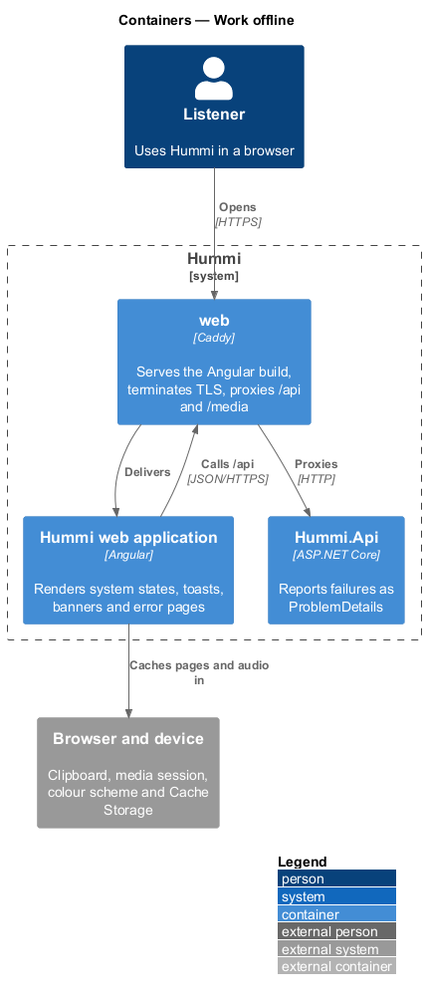
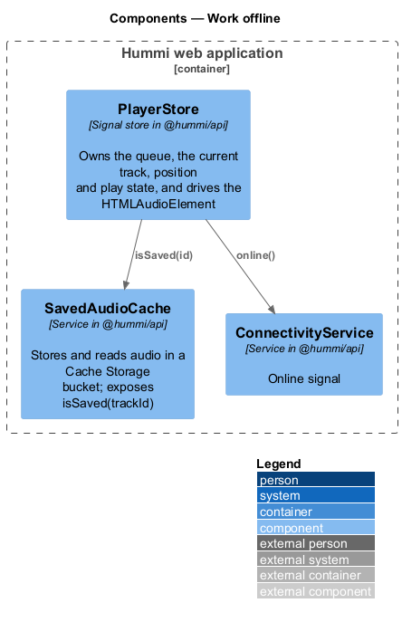
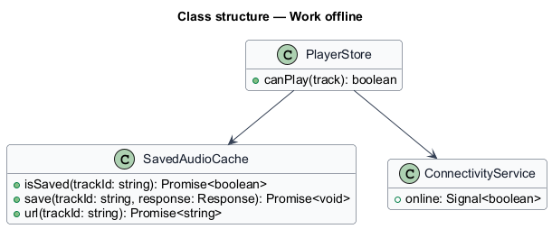
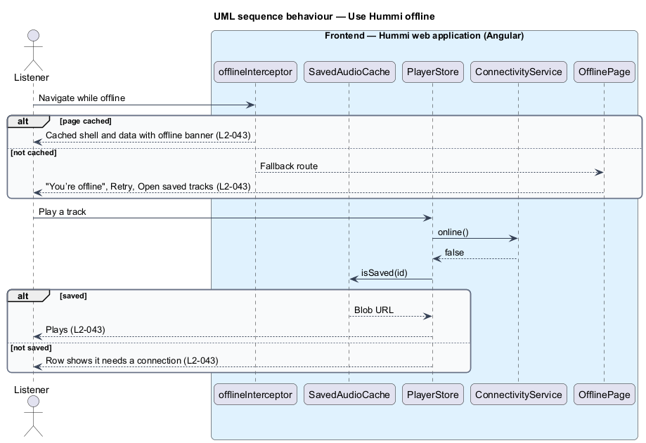

# Work offline

## Overview

Hummi keeps working without a connection where it can. Pages the listener visited are cached and
shown with the offline banner; tracks saved on the device still play. A page that was never cached
shows the Offline page. Hummi offers no download option for any track.

- **saved track** — track whose audio `SavedAudioCache` kept in Cache Storage when it started playing online; the 25 most recently played (ADR 0020)
- **cached page** — a page whose API answers `offlineInterceptor` kept in `localStorage` (the newest 60), opened from the running app with every lazy page preloaded

## Description

The running app keeps page answers in `localStorage` and saved audio in Cache Storage; no service worker is used yet, so a cold start offline is not covered (ADR 0020).

**Frontend — Hummi web application (Angular)**

- **`offlineInterceptor`** — HTTP interceptor in @hummi/api. Keeps page answers and serves them offline; with none, shows the Offline page keeping the address
- **`SavedAudioCache`** — Service in @hummi/api. Stores and reads audio in a Cache Storage bucket; exposes `isSaved(trackId)`
- **`PlayerStore`** — Signal store in @hummi/api. Owns the queue, the current track, position and play state, and drives the `HTMLAudioElement`
- **`ConnectivityService`** — Service in @hummi/api. Online signal
- **`OfflinePage`** — Shell page in the hummi application. Renders "You’re offline" with Retry and Open saved tracks; `/saved` lists the saved tracks

## Requirements

The feature realizes the following level-2 (L2) requirements. Each L2 requirement refines a level-1 (L1) requirement in `docs/specs/L1.md`; the text is copied from `docs/specs/L2.md`.

| L2 ID | Refines (L1) | Requirement |
|-------|--------------|-------------|
| `L2-043` | `L1-011` | **Offline behaviour.** 1. Given the device is offline, when the listener opens a page that was cached, then the cached content is shown with the offline banner. 2. Given the device is offline, when the listener plays a track saved on the device, then it plays; other tracks show that they need a connection. 3. Given the device is offline and the page is not cached, when it opens, then the Offline page shows "You’re offline" with "Hummi can’t reach the network. Tracks you saved on this device still play; everything else will load when you’re back.", "Retry" and "Open saved tracks". 4. Given any track, when the listener looks for a download option, then none is offered. |

## Diagrams

### System context

A listener uses Hummi without a network; the browser's Cache Storage holds pages and audio.

### Containers

The Angular application and its service worker run on the device; `Hummi.Api` is unreachable in this slice.

### Components

`ngsw` serves cached pages or `OfflinePage`; `PlayerStore` consults `ConnectivityService` and `SavedAudioCache`.

### Class structure

`PlayerStore` depends on `SavedAudioCache` and `ConnectivityService` to decide whether a track can play.

### Behaviour — use Hummi offline

The service worker serves cached navigations and API responses. `PlayerStore` checks `SavedAudioCache` before streaming while offline. No UI offers a download (`L2-043`).

